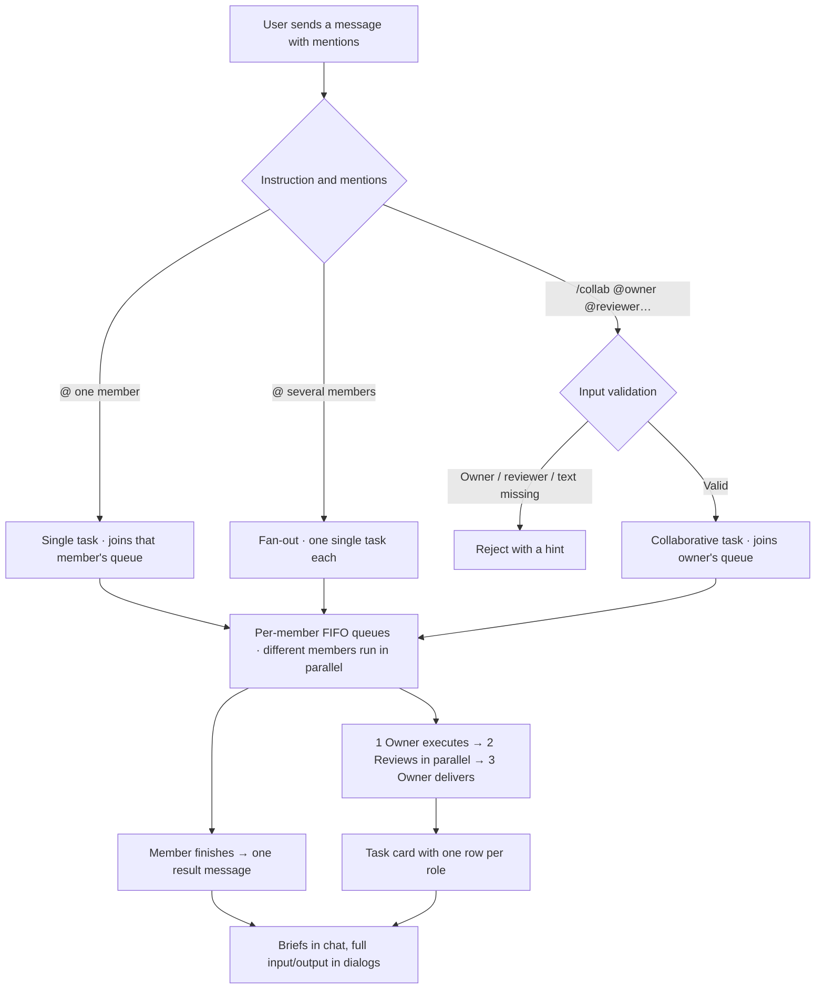

<div align="center">

# AI-Meeting

### Multi-AI Task Workspace

*Hand a task to a local team of AI members: one does the work, others review it read-only, and the owner revises and delivers. Briefs live in chat; the files land in your workspace.*

<br/>

[English](README.md) | [简体中文](README_zh.md)

<br/>

[](https://python.org)
[](LICENSE)
[](#start)
[](#security)

<br/>


<sub>The demo covers **both a single task and a collaborative task**. Each scene holds for ~3s and scrolling takes ~3s so nothing flashes by (51s total). All sessions, members, tasks and files shown are fictional sample data.</sub>

</div>

---

## 📖 Table of Contents

- [What It Is](#about)
- [Quick Start](#start)
- [Task Types and Dispatch](#tasks)
- [The Task Card in Chat](#card)
- [Messages, Context and Deletion](#message)
- [Workspace and File Preview](#workspace)
- [Queues, Cancel and Retry](#queue)
- [Settings and Run Protocol](#settings)
- [Security Boundaries](#security)
- [Tests and Docs](#test)
- [Repository Layout](#layout)

---

<a id="about"></a>

## 💡 What It Is

AI-Meeting is a **local, single-user workspace for multiple AI agents**. In a chat session you hand a task to AI team members; they work in their roles, review each other, and deliver a final version. The point is not to produce meeting minutes — it is to let several AIs actually finish work. A run yields both a short explanation in chat and real files written into the workspace.

Three panes, no global control bar:

| Pane | Contents |
| :--- | :--- |
| **Left** | Session list: create, rename, favourite, collapse, search |
| **Middle** | Chat stream: user messages, single-task results, collaborative task cards; Markdown rendering, per-section folding, dialogs with full prompt and raw output |
| **Right** | Workspace file tree; click a file to preview it in a dialog |

Members currently run as **local CLI subprocesses** (defaults assume `agy` / `codebuddy`, but any supported binary can be configured with a command template). Neither the UI nor the task flow depends on the execution backend. See the [design notes](docs/task-review-protocol.md) for the full specification.

---

<a id="start"></a>

## 🚀 Quick Start

### Prerequisites

- **Python 3.8+** (developed and verified on 3.12)
- At least one **local AI CLI** that accepts a prompt; configure its command template under Settings → Members

> [!NOTE]
> The only execution backend today is a local CLI subprocess. Remote model APIs are not wired up yet.

### Install and run

```bash
git clone https://github.com/BinaryAlan/ai-meeting.git
cd ai-meeting
./run.sh          # creates .venv, installs dependencies, starts the server
```

Open <http://127.0.0.1:5050>. On first run `run.sh` creates the virtual environment and installs `requirements.txt` (Flask only).

```bash
./run.sh start      # start in the foreground (Ctrl+C exits gracefully)
./run.sh status     # PID, uptime, active tasks, hot reload
./run.sh restart    # restart (running tasks are marked cancelled, retry from the card)
./run.sh stop       # graceful shutdown
./run.sh dev        # development mode: enables hot reload
./run.sh logs       # follow the service log (restart-spawned instances write .run/service.log)
```

### Your first task

1. **⚙️ Settings → Members**: make sure at least two members are available;
2. **＋ New session**: pick members and a workspace directory (members can read files there);
3. Send `@agy Outline this material for me` (single task), or `/collab @agy @DS4 @HY4 Turn this material into an actionable plan` (collaborative task);
4. A single task returns a result message; a collaborative task shows its card right in chat. Produced files appear on the right.

---

<a id="tasks"></a>

## 🔄 Task Types and Dispatch

The instruction and the mentions decide the type.

**Single task** — `@` one member and ask it to do something. The task joins that member's queue, runs independently, and produces one result message (Markdown body + artifact info). Cancel / Retry / Regenerate live directly on that message.

You can also skip the `@`: the message goes to the member you last talked to in this session, so follow-up questions don't need re-mentioning. If no AI has spoken in the session yet, the message is kept as context only.

**Fan-out** — when one plain message `@`s two or more members, each gets its own single task: one take each, one result message each. They run in parallel (different members never block each other), stay independent (one failing does not affect the others, and retries are per task), and cannot see each other's answers, so they do not converge. Artifacts share one workspace, so every task is told to prefix filenames with its own name (e.g. `DS4-beijing.md`). The composer shows "Will go to A, B, C separately: each answers independently" before sending; a disabled member blocks the whole message.

**Collaborative task** — start with `/collab`. Exactly **one round** of three stages: owner executes → reviewers work in parallel → owner delivers. Input is validated strictly: one explicit owner, at least one reviewer after it, and a task description; anything missing is rejected with a hint. Mentions may appear anywhere in the sentence, and forms such as `@DS4`, `@//agy/` or `@DeepSeek-V4 (DS4)` are recognised.



| Stage | What happens | Controls on the card |
| :--- | :--- | :--- |
| **1 Owner executes** | Owner works in the workspace, returns a short result and artifact list | Cancel / Retry execution / Execute again |
| **2 Members review** | Each reviewer reads the real artifacts read-only and independently gives an opinion | Per member: Cancel / Retry review / Review again |
| **3 Owner delivers** | Owner takes all opinions, makes one revision, delivers the final version | Cancel delivery / Retry delivery / Regenerate delivery |

The user's original wording (minus the command prefix and mentions) is passed along as-is; the software does not parse the goal or invent acceptance criteria. Reviewers are always **read-only** and never modify the owner's artifacts. If a reviewer fails, times out, is cancelled, or gives no opinion, the card records its status and the owner still delivers.

**Review standard** (`prompts/roles/reviewer.md`): (1) **Find real risks** — flaws in logical consistency, boundary conditions and practical usability; boundaries are not code-only: a plan is checked against changed constraints / rollout gaps, a product design against user segments / edge flows. (2) **Offer better ideas** — if the owner's solution is merely adequate, propose a cleverer or more efficient alternative; it may be an unwritten idea, but must be marked optional with its preconditions and cost. (3) **Be concrete** — no length cap, yet no filler, courtesy phrases or vague theory; every item must point to a file or location and say what to change. (4) **Pass when it is good enough** — write a leading `[通过]` (pass) with a one-line highlight, and never pad the review with trivial nits. The yardstick is ordered "user's wording > the artifact's own stated goals > general correctness"; the software defines review methodology, not task acceptance criteria. A `[通过]` verdict flows to the card (green Pass tag), the flow log and the owner's prompt ("no changes required"), so the owner does not invent work for a reviewer who already passed. Protocol files are read from disk on every run: clicking **Review again** rebuilds the full input with the current standards instead of replaying a saved prompt. Older input snapshots are kept for history only and are never sent to the model; the UI adds no protocol-version annotations — the rebuilt input itself shows the current standards.

---

<a id="card"></a>

## 🗂️ The Task Card in Chat

A collaborative task creates a card in the chat stream immediately — you can read a whole round **without opening a dialog**:

- **Header**: goal, overall status, creation time, elapsed time, member count, artifact count, three-step progress and "n/m complete". Clicking the header folds / expands the whole card; the header and the latest flow line stay visible, and the collapsed layout keeps the same ~8-line typography as the expanded one.
- **One row per role**: 🎯 owner execution, 🤝 one row per reviewer, 📦 owner delivery. Each row shows status, start time and duration, a Markdown brief (long ones clamp to ~8 lines while keeping headings and lists), and three actions: `Show more/less`, `Input / output ›`, and `Execute again / Review again / Regenerate delivery` (or `Cancel` while running). A reviewer who passes gets an extra green Pass tag on that row. Clicking the body only folds; only "Input / output" opens a dialog.
- **Footer**: the latest flow entry and "Full task details".

**One auto-supplemented delivery after reviews conclude** — after any review is rerun, once every reviewer has a conclusion (`done` / `no opinion`), the system regenerates the final version against the latest feedback and tags the delivery row "↻ Regenerated after reviews" (hover for the exact time). The flow log states that this delivery was auto-supplemented. Parallel reruns of two reviewers still trigger only one delivery. If any review failed, timed out or was cancelled, nothing is auto-supplemented; the card shows "Comments updated · final version pending" and the user decides via "Regenerate delivery". A manual regeneration clears the auto label.

**Two dialogs, two jobs**:

- Each row's "Input / output ›" — the exact prompt sent to the model and its raw response, with **start / return time and duration** at the top; a trailing artifact-registration JSON block is peeled into a collapsible "Artifact registry" section instead of polluting the body. Past execution records open in the same dialog.
- "Full task details" — three-step progress, artifact list, final summary, how review feedback was handled, live flow log, execution history, and cancel / retry controls for each stage.

Task states: queued / running / delivered / cancelled / failed / timed out. Member slots additionally show waiting / in progress / done / failed / cancelled / timed out / no opinion.

---

<a id="message"></a>

## ✉️ Messages, Context and Deletion

- AI output is rendered as **Markdown** (headings, lists, quotes, tables) and sanitised with DOMPurify before reaching the DOM; `mermaid` code blocks become diagrams, with the library lazy-loaded from the local `static/vendor/` bundle.
- Quote replies carry the quoted text to the member; clicking a quote jumps back to the original, or shows a saved snapshot if it is gone.
- Long content is collapsed by measured rendered height, with "Show more / less".
- Every message has a delete affordance: **your own messages at the top-left, all other messages and task cards at the top-right**. It stays hidden until the pointer enters that small corner hotspot, and requires confirmation.
- **Deletion boundary**: deletion physically removes the message, so new tasks (and prompts rebuilt after a retry) no longer include it. But a **completed task** keeps `sent_prompt` as the snapshot of what was actually sent — opening "Input / output" still shows that text. That is an execution record and must not be rewritten after the fact.
- The output protocol asks models to write **normal prose first**, then optionally append a JSON code block registering artifacts. The server strips that registry from the body, so chat always shows human-readable text, never a JSON dump.

---

<a id="workspace"></a>

## 📁 Workspace and File Preview

Each session has a workspace directory where AIs read and write files; the owner emits an artifact list, which the software uses to list what was produced. Clicking a file on the right opens a preview dialog:

- Markdown: tables, code blocks and headings render normally; `mermaid` fenced blocks become diagrams;
- Images are served through a local `raw` endpoint; other text is shown in monospace;
- Files over 500 KB get a clear notice instead of being forced into the dialog; the full path can be copied with one click.

Write access is a per-member setting under Settings → Members, and the review stage is always read-only. When enabled, the server injects the right CLI flags (`--dangerously-skip-permissions` for `agy`; `-y` plus `Write/Edit/Bash` tools for `codebuddy`) so command templates stay untouched. **Write access is off by default.**

CLI subprocesses start with an **environment allow-list**: host-injected `SERVER__PORT`, proxies and sandbox variables are not inherited, which prevents CLIs from trying to bind the host's port and failing with `EADDRINUSE`.

---

<a id="queue"></a>

## ⏳ Queues, Cancel and Retry

- Each member has a FIFO queue: one member's tasks run serially, different members run in parallel. Reviews are started directly by the task, so different reviewers work simultaneously; a busy reviewer picks it up after its current task. The UI shows queue positions.
- **Cancel** appears only on a message that is producing output or a stage that is running. It sends a termination signal immediately; files already written stay, there is no rollback and no confirmation dialog, and the input box is instantly usable again.
- **Retry** reruns only the clicked execution with the original input and workspace — no new task, no extra round. Retrying owner execution restarts review and delivery; retrying a review only refreshes that reviewer's opinion (with one auto-supplemented delivery once all conclusions are in).
- Tasks and queues are persisted with the session. Refreshing does not disturb running tasks. After a service restart, running tasks are marked cancelled and can be retried from the interrupted stage; queued tasks are picked up again.

---

<a id="settings"></a>

## ⚙️ Settings and Run Protocol

Settings have exactly three parts: **Members** (name, avatar, persona, CLI template, write access, per-run timeout, bulk write-access toggle), **Interface language** (简体中文 / English, applied immediately), and **Service** (PID, uptime, active tasks, hot reload, one-click restart / shutdown).

A set of protocol texts ships with the app; the server adds them to a member's input to describe the current stage and expected output:

| File | Used for |
| :--- | :--- |
| `prompts/protocol/task-flow.md` | Collaboration flow and stage order |
| `prompts/roles/single.md` | Single-task member: finish the job, output prose and an artifact registry |
| `prompts/roles/owner.md` | Owner: do the work, register artifacts, revise from feedback and deliver |
| `prompts/roles/reviewer.md` | Reviewer: read-only, four review standards, `[通过]` verdict and registry block |

---

<a id="security"></a>

## 🔒 Security Boundaries

Built as a **local-first, single-user** tool:

- **Network** — binds `127.0.0.1` only, validates the `Host` header to blunt DNS rebinding, and runs with the Werkzeug debugger disabled;
- **Command allow-list** — CLI templates are restricted to known AI CLI binaries; `bash` / `python` and similar are rejected, so a template cannot become arbitrary command execution. Subprocess environments are allow-listed too;
- **Path confinement** — workspace browsing is limited to the project and home directories, and dot-prefixed secrets (`.ssh`, `.gitconfig`, …) are blocked;
- **Write access is opt-in** — members are read-only by default. Enabling it lets a member modify files and run commands inside the workspace; keep it off unless the directory is trusted;
- **XSS** — model output is sanitised with DOMPurify before it reaches the DOM; raw HTML is never injected into the page.

> [!WARNING]
> **No authentication is implemented.** Anyone who can reach the port can drive sessions, including enabling write access. Keep it on localhost; do not expose it to a LAN or the internet as-is.

---

<a id="test"></a>

## 🧪 Tests and Docs

```bash
.venv/bin/python -m unittest discover -s tests -v
```

All **105 tests pass**, covering instruction parsing, queues and parallelism, the three-stage flow, cancel / retry, auto-supplemented delivery, the four review standards, the `[通过]` verdict path and prompts rebuilt from the current protocol, restart recovery, read-only reviews, the CLI environment allow-list, message deletion and context, file-preview endpoints and HTTP APIs. Line-by-line verification is in the [acceptance record](docs/acceptance.md) (A1–A59); design detail lives in the [design notes](docs/task-review-protocol.md).

---

<a id="layout"></a>

## 📁 Repository Layout

```text
ai-meeting/
├── app.py                       # Flask app: endpoints, Host guard, static assets, cache policy
├── core/
│   ├── tasks.py                 # Task state machine, per-member FIFO queues, context assembly, card builder
│   ├── executor.py              # CLI subprocess, command/env allow-lists, timeout, cancellation
│   ├── storage.py               # Atomic session/settings persistence
│   └── scanner.py               # Local AI CLI / model discovery
├── prompts/
│   ├── protocol/task-flow.md    # Collaboration flow protocol
│   └── roles/                   # Single-task / owner / reviewer protocols
├── data/
│   ├── settings.json            # Interface language and member list
│   └── sessions/                # Sessions, messages, tasks, queues (git-ignored)
├── static/
│   ├── index.html               # Single-page UI
│   ├── js/app.js                # Vue 3 app
│   ├── js/i18n.js               # English UI dictionary
│   └── vendor/                  # Vue / Tailwind / marked / DOMPurify / Mermaid, bundled offline
├── docs/
│   ├── demo.gif                 # Demo animation (Chinese UI)
│   ├── demo-en.gif              # Demo animation (English UI)
│   ├── task-review-protocol.md  # Design notes
│   └── acceptance.md            # Acceptance criteria and verification
├── tests/                       # Task system, executor, message deletion, file preview tests
├── requirements.txt             # Flask
├── run.sh                       # start / dev / stop / restart / status / logs
└── LICENSE                      # PolyForm Noncommercial 1.0.0
```

---

## 📄 License

[PolyForm Noncommercial License 1.0.0](LICENSE) — personal, research, educational and other noncommercial use only. **Commercial use requires a separate licence from the copyright holder.**
