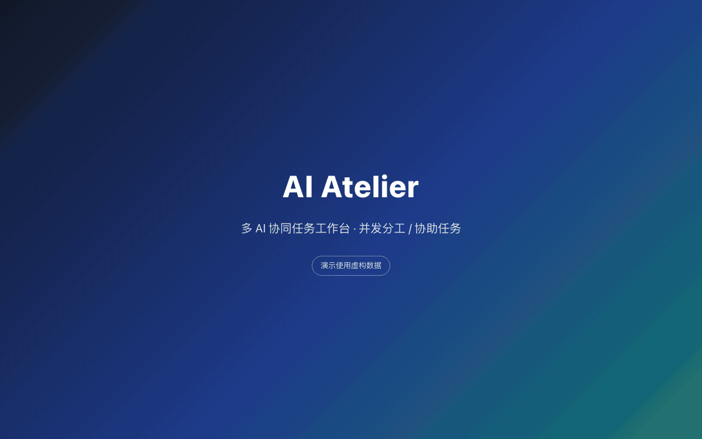
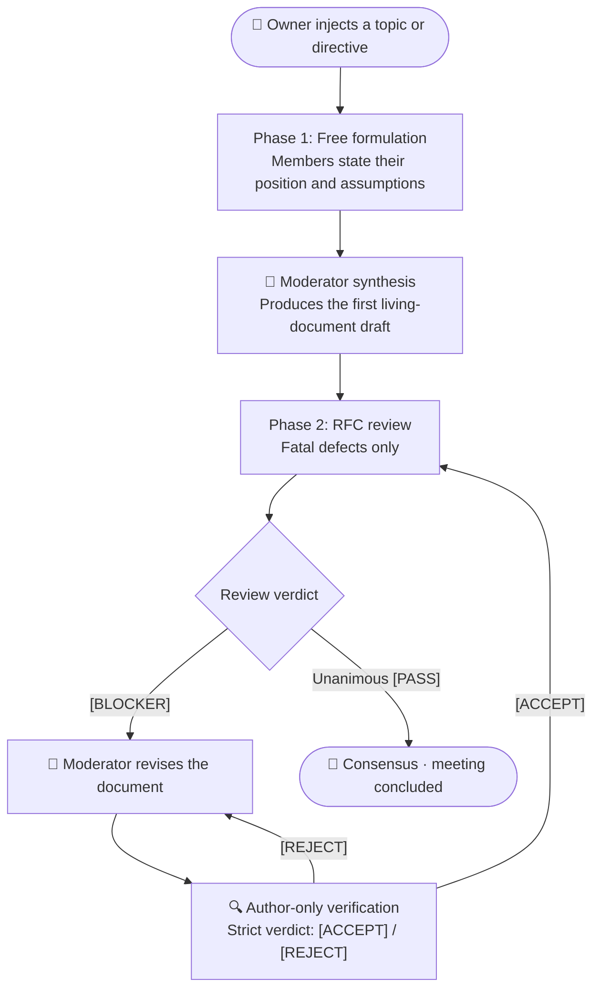

<div align="center">

# 🏛️ AI-Meeting
### Multi-AI Council with RFC-Style Review

*A local, single-user council of AI models that debates a proposal and converges on one authoritative document — instead of flooding you with chat logs.*

<br/>

[English](README.md) | [简体中文](README_zh.md)

<br/>

[](https://python.org)
[](LICENSE)
[](#config)
[](#security)

<br/>



<sub>Demo recorded on fictional data (a made-up weekly-report tool) — no real conversations are shown.</sub>

</div>

---

## 📖 Table of Contents

- [Why AI-Meeting?](#why)
- [How It Works](#how)
- [Features](#features)
- [Quick Start](#start)
- [Virtual Employee Configuration](#config)
- [Security Boundaries](#security)
- [Known Limitations](#limits)
- [Troubleshooting](#trouble)
- [Repository Layout](#layout)

---

<a id="why"></a>
## 💡 Why AI-Meeting?

Most multi-agent frameworks (ChatDev, AutoGen, …) are built for open-ended conversation. In architecture and design work that produces two recurring problems:

1. **No convergence** — agents compliment each other and nitpick wording, so the discussion never reaches a decision;
2. **Signal loss** — every model rewrites the whole document into the chat stream, and nobody can extract the actual conclusion.

**AI-Meeting** applies the **RFC / pull-request review** discipline used by large open-source projects:

| Dimension | Typical multi-agent chat | AI-Meeting (RFC review) |
| :--- | :--- | :--- |
| **Primary goal** | Accumulate chat logs; conclusions scattered | **Deliverable-oriented**: one living document in the right panel, always current |
| **Speaking rules** | Open-ended dialogue, drifts off-topic | **Two phases**: free formulation ➡️ strict blocker-only review with a first-line verdict protocol |
| **Convergence** | "Stop after N rounds" | **State-driven**: concludes the moment everyone PASSes; blockers are fixed in a closed loop |
| **Fault tolerance** | One timeout deadlocks the session | **Per-member resilience**: retry / skip / restore a single member |
| **Execution** | Bound to a cloud API key | **Decoupled**: drives local CLIs (`agy`, `codebuddy`, …) via command templates |

---

<a id="how"></a>
## 🔄 How It Works



### 1. Two phases: open formulation ➡️ strict review

- **Phase 1 — free formulation.** Each member states its perspective, assumptions and proposed approach. Answer length is decided by the model, not by a character cap. Once everyone has spoken, the moderator synthesises the consensus and creates the **living document** (right panel).
- **Phase 2 — blocker-only scrutiny.** The council switches to review mode. Minor wording or style suggestions are explicitly forbidden; only defects that would make the plan wrong — data corruption, deadlocks, security holes, broken logic — may be raised as `[BLOCKER: one-line issue]`. Otherwise the model must answer `[PASS]` and yield the floor.

### 2. Closed-loop verification (anti scope creep)

When a member raises a `[BLOCKER]`:

1. the moderator applies a targeted revision to the document;
2. **only the author of that blocker** is invited to verify it (fed the revised full text, forbidden to raise unrelated topics);
3. the author must answer `[ACCEPT]` or `[REJECT]` — rejections loop back to step 1;
4. when every member has said `[PASS]` and no blocker is open, the meeting concludes and the document is final.

> [!IMPORTANT]
> **Verdicts are parsed, not guessed.** The engine only accepts explicit markers on the first non-empty line of a reply; it never infers agreement from prose, so a "this is not acceptable" sentence can no longer be counted as an approval.
>
> **Minutes contain only what happened.** If a member times out, returns an empty reply, or emits raw tool calls, the moderator is forbidden from inventing a position for it. The draft appends a *Data Integrity Note* listing every absent member, so the record stays auditable.

---

<a id="features"></a>
## ✨ Features

### 🛡️ Single-member failures don't kill the session

- **Retry in place** — re-run only the failed speech and overwrite that record; other members are untouched;
- **Skip a member** — if a CLI is genuinely down, skip it and let the rest finish; it can be restored later;
- **Resume a stuck meeting** — after a crash or a service restart, the meeting pauses instead of losing state. Resuming retries the same member once; if it stalls twice in a row, that member is set aside automatically and the meeting moves on.

### 👑 Human-in-the-loop authority

- **Pause / resume at any time** — sends `SIGTERM` to the process group, so no orphaned CLI processes keep burning tokens;
- **Inject directives mid-flight** — anything you type becomes the highest-priority "owner directive" in subsequent prompts;
- **`@all` / `@member`** — `@all` restarts Phase 1 under your new direction; `@member` is an isolated inquiry that doesn't disturb the session state machine;
- **💬 Quote reply (WeChat-style)** — reply to any speech; the question is routed to its author (equivalent to `@` them). The quoted text is resolved server-side (the client only sends a message id) and is passed to the prompt as its own block. Clicking a quote jumps back to the original message, or shows a snapshot if it's no longer in the list;
- **✕ Cancel vs ⏭ Skip** — interrupting a normal turn removes that member from the speaking order; during a `@` answer the same button becomes **Cancel** and keeps them in the meeting;
- **🔍 Prompt inspector** — the full prompt of every speech, split into `【block】` cards with char/line counts; bulk material (chat transcript, plan document) is collapsed by default, so a 14k-char prompt shows ~1.2k chars on first paint.

<details>
<summary>How the <code>@</code> prompt is assembled (token-cost notes)</summary>

Order: **plan document → meeting context → persona → chat transcript → the question → output rules**.

Two deliberate choices:

- **Document first** — the same revision is byte-identical across every reviewer, so it forms a stable prefix that provider-side prompt caching can hit; the per-member persona comes *after* it, not before.
- **Context shrinks as the document matures** — once the document exceeds ~3000 chars, the chat transcript is trimmed to owner follow-ups plus the two latest peer messages, and system broadcasts / moderator status lines are dropped. The same fact is never paid for twice as "raw transcript + document summary".

Documents over 12k chars switch to *outline + 2–3 sections matching the question + closing summary* instead of being re-sent whole.
</details>

### 🖥️ Three-pane workspace

- **Left** — sessions: search, rename, favourite, collapse;
- **Middle** — the debate: verdict badges (`PASS` / `BLOCKER` / `ACCEPT`), retry/skip/reply actions, Markdown rendering for AI replies (owner/system messages stay plain);
- **Streaming** — subprocess stdout is pushed in 0.33 s chunks. While streaming the text is rendered as **plain text on purpose**: half-finished Markdown (an unclosed code fence, a half-written table) would reflow the whole block on every tick. The final message takes over with full Markdown. Whether you see it token-by-token depends on whether the CLI flushes its output;
- **Follow & "back to latest"** — auto-scroll stops only when *you* scroll up, so a fast-growing answer never loses your position; a `Back to latest` pill appears while you read history;
- **Collapsible long answers** — measured by real rendered height (roughly one viewport); re-measured on resize so short messages are never folded;
- **Right** — the living document: live Markdown, revision history, distract-free full-screen mode.

---

<a id="start"></a>
## 🚀 Quick Start

### Prerequisites

- **Python 3.8+** (developed and verified on 3.12)
- At least one **local AI CLI** that accepts a prompt on the command line — the defaults assume `agy` and `codebuddy`, but any binary works via a command template;
- A browser with internet access for the first load: the UI loads Vue 3, Tailwind, marked and DOMPurify from a CDN. **Offline?** The page still runs, but Markdown falls back to escaped plain text and styling degrades.

### Install and run

```bash
git clone https://github.com/BinaryAlan/ai-meeting.git
cd ai-meeting
./run.sh          # creates .venv, installs deps, starts the server
```

Open <http://127.0.0.1:5050>.

### Service lifecycle

```bash
./run.sh start      # start (foreground; Ctrl+C exits gracefully)
./run.sh status     # PID, uptime, hot-reload state, running meetings
./run.sh restart    # graceful restart (halts active CLI tasks, pauses meetings)
./run.sh stop       # graceful shutdown
```

> [!TIP]
> The **⏻ power menu** in the top-left of the UI shows the same telemetry and offers one-click restart / shutdown.

### Your first meeting

1. Open **⚙️ Settings**, confirm at least one employee whose `cli_cmd` actually runs on your machine (test it in a terminal first), and adjust the persona if you like;
2. Click **＋ New topic**, pick the participants and a workspace directory (the models may read files there);
3. Send your topic. Watch Phase 1, then Phase 2; the document grows on the right;
4. When every member has PASSed, the meeting concludes — the document is your deliverable.

---

<a id="config"></a>
## ⚙️ Virtual Employee Configuration

Each employee is just a command template plus a persona. `{prompt}` is replaced with the full prompt; commands are constrained to AI CLIs (see *Security*).

```json
{
  "employees": [
    {
      "id": "emp_agy",
      "name": "agy",
      "avatar": "🦉",
      "avatar_color": "#2563eb",
      "cli_cmd": "agy -p \"{prompt}\"",
      "enabled": true
    },
    {
      "id": "codebuddy-ds4",
      "name": "DeepSeek-V4 (DS4)",
      "avatar": "🧠",
      "avatar_color": "#9333ea",
      "cli_cmd": "codebuddy --model deepseek-v4-pro --tools \"Read,Glob,Grep\" -p \"{prompt}\"",
      "system_prompt": "Focuses on system boundaries and fatal edge cases.",
      "enabled": true
    }
  ]
}
```

> [!WARNING]
> **CodeBuddy CLI tip** — prefer supplying read-only tools: `--tools "Read,Glob,Grep"`. With `--tools ""` and a topic that requires reading local files, the model may answer with a single planning sentence. AI-Meeting strips stray XML tags and retries an obviously incomplete reply once, but it cannot recover content the model never produced.

---

<a id="security"></a>
## 🔒 Security Boundaries

Built as a **local-first, single-user** tool:

- **Network** — binds `127.0.0.1` only, validates the `Host` header to blunt DNS-rebinding, and runs with the Werkzeug debugger disabled;
- **Command allow-list** — execution templates are restricted to known AI CLI binaries; shells such as `bash`/`python` are rejected, so a template cannot become arbitrary code execution;
- **Path confinement** — workspace browsing is limited to the project and home directories, and dot-prefixed secrets (`.ssh`, `.gitconfig`, …) are blocked;
- **XSS** — model output is sanitised with DOMPurify before it reaches the DOM.

**No authentication is implemented.** Anyone who can reach the port can drive the meeting. Keep it on localhost; do not expose it to a LAN or the internet as-is.

---

<a id="limits"></a>
## ⚠️ Known Limitations & Trade-offs

These are deliberate, documented rather than hidden:

| Limitation | Why / impact |
| :--- | :--- |
| **In-process state** (`_ACTIVE_SESSIONS`, `_PENDING_RESUME`, `_SKIP_REQUESTS`, stream buffers) | Fine for a single-process dev server. Running multiple workers would break skip/resume/streaming across processes — it would need shared storage (Redis). |
| **Full-file session writes** | Each session is one JSON file rewritten on change; cost grows with transcript size. Fine for meetings of tens of turns, not a durable chat store. |
| **1.5 s polling** | The UI polls the whole session while a meeting runs. Simple and robust, but O(n²) in transcript size; SSE/WebSocket is the obvious upgrade. |
| **Streaming depends on the CLI** | If the binary buffers stdout until exit (`agy` does), there is nothing to stream and you only see the final message. |
| **CDN-loaded frontend** | Vue / Tailwind / marked / DOMPurify come from CDNs; offline use degrades to plain text and unstyled layout. |
| **Concurrent meetings** | Each meeting runs in its own thread, so two meetings will spawn two CLI processes at once. There is no global scheduler or rate limit — the machine (and your local model) absorbs the load. |

---

<a id="trouble"></a>
## 🩺 Troubleshooting

| Symptom | Cause / fix |
| :--- | :--- |
| Meeting shows **paused** after I edited code | The dev server's hot reload restarts the process, which pauses running meetings by design. Resume from the banner or the ⏸️/▶️ button. |
| **"Service unavailable"** right after a restart | Polls fail for a second or two while Flask restarts. Refresh, or wait for `./run.sh status` to report healthy. |
| A member returns only "I'll read the files first…" | The CLI has no tool access for that prompt. Give it read tools (`--tools "Read,Glob,Grep"`) or ask a question that doesn't need files. |
| `Port 5050 already in use` | `./run.sh stop` (it falls back to `lsof` + `SIGTERM`), or start with `PORT=5051 ./run.sh`. |
| Button missing after an interrupted answer | Interrupting a `@` answer only cancels that answer; the member stays. Use retry on the failed message, or `@` them again. |
| Markdown looks like plain text | The CDN scripts didn't load (offline / blocked). The UI intentionally degrades to escaped text instead of injecting raw HTML. |

---

<a id="layout"></a>
## 📁 Repository Layout

```text
ai-meeting/
├── app.py                # Flask app: routes, locks, host guard
├── core/
│   ├── engine.py         # Meeting state machine (phases, verdicts, prompts)
│   ├── executor.py       # CLI runner: process groups, streaming, timeouts
│   ├── streaming.py      # In-memory buffer for in-flight output
│   ├── storage.py        # Atomic session/employee persistence
│   └── scanner.py        # Local AI CLI / model discovery
├── data/
│   ├── settings.json     # Employees, moderator, defaults
│   └── sessions/         # Meeting transcripts + final documents (git-ignored)
├── static/
│   ├── index.html        # Single-page UI
│   └── js/app.js         # Vue 3 app (rendering, scroll, IME guards)
├── docs/demo.gif         # The demo above
├── requirements.txt      # Flask
├── run.sh                # start / stop / restart / status
└── LICENSE               # MIT
```

---

## 📄 License

[MIT](LICENSE).
