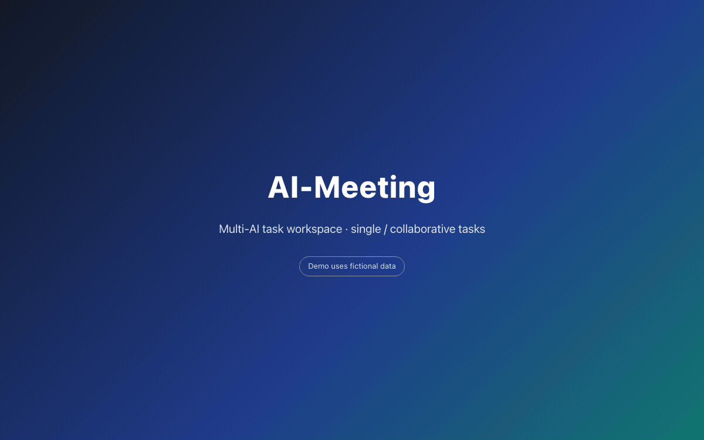

<div align="center">

# 🏛️ AI-Meeting
### Multi-AI Collaboration Workspace

*A local, single-user workspace where multiple AI models collaborate on the same job: debating and cross-reviewing, or splitting a task and calling in teammates for help.*

<br/>

[English](README.md) | [简体中文](README_zh.md)

<br/>

[](https://python.org)
[](LICENSE)
[-blueviolet?style=flat-square)](#start)
[](#security)

<br/>



</div>

---

## 📖 Table of Contents

- [Why AI-Meeting?](#why)
- [How It Works](#how)
- [Features](#features)
- [Modes & Configuration](#modes)
- [Quick Start](#start)
- [Security Boundaries](#security)
- [Repository Layout](#layout)

---

<a id="why"></a>
## 💡 Why AI-Meeting?

Most multi-agent frameworks (ChatDev, AutoGen, …) are built for open-ended conversation. In day-to-day collaborative work that produces two recurring problems:

1. **No convergence** — agents compliment each other and nitpick wording, so the discussion never reaches a decision;
2. **Signal loss** — every model rewrites the whole document into the chat stream, and nobody can extract the actual conclusion.

**AI-Meeting** applies the **RFC / pull-request review** discipline used by large open-source projects:

| Dimension | Typical multi-agent chat | AI-Meeting (RFC review) |
| :--- | :--- | :--- |
| **Primary goal** | Accumulate chat logs; conclusions scattered | **Shared source of truth**: one living document kept current, so every member works from the same version |
| **Speaking rules** | Open-ended dialogue, drifts off-topic | **Two phases**: free formulation ➡️ strict blocker-only review with a first-line verdict protocol |
| **Convergence** | "Stop after N rounds" | **State-driven**: concludes the moment everyone PASSes; blockers are fixed in a closed loop |
| **Fault tolerance** | One timeout deadlocks the session | **Per-member resilience**: retry / skip / restore a single member |
| **Execution** | Locked to one cloud API key | **Pluggable backend**: local CLIs (`agy`, `codebuddy`, …) today; remote API calls planned |

---

<a id="how"></a>
## 🔄 How It Works

The flow below describes the **roundtable** mode; autonomous tasks are covered in [Modes & Configuration](#modes).


### 1. Two phases: open formulation ➡️ strict review

- **Phase 1 — free formulation.** Each member states its perspective, assumptions and proposed approach. Answer length is decided by the model, not by a character cap. Once everyone has spoken, the moderator synthesises the consensus and creates the **living document** (right panel).
- **Phase 2 — blocker-only scrutiny.** The council switches to review mode. Minor wording or style suggestions are explicitly forbidden; only defects that would make the plan wrong — data corruption, deadlocks, security holes, broken logic — may be raised as `[BLOCKER: one-line issue]`. Otherwise the model must answer `[PASS]` and yield the floor.

### 2. Closed-loop verification (anti scope creep)

When a member raises a `[BLOCKER]`:

1. the moderator applies a targeted revision to the document;
2. **only the author of that blocker** is invited to verify it (fed the revised full text, forbidden to raise unrelated topics);
3. the author must answer `[ACCEPT]` or `[REJECT]` — rejections loop back to step 1;
4. when every member has said `[PASS]` and no blocker is open, the meeting concludes and the minutes are locked in.

> [!IMPORTANT]
> **Verdicts are parsed, not guessed.** The engine only accepts explicit markers on the first non-empty line of a reply; it never infers agreement from prose, so a "this is not acceptable" sentence can no longer be counted as an approval.
>
> **Minutes contain only what happened.** If a member times out, returns an empty reply, or emits raw tool calls, the moderator is forbidden from inventing a position for it. The draft appends a *Data Integrity Note* listing every absent member, so the record stays auditable.

---

<a id="features"></a>
## ✨ Features

### 🛡️ Single-member failures don't kill the session

- **Retry in place** — re-run only the failed speech and overwrite that record; other members are untouched;
- **Skip a member** — if a CLI is genuinely down, skip it and let the rest finish; it can be restored later;
- **Resume a stuck meeting** — after a crash or a service restart, the meeting pauses instead of losing state. Resuming retries the same member once; if it stalls twice in a row, that member is set aside automatically and the meeting moves on.

### 👑 Human-in-the-loop authority

- **Pause / resume at any time** — sends `SIGTERM` to the process group, so no orphaned CLI processes keep burning tokens;
- **Inject directives mid-flight** — anything you type becomes the highest-priority "owner directive" in subsequent prompts;
- **`@all` / `@member`** — `@all` restarts Phase 1 under your new direction; `@member` is an isolated inquiry that doesn't disturb the session state machine;
- **💬 Quote reply (WeChat-style)** — reply to any speech; the question is routed to its author (equivalent to `@` them). The quoted text is resolved server-side (the client only sends a message id) and is passed to the prompt as its own block. Clicking a quote jumps back to the original message, or shows a snapshot if it's no longer in the list;
- **✕ Cancel vs ⏭ Skip** — interrupting a normal turn removes that member from the speaking order; during a `@` answer the same button becomes **Cancel** and keeps them in the meeting;
- **🔍 Prompt inspector** — the full prompt of every speech, split into `【block】` cards with char/line counts; bulk material (chat transcript, plan document) is collapsed by default, so a 14k-char prompt shows ~1.2k chars on first paint.

<details>
<summary>How the <code>@</code> prompt is assembled (token-cost notes)</summary>

Order: **plan document → meeting context → persona → chat transcript → the question → output rules**.

Two deliberate choices:

- **Document first** — the same revision is byte-identical across every reviewer, so it forms a stable prefix that provider-side prompt caching can hit; the per-member persona comes *after* it, not before.
- **Context shrinks as the document matures** — once the document exceeds ~3000 chars, the chat transcript is trimmed to owner follow-ups plus the two latest peer messages, and system broadcasts / moderator status lines are dropped. The same fact is never paid for twice as "raw transcript + document summary".

Documents over 12k chars switch to *outline + 2–3 sections matching the question + closing summary* instead of being re-sent whole.
</details>

### 🖥️ Three-pane workspace

- **Left** — sessions: search, rename, favourite, collapse;
- **Middle** — the debate: verdict badges (`PASS` / `BLOCKER` / `ACCEPT`), retry/skip/reply actions, Markdown rendering for AI replies (owner/system messages stay plain);
- **Streaming** — subprocess stdout is pushed in 0.33 s chunks. While streaming the text is rendered as **plain text on purpose**: half-finished Markdown (an unclosed code fence, a half-written table) would reflow the whole block on every tick. The final message takes over with full Markdown. Whether you see it token-by-token depends on whether the CLI flushes its output;
- **Follow & "back to latest"** — auto-scroll stops only when *you* scroll up, so a fast-growing answer never loses your position; a `Jump to latest` pill appears while you read history;
- **Collapsible long answers** — measured by real rendered height (roughly one viewport); re-measured on resize so short messages are never folded;
- **Right** — the living document: live Markdown, revision history, distract-free full-screen mode.

---

<a id="modes"></a>
## 🎛️ Modes & Configuration

### Two ways to collaborate

Pick the mode when creating a meeting (and change it later in **Edit meeting**, while paused):

| Mode | Behaviour |
| :--- | :--- |
| **🗣️ Roundtable** | Members speak in turn through Phase 1 and Phase 2; the moderator synthesises and maintains the living document. |
| **🎯 Autonomous task** | `@` one member to hand it a task. It works on its own, keeps going across rounds until it writes a completion marker or hits the round limit, and can `@` teammates for a second opinion or help. A task banner shows the current round with an **End task** button. |

Autonomous task settings live in **Employee Management** (the "Meeting Behavior" section): the maximum number of rounds per task (4 by default, 1–20) and whether the AI may call in other members. Each round is one full model call, so the limit is also a cost cap. Turning helper mentions off makes the owner work alone.

### Write access (let the AI actually do the work)

Read-only roles can only look things up. In **Employee Management**, each member card shows its access mode and timeout; toggle write access there (or use **Enable all / Disable all**), then click Save settings:

- `agy` gets `--dangerously-skip-permissions`;
- `codebuddy` gets `-y` and `Write,Edit,Bash` appended to `--tools` (on top of `Read,Glob,Grep`).

The flags are injected by the server from the setting, so the command template stays untouched and the permission is auditable in one place. **Write access is off by default** — a writable role can modify files in the workspace, so enable it only on your own machine with a trusted directory.

---

<a id="start"></a>
## 🚀 Quick Start

### Prerequisites

- **Python 3.8+** (developed and verified on 3.12)
- At least one **local AI CLI** that accepts a prompt on the command line — the defaults assume `agy` and `codebuddy`, but any binary works via a command template (the only backend available today)

> [!NOTE]
> **Execution backends.** Today the only backend is a local CLI spawned as a subprocess; each member is a command template. Remote API calls (pointing a member at a hosted model endpoint) are planned — CLI will then be one of several backends, not a constraint of the meeting engine. The collaboration flow, minutes and prompt assembly are backend-independent.

### Install and run

```bash
git clone https://github.com/BinaryAlan/ai-meeting.git
cd ai-meeting
./run.sh          # creates .venv, installs deps, starts the server
```

Open <http://127.0.0.1:5050>.

### Service lifecycle

```bash
./run.sh start      # start (foreground; Ctrl+C exits gracefully)
./run.sh status     # PID, uptime, running meetings
./run.sh restart    # graceful restart (halts active CLI tasks, pauses meetings)
./run.sh stop       # graceful shutdown
./run.sh dev        # development only: enables hot reload
```

> [!TIP]
> The **Service** section of **Employee Management** shows the same telemetry and offers one-click restart / shutdown from inside the browser.

### Your first meeting

1. Open **⚙️ Employee Management**, confirm at least one employee whose `cli_cmd` actually runs on your machine (test it in a terminal first), and adjust the persona if you like;
2. Click **＋ New meeting**, pick **Roundtable** or **Autonomous task**, the participants and a workspace directory (the models may read files there);
3. Send your topic — or `@` an owner to delegate a self-contained task;
4. Watch the collaboration unfold; the shared document grows on the right. In roundtable mode the meeting concludes when every member has PASSed; in autonomous task mode the owner keeps working until it reports completion or hits the round limit.

---

<a id="security"></a>
## 🔒 Security Boundaries

Built as a **local-first, single-user** tool:

- **Network** — binds `127.0.0.1` only, validates the `Host` header to blunt DNS-rebinding, and runs with the Werkzeug debugger disabled;
- **Command allow-list** — in the current CLI backend, execution templates are restricted to known AI CLI binaries; shells such as `bash`/`python` are rejected, so a template cannot become arbitrary code execution;
- **Path confinement** — workspace browsing is limited to the project and home directories, and dot-prefixed secrets (`.ssh`, `.gitconfig`, …) are blocked;
- **Write access is opt-in** — members are read-only by default. Enabling it lets that role modify files and run commands inside the workspace; keep it off unless the directory is trusted;
- **XSS** — model output is sanitised with DOMPurify before it reaches the DOM; raw HTML is never injected into the page.

**No authentication is implemented.** Anyone who can reach the port can drive the meeting — including enabling write access. Keep it on localhost; do not expose it to a LAN or the internet as-is.

---

<a id="layout"></a>
## 📁 Repository Layout

```text
ai-meeting/
├── app.py                # Flask app: routes, locks, host guard, cache policy
├── core/
│   ├── engine.py         # Meeting state machine (phases, verdicts, prompts, tasks)
│   ├── executor.py       # Execution backend: process groups, streaming, timeouts, write access
│   ├── streaming.py      # In-memory buffer for in-flight output
│   ├── storage.py        # Atomic session/settings persistence
│   ├── i18n.py           # Backend system-message language selection
│   └── scanner.py        # Local AI CLI / model discovery
├── data/
│   ├── settings.json     # Employees, moderator, language, modes, task rules
│   └── sessions/         # Meeting transcripts + final documents (git-ignored)
├── static/
│   ├── index.html        # Single-page UI
│   ├── js/app.js         # Vue 3 app (rendering, scroll, IME guards)
│   ├── js/i18n.js        # English UI dictionary
│   └── vendor/           # Vue / Tailwind / marked / DOMPurify
├── docs/
│   ├── demo.gif          # Demo animation (Chinese UI)
│   └── demo-en.gif       # Demo animation (English UI)
├── requirements.txt      # Flask
├── run.sh                # start / dev / stop / restart / status
└── LICENSE               # PolyForm Noncommercial 1.0.0
```

---

## 📄 License

[PolyForm Noncommercial License 1.0.0](LICENSE) — personal, research, educational and other noncommercial use only. **Commercial use requires a separate licence from the copyright holder.**
