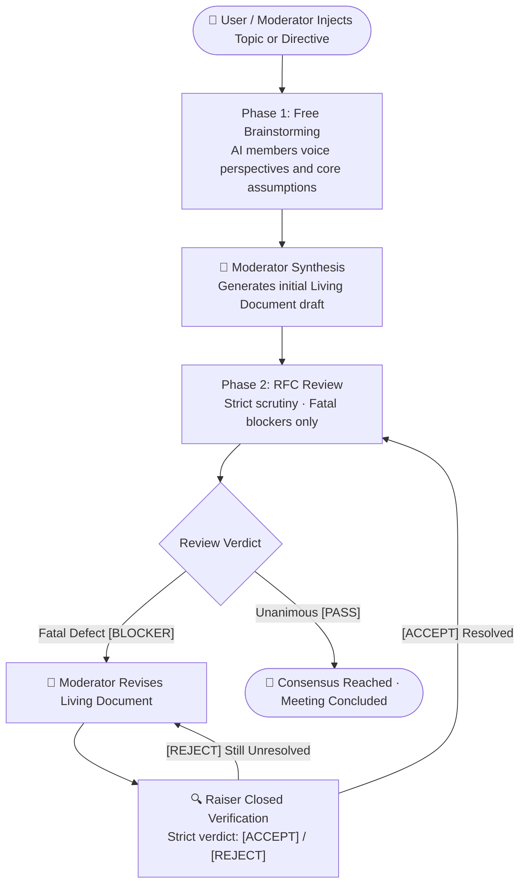

<div align="center">

# 🏛️ AI-Meeting
### Multi-AI Council & RFC Review Consensus System

*A lightweight multi-agent consensus system driven by **RFC Review Paradigm***  
*Say goodbye to endless flattery and chat flood — debate on the left, living architecture document on the right!*

<br/>

[English](README.md) | [简体中文](README_zh.md)

<br/>

[](https://python.org)
[](LICENSE)
[](#-core-workflow)
[](#-virtual-employee-configuration)
[](#-security-boundaries)

</div>

---

## 💡 Why AI-Meeting?

Most existing multi-agent discussion frameworks (such as ChatDev, AutoGen, etc.) suffer from two primary pain points in practical engineering and architecture design:

1. **Endless Politeness & Non-Convergence**: AI agents tend to compliment each other and endlessly nitpick minor wording, preventing the discussion from naturally reaching closure;
2. **Chat Flooding & Lost Signal**: Each model repeatedly rewrites full documents or thousands of lines of code into the chat stream, making it almost impossible for human operators to extract actionable consensus.

**AI-Meeting** borrows the battle-tested **RFC / PR Review mechanism** from premier open-source communities (like Linux and Kubernetes):

| Dimension | Traditional Multi-Agent Chat | AI-Meeting (RFC Review Paradigm) |
| :--- | :--- | :--- |
| **Primary Goal** | Accumulating chat logs; takeaways scattered across messages | **Deliverable-Oriented**: The right panel maintains a single, continuously growing, authoritative living document |
| **Speech Constraint** | Open-ended, rambling dialogue prone to drifting | **Dual-Track Workflow**: Phase 1 Free Brainstorming ➡️ Phase 2 Strict Blocker Review with first-line verdict protocol |
| **Convergence** | Relies on arbitrary round counts (e.g., "stop after 3 rounds") | **State-Ready Natural Termination**: Closes immediately when all PASS; pinpoints and fixes blockers iteratively |
| **Fault Tolerance** | A single model timeout or crash deadlocks the entire session | **Per-Member Resilience**: In-place single-speech retry, temporary skip, and seamless member restoration |
| **Execution Layer** | Tied to commercial cloud API keys or proprietary platforms | **Decoupled Architecture**: Natively drives local CLIs (`agy`, `codebuddy`, etc.), architected for future REST/HTTP API expansion |

---

## 🔄 Core Workflow



### 1. Dual-Track Workflow (Open Formulation ➡️ Strict Review)
- **Phase 1: Free Brainstorming**  
  Participating models voice their perspectives, architectural assumptions, and recommended solutions. Length is determined dynamically by the topic's complexity, prioritizing dense, high-signal input. Once all members have spoken, the moderator synthesizes the consensus and initializes the **Living Document** in the right panel.
- **Phase 2: Strict Blocker Scrutiny**  
  After the draft is generated, the council switches into strict code-review mode. **Minor wording or stylistic nitpicks are strictly forbidden**. Only fatal defects—such as system crashes, concurrency deadlocks, critical security flaws, or fundamental logic contradictions—may be raised as `[BLOCKER: Brief Issue Description]`. When no fatal flaws exist, models must explicitly state `[PASS]` and yield the floor.

### 2. Closed-Loop Verification (Anti-Scope-Creep)
When an AI member raises a `[BLOCKER]`:
1. The moderator immediately applies a targeted revision to the living document;
2. The system **invites only the blocker's author into a closed verification round** (feeding them the revised full text, with strict instructions forbidding extraneous new topics);
3. Once the author confirms resolution with `[ACCEPT]`, the review resumes with the remaining reviewers;
4. When all participants confirm `[PASS]` and zero blockers remain, the meeting naturally concludes with the finalized deliverable.

> [!IMPORTANT]
> **Strict Verdict Protocol & Data Integrity**:
> - **Strict First-Line Protocol**: Verdicts are parsed strictly from explicit markers on the first non-empty lines of model outputs. The engine never infers agreement from conversational prose, preventing negative statements from being misclassified as approvals;
> - **Accurate Minutes**: If a member produces an invalid response (e.g. timeout, empty output, or raw tool calls), the moderator is strictly forbidden from hallucinating positions on their behalf. The draft automatically appends a **Data Integrity Note** auditing all absent members.

---

## ✨ Key Features

### 🛡️ Resilient Recovery: Single AI Failures Don't Halt the Session
When a local model CLI times out or errors, the meeting pauses gracefully without discarding progress:
- **In-Place Retry**: Rerun only the failed speech with its original prompt. The new response cleanly overwrites the record without re-running other members;
- **Skip Member**: If a CLI is temporarily unavailable, skip that member with one click. The meeting continues with the remaining participants;
- **Restore Member**: Re-enable skipped members at any time from the participant panel; they will rejoin in the next round.

### 👑 Human-in-the-Loop Authority
- **Instant Pause / Resume**: Click `⏸️ Pause` at any moment to immediately send `SIGTERM` to the underlying process group, preventing orphan processes and wasted tokens;
- **In-Flight Directives**: Messages sent by the human user are injected into subsequent prompts as the highest-priority "User Directive";
- **Direct Mention (@) Controls**: `@all` resets the council back to Phase 1 under your updated direction; `@member` triggers an isolated direct inquiry without derailing the main session state machine.

### 🖥️ Responsive Three-Column Workspace
- **Left Column (Sessions)**: Search, rename, favorite, and drag to resize or collapse;
- **Center Column (Interactive Stream)**: Visual waterfall clearly distinguishing initial opinions, blockers, verification verdicts, and system broadcasts;
- **Right Column (Living Document)**: Real-time Markdown rendering, version history tracking, and distraction-free full-screen reading mode.

---

## 🚀 Quick Start

### 1. Prerequisites
- Python 3.8+
- An execution environment (natively supports `agy` and `codebuddy` CLIs, with customizable templates)

### 2. Installation & Launch
```bash
# Clone the repository
git clone https://github.com/BinaryAlan/ai-meeting.git
cd ai-meeting

# Start the service (automatically initializes an isolated .venv and installs dependencies)
./run.sh
```

Once ready, open `http://127.0.0.1:5050` in your browser to launch your first meeting!

### 3. Service Lifecycle Management
`run.sh` also acts as a full-featured service management script:

```bash
./run.sh start      # Launch server (foreground daemon; Ctrl+C to exit gracefully)
./run.sh status     # Inspect PID, uptime, hot-reload status, and active meetings
./run.sh restart    # Gracefully restart (safely halts active CLI tasks and pauses meetings)
./run.sh stop       # Gracefully shut down the server
```

> [!TIP]
> You can also click the **⏻ Power Menu** in the top-left of the web UI to inspect service telemetry and trigger one-click restarts or shutdowns.

---

## ⚙️ Virtual Employee Configuration

Configure CLI commands, model parameters, and persona prompts in the Settings modal:

```json
{
  "employees": [
    {
      "id": "emp_agy",
      "name": "agy",
      "avatar": "🦉",
      "avatar_color": "#2563eb",
      "cli_cmd": "agy -p \"{prompt}\"",
      "enabled": true
    },
    {
      "id": "codebuddy-ds4",
      "name": "DeepSeek-V4 (DS4)",
      "avatar": "🧠",
      "avatar_color": "#9333ea",
      "cli_cmd": "codebuddy --model deepseek-v4-pro --tools \"Read,Glob,Grep\" -p \"{prompt}\"",
      "system_prompt": "Specializes in system boundary exploration and fatal edge-case discovery.",
      "enabled": true
    }
  ]
}
```

> [!WARNING]
> **CodeBuddy CLI Tool Parameter Tip**:  
> When configuring CodeBuddy models, we recommend supplying read-only inspection tools: `--tools "Read,Glob,Grep"`. If tools are disabled via `--tools ""` and a topic asks the model to inspect local files, the model may output only an incomplete planning sentence. AI-Meeting includes built-in safeguards (XML tag stripping and automatic retries) to maintain flow continuity.

---

## 🔒 Security Boundaries

Built strictly with a **Local-First, Single-User Security Architecture**:

- **Network Boundary**: Bound strictly to `127.0.0.1` by default; enforces `Host` header verification to neutralize DNS Rebinding attacks, with production debuggers disabled;
- **Command Whitelisting**: CLI execution templates are constrained to verified AI binaries, strictly preventing arbitrary shell execution (e.g. `bash`, `python`);
- **Path Traversal Protection**: File and workspace browsing is confined strictly to the user home and project directory, completely blocking sensitive hidden files (`.ssh`, `.gitconfig`, etc.);
- **XSS Sanitization**: Markdown output is rigorously sanitized through `DOMPurify` before DOM insertion.

---

## 📁 Repository Layout

```text
ai-meeting/
├── app.py              # Flask Web server & API controller (Host guard & concurrency locks)
├── core/
│   ├── engine.py       # Meeting state machine & RFC consensus scheduler
│   ├── executor.py     # Unified CLI/API execution runner with process group cleanup
│   ├── scanner.py      # Local AI CLI / model discovery engine
│   └── storage.py      # Session and employee persistence (atomic file writes)
├── data/
│   ├── settings.json   # Employee configurations and defaults
│   └── sessions/       # Meeting chat history and finalized deliverables
├── static/
│   ├── index.html      # Responsive web interface
│   └── js/app.js       # Vue.js frontend driver (IME composition & session guard)
├── requirements.txt    # Core Python dependencies
├── run.sh              # Service lifecycle CLI (start / stop / restart / status)
└── LICENSE             # MIT License
```

---

## 📄 License

This project is licensed under the [MIT License](LICENSE).
