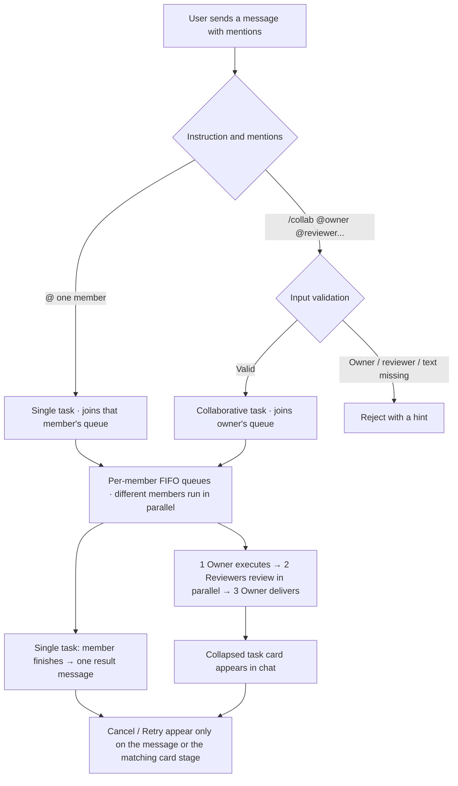

<div align="center">

# AI-Meeting

### Multi-AI Task Workspace

*A local workspace where you hand tasks to AI team members: they do the work, review each other, and deliver the result.*

<br/>

[English](README.md) | [简体中文](README_zh.md)

<br/>

[](https://python.org)
[](LICENSE)
[-blueviolet?style=flat-square)](#start)
[](#security)

</div>

---

## 📖 Table of Contents

- [What It Is](#about)
- [Two Kinds of Tasks](#tasks)
- [The Task Card](#card)
- [Queues, Cancel and Retry](#queue)
- [Workspace and Permissions](#workspace)
- [Settings](#settings)
- [Run Protocol](#protocol)
- [Quick Start](#start)
- [Security Boundaries](#security)
- [Repository Layout](#layout)

---

<a id="about"></a>

## 💡 What It Is

AI-Meeting is a multi-AI task workspace that runs on your machine. In a chat session you hand a task to an AI team member; members do their part of the work, review each other, and deliver a result.

The goal is **not** to produce a formal plan document. It is to let several AIs collaborate on real work. The chat window is where collaboration happens; the right panel holds only the workspace directory, shared as the place where files are produced and browsed. A run produces both a short explanation in chat and files in the workspace.

The interface has three parts:

- **Left** — session list: create, rename, favourite, collapse, search;
- **Middle** — messages and task cards: result messages, collapsed collaborative-task cards, quote replies, Markdown rendering, collapsible long content, full-input / raw-output inspector;
- **Right** — workspace file tree and browsing. There is no global control bar.

Members currently run as local CLI processes; pointing them at remote model services is planned. Neither the UI nor the task flow depends on the execution backend. Full design: [software design draft](docs/task-review-protocol.md).

---

<a id="tasks"></a>

## 🔄 Two Kinds of Tasks

The user's instruction and mentions decide the task type.

**Single task**: `@` one member and ask it to do something. The task joins that member's queue, runs independently, and produces one result message (short summary + artifact list).

**Collaborative task**: start with `/collab`, in the form `/collab @owner @reviewer1 [@reviewer2...] task description`. Input is strictly validated: one explicit owner, at least one reviewer after it, and a task description. Anything missing is rejected with a hint. A collaborative task always has exactly **one round**:



| Stage | What happens | Controls on the card |
| :--- | :--- | :--- |
| **1 Owner executes** | Owner works in the workspace and returns a short result and artifact list | Cancel; Retry after failure, timeout or cancellation |
| **2 Members review** | Each named reviewer reads the real artifacts and independently gives an opinion | Per-member Cancel and Retry |
| **3 Owner delivers** | Owner takes all opinions, makes one revision, and delivers the final result | Retry to regenerate the delivery |

The user's original message (minus the command prefix) is passed to participants as-is; each member interprets what to do. When the owner hands the task to reviewers, the software passes only the original text and artifact information — it does not parse the task goal or set acceptance criteria. Reviewers always run read-only and never modify the owner's artifacts. If a reviewer fails, times out, is cancelled, or gives no opinion, the card records its status and the owner still delivers.

---

<a id="card"></a>

## 🗂️ The Task Card

A collaborative task creates a card in chat immediately, collapsed by default. Its shell shows the task summary, overall status, current stage, elapsed-time activity and per-member status dots. Open it for two parts:

- **Part A · What the owner did** — execution brief, artifact list, final-change notes, and how the owner handled review opinions;
- **Part B · Member reviews** — one slot per reviewer with its status and opinion; open a slot for the full text and raw output.

Every stage keeps its execution history; the dialog lets you inspect the full input and raw output of each past run. Task states: queued / running / delivered / cancelled / failed. Member slots additionally show waiting / in progress / done / failed / cancelled / timed out / no opinion.

Other message features: quote replies carry the quoted text to the member, and clicking a quote jumps back to the original (or shows a saved snapshot if it is gone); long content is collapsed by measured rendered height; every AI output has a full-input / raw-output inspector; AI output is rendered as Markdown.

---

<a id="queue"></a>

## ⏳ Queues, Cancel and Retry

- Each member has a FIFO queue: tasks for one member run serially, while different members run in parallel. Reviews are started directly by the task, so different reviewers can work at the same time; if a reviewer is busy with its own queued task, its review waits and runs afterwards. The UI shows queue positions.
- **Cancel** appears only on a message that is producing output, or on a stage that is running. It sends a termination signal to the process immediately; files already written stay in the workspace, there is no rollback and no confirmation dialog, and the input box is instantly usable again.
- **Retry** appears on failed / cancelled / timed-out messages or stages. It reruns only that one execution with the original input — no new task, no extra round. Retrying owner execution restarts review and delivery; retrying a review only updates that reviewer's opinion, so use the owner-delivery retry if you want a new final version.
- Tasks and queues are saved with the session. Refreshing the page does not change running tasks. After a service restart, running tasks are marked cancelled and can be retried from the interrupted stage; queued tasks are picked up again.

---

<a id="workspace"></a>

## 📁 Workspace and Permissions

Each session has a workspace directory where AIs read and write files. The owner emits an artifact list, which the software uses to list the files produced; the right panel browses and previews them.

Write access is a per-member setting; the review stage of a collaborative task is always read-only. When write access is on, the server injects the right CLI flags (`--dangerously-skip-permissions` for `agy`; `-y` plus `Write/Edit/Bash` in `--tools` for `codebuddy`), so command templates stay untouched. **Write access is off by default** — enable it only on your own machine with a trusted directory.

---

<a id="settings"></a>

## ⚙️ Settings

Settings have exactly three parts:

- **Members** — add and edit members: name, avatar, persona, CLI template, write access, per-run timeout; batch-enable or disable write access;
- **Interface language** — 简体中文 / English, applied immediately;
- **Service** — process status (PID, uptime, active tasks, hot reload), one-click restart / shutdown.


---

<a id="protocol"></a>

## 📜 Run Protocol

A set of texts shipped with the software. The server adds them to a member's input to describe the current stage and the expected output:

| File | Used for |
| :--- | :--- |
| `prompts/protocol/task-flow.md` | Describes the collaboration flow and stage order |
| `prompts/roles/single.md` | Single-task member: finish the job, output a short result and artifact list |
| `prompts/roles/owner.md` | Owner: do the work, list artifacts, revise once from review opinions and deliver |
| `prompts/roles/reviewer.md` | Reviewer: read-only, read the real artifacts, give an opinion |

Structured output defined by the protocol is parsed by the server. If parsing fails, the text is shown as plain output and delivery still proceeds.

---

<a id="start"></a>

## 🚀 Quick Start

### Prerequisites

- **Python 3.8+** (developed and verified on 3.12)
- At least one **local AI CLI** that accepts a prompt on the command line — the defaults assume `agy` and `codebuddy`, but any binary works via a command template

> [!NOTE]
> **Execution backends.** Today the only backend is a local CLI spawned as a subprocess. Remote API calls are planned.

### Install and run

```bash
git clone https://github.com/BinaryAlan/ai-meeting.git
cd ai-meeting
./run.sh          # creates .venv, installs deps, starts the server
```

Open <http://127.0.0.1:5050>.

### Service lifecycle

```bash
./run.sh start      # start (foreground; Ctrl+C exits gracefully)
./run.sh status     # PID, uptime, active tasks
./run.sh restart    # restart (running tasks are marked cancelled for retry)
./run.sh stop       # graceful shutdown
./run.sh dev        # development only: enables hot reload
```

**Settings → Service** shows the same telemetry and offers one-click restart / shutdown from inside the browser.

### Your first task

1. Open **⚙️ Settings → Members** and confirm at least two members are available;
2. Click **＋ New session**, pick members and a workspace directory (members can read files there);
3. Send `@agy Outline this material for me`, or `/collab @agy @DS4 @HY4 Turn this material into an actionable plan`;
4. A single task returns a result message; a collaborative task opens a card with what the owner did and each reviewer's opinion. Produced files are on the right.

### Tests and acceptance

```bash
.venv/bin/python -m unittest discover -s tests -v
```

Tests cover task parsing, queues, the three-stage flow, cancel / retry, restart recovery, read-only reviews and HTTP endpoints. Line-by-line verification is in the [acceptance record](docs/acceptance.md).

---

<a id="security"></a>

## 🔒 Security Boundaries

Built as a **local-first, single-user** tool:

- **Network** — binds `127.0.0.1` only, validates the `Host` header to blunt DNS rebinding, and runs with the Werkzeug debugger disabled;
- **Command allow-list** — in the current CLI backend, execution templates are restricted to known AI CLI binaries; shells such as `bash` / `python` are rejected, so a template cannot become arbitrary code execution;
- **Path confinement** — workspace browsing is limited to the project and home directories, and dot-prefixed secrets (`.ssh`, `.gitconfig`, …) are blocked;
- **Write access is opt-in** — members are read-only by default. Enabling it lets a member modify files and run commands inside the workspace; keep it off unless the directory is trusted;
- **XSS** — model output is sanitised with DOMPurify before it reaches the DOM; raw HTML is never injected into the page.

**No authentication is implemented.** Anyone who can reach the port can drive sessions, including enabling write access. Keep it on localhost; do not expose it to a LAN or the internet as-is.

---

<a id="layout"></a>

## 📁 Repository Layout

```text
ai-meeting/
├── app.py                      # Flask app: endpoints, host guard, cache policy
├── core/
│   ├── tasks.py                # Task state machine, per-member FIFO queues, prompt assembly, card builder
│   ├── executor.py             # CLI subprocess, timeouts, cancellation, write access
│   ├── storage.py              # Atomic session/settings persistence
│   └── scanner.py              # Local AI CLI / model discovery
├── prompts/
│   ├── protocol/task-flow.md   # Collaboration flow protocol
│   └── roles/                  # Single-task / owner / reviewer protocols
├── data/
│   ├── settings.json           # Interface language and member list
│   └── sessions/               # Sessions, messages, tasks, queues (git-ignored)
├── static/
│   ├── index.html              # Single-page UI
│   ├── js/app.js               # Vue 3 app
│   ├── js/i18n.js              # English UI dictionary
│   └── vendor/                 # Vue / Tailwind / marked / DOMPurify, bundled locally
├── docs/
│   ├── task-review-protocol.md # Software design draft
│   └── acceptance.md           # Acceptance criteria and verification
├── tests/test_tasks.py         # Automated task-system tests
├── requirements.txt            # Flask
├── run.sh                      # start / dev / stop / restart / status
└── LICENSE                     # PolyForm Noncommercial 1.0.0
```

---

## 📄 License

[PolyForm Noncommercial License 1.0.0](LICENSE) — personal, research, educational and other noncommercial use only. **Commercial use requires a separate licence from the copyright holder.**
