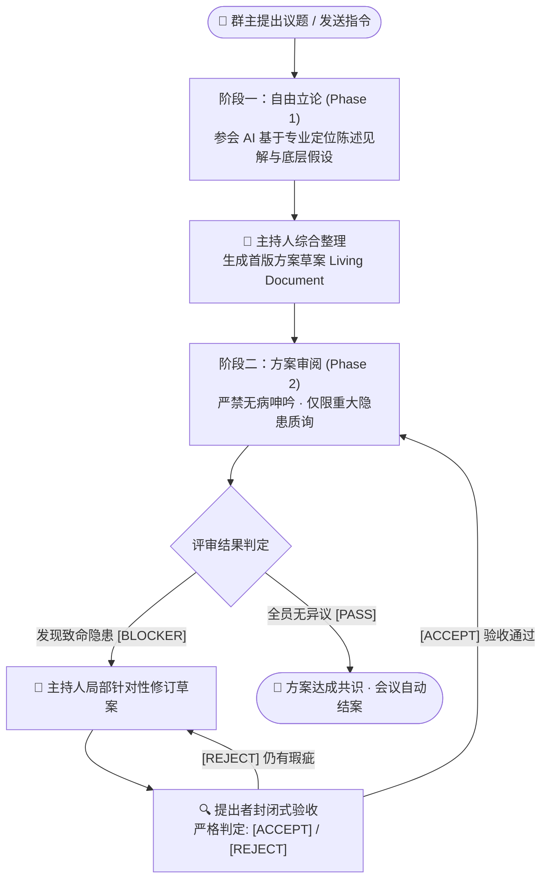

<div align="center">

# 🏛️ AI-Meeting
### 多 AI 协同圆桌讨论与方案评审中枢

*基于 **RFC 审查制** 的多智能体协同与共识系统*  
*告别死板轮次与无休止的寒暄刷屏 —— 左侧短平快辩论交锋，右侧实时生长架构文档！*

<br/>

[English](README.md) | [简体中文](README_zh.md)

<br/>

[](https://python.org)
[](LICENSE)
[](#-核心运行机制)
[](#-虚拟员工配置)
[](#-安全边界)

</div>

---

## 💡 为什么需要 AI-Meeting？

市面上多数多 Agent 讨论框架（ChatDev、AutoGen 等）在实际工程与方案落地时往往面临两个痛点：
1. **无限客套与无法收敛**：AI 之间倾向于互相夸赞、并反复提出细枝末节的措辞建议，导致讨论循环无法自然停机；
2. **长篇大论与信息淹没**：每个模型动辄重写数千字，人类在海量碎片化对话中难以提炼出最终可执行的共识结论。

**AI-Meeting** 借鉴了顶级开源社区（Linux / Kubernetes RFC）与现代工程团队的代码审查（PR Review）机制：

| 对比维度 | 传统多 Agent 方案 | AI-Meeting (RFC 审查范式) |
| :--- | :--- | :--- |
| **讨论目标** | 纯聊天记录堆积，结论散落在消息流中 | **交付物导向**：右侧始终维护唯一一份实时生长的正式方案文档 |
| **发言约束** | 漫无边际的自由发言，容易偏题发散 | **双轨制**：阶段一自由立论 ➡️ 阶段二严苛质询与首行协议 |
| **收敛规则** | 依赖“跑满 N 轮强制停止”的死板计数 | **状态就绪即停机**：全员 `[PASS]` 立即交卷；存在异议精准修复闭环 |
| **成员异常** | 单个模型超时/挂掉直接导致整场死锁 | **单人韧性恢复**：支持单条原地重试、临时跳过与随时召回 |
| **执行载体** | 依赖特定的商业 API Key 或固定云端服务 | **解耦执行架构**：原生支持本地 CLI（`agy`、`codebuddy` 等），架构已解耦可平滑扩展 REST/HTTP API |

---

## 🔄 核心运行机制



### 1. 阶段双轨制（立论自由 ➡️ 审查严苛）
- **阶段一：自由立论（Phase 1）**  
  参会模型各抒己见，提出核心见解、底层假设与落地方案。篇幅由模型按议题复杂度自行决定，强调高信息密度。全部发言完毕后，主持人提炼共识，在右侧面板初始化首版方案草案（*Living Document*）。
- **阶段二：严查重大阻断（Phase 2）**  
  草案生成后自动转入审阅模式。**严禁挑刺细微措辞或非原则性细节**，只有存在系统崩溃、并发死锁、严重安全风险或底层逻辑硬伤时，才允许首行标注 `[BLOCKER: 问题简述]`；无异议必须明确输出 `[PASS]` 闭麦通过。

### 2. 闭环精准验收（Anti-Scope-Creep）
当某位成员提出 `[BLOCKER]` 后：
1. 主持人针对该问题立即对方案进行定向修订；
2. 系统**定向邀请该成员进场验收**（封闭式质询，送入最新修订正文，禁止引申无关新话题）；
3. 验收模型通过输出 `[ACCEPT]` 后，讨论方可流转至下一位评审人；
4. 当所有参会成员均给出 `[PASS]` 且无未决阻断时，讨论自然结案，交付最终定稿。

> [!IMPORTANT]
> **真实性与协议保障**：
> - **严格首行协议**：评审结论由状态机直接解析回答首行标记，绝不用中文子串推测，防止将“不通过”误判为“通过”；
> - **纪要只写真实发生的事**：某成员未发言（或仅回了计划句）时，主持人会被明令禁止脑补其立场，且纪要文末会附带《数据完整性说明》列明缺席成员，确保记录 100% 可审计。

---

## ✨ 特性亮点

### 🛡️ 高韧性容错：单成员掉线不拖垮整场会议
模型偶发超时或报错时，系统会自动挂起等待处理，无需推翻重开：
- **原地重试 (Retry)**：针对报错的发言单独重跑，结果原地更新，不影响其他人；
- **跳过此人 (Skip)**：某个模型持续挂掉时一键跳过，该成员不再占用发言位，余下成员照常审阅并结案；
- **成员召回 (Restore)**：在参会面板随时点击恢复，下一轮点名时重新归队。

### 👑 群主最高裁决权（Human-in-the-Loop）
- **即时暂停/恢复**：随时点击 `⏸️ 暂停`，系统会立即以 `SIGTERM` 终结底层进程组，避免后台空转烧 Token；
- **随时动态插话**：在输入框发送的消息会作为最高优先级的「群主指令」即时注入后续所有 Prompt；
- **定向 @ 调度**：发送 `@所有人` 会重置为阶段一全员重新立论；定向 `@某位成员` 则进行单点答疑，不破坏当前主线状态。
  Prompt 组成：方案纪要 → 会议背景 → 身份 → 聊天上下文 → 本次提问 → 回答要求。
  纪要成稿（≥3000 字）后，聊天上下文只保留群主的追问与最近两条成员发言（更早讨论以纪要为准），
  系统广播与主持人流程播报不进 Prompt——同一段信息不再「原话 + 纪要转述」各送一遍。
  纪要超过 1.2 万字时自动改走「标题大纲 + 与提问命中的 2~3 节 + 结尾结论段」，不再整份重发。
  正文放在最前面是有意为之：同一版本对所有成员一致，稳定前缀可命中 provider 的 prompt 缓存。
- **💬 引用回复（微信式）**：任意成员/主持人的气泡上都有「回复」，点一下即带出引用条，发送后由它本人作答（等价于 @ 它）。
  引用原文一律以服务端存档为准（前端只传消息 id），并会作为独立区块写进 Prompt，避免模型答非所问；
  点引用块可跳回被引用的原话（黄色高亮一下），原话已不在列表时弹出快照预览；
  这条应答失败后点「🔄 重试」也会自动还原引用块。
- **✕ 取消 / ⏭ 跳过**：普通轮次里中断当前发言=把该成员移出发言位；定向 @ 应答时同一个按钮变成「取消」，
  只终止这次提问，成员仍在会上，可以随时再 @ 一次。
- **🔍 Prompt 分段查看**：消息详情里的完整 Prompt 会按 `【区块】` 切成卡片，标题旁标注字数与行数；
  「聊天窗口上下文」「方案纪要/草案」这类大块材料默认折叠（一份 1.4 万字的 Prompt 首屏只剩 1200 字），
  可单段展开或用「展开全部 / 收起全部」一键切换。

### 🖥️ 极简响应式三栏工作台
- **左栏（会话管理）**：支持搜索、重命名、置顶收藏与拖拽收起；
- **中栏（交互瀑布流）**：清晰标注立论观点、阻断项、验收结论与系统广播；
- **Markdown 渲染**：AI 发言按 Markdown 渲染（标题、列表、表格、代码块、引用），群主与系统消息保持原样纯文本；
- **流式输出**：子进程输出按 0.33 秒节流推送，界面在等待时实时显示已生成内容（是否逐字可见取决于 CLI 自身是否 flush）；
  流式期间按**纯文本**呈现，不解析 Markdown —— 半成品语法（未闭合代码块、只写一半的表格）会让整段反复重排，反而看不清；
  回答结束后由正式消息接管并恢复 Markdown 渲染；
- **跟随与「回到最新」**：只有你主动上翻才停止自动跟随，内容增长再快也保持贴底；翻看历史时右下角出现「⬇ 回到最新」。
- **长回答折叠**：按真实渲染高度判断，超过一屏（约 30 行）自动收起并给「展开全文 / 收起」，
  一条长回答不再霸占整个聊天区；窗口缩放后会重新计算，不会把短消息误折叠；
- **右栏（方案实时看板）**：Markdown 实时渲染、版本历史回溯与全屏阅读沉浸模式。

---

## 🚀 快速启动

### 1. 环境准备
- Python 3.8+
- 可用的执行环境（默认支持本地 `agy` 与 `codebuddy` CLI，也可自定义配置）

### 2. 安装与启动
```bash
# 克隆仓库
git clone https://github.com/BinaryAlan/ai-meeting.git
cd ai-meeting

# 启动服务（自动创建项目隔离虚拟环境并安装依赖）
./run.sh
```

服务就绪后，浏览器访问 `http://127.0.0.1:5050` 即可开始会议。

### 3. 命令行服务运维
`run.sh` 同时充当服务的全生命周期管理脚本：

```bash
./run.sh start      # 启动服务（前台守护，Ctrl+C 优雅退出）
./run.sh status     # 查看当前进程 PID、已运行时长、热重载状态与在跑会话
./run.sh restart    # 优雅重启服务（安全中断后台任务并挂起会议）
./run.sh stop       # 优雅停止服务
```

> [!TIP]
> 也可以直接在 Web 界面左上角点击 **⏻ 电源菜单** 查看服务详情，并完成一键热重启或安全停机。

---

## ⚙️ 虚拟员工配置

在设置弹窗中可以自由为员工配置执行模板与人设定位：

```json
{
  "employees": [
    {
      "id": "emp_agy",
      "name": "agy",
      "avatar": "🦉",
      "avatar_color": "#2563eb",
      "cli_cmd": "agy -p \"{prompt}\"",
      "enabled": true
    },
    {
      "id": "codebuddy-ds4",
      "name": "DeepSeek-V4 (DS4)",
      "avatar": "🧠",
      "avatar_color": "#9333ea",
      "cli_cmd": "codebuddy --model deepseek-v4-pro --tools \"Read,Glob,Grep\" -p \"{prompt}\"",
      "system_prompt": "注重架构边界与潜在隐患推演",
      "enabled": true
    }
  ]
}
```

> [!WARNING]
> **CodeBuddy CLI 工具配置建议**：  
> 运行 CodeBuddy 模型时，建议设置只读工具 `--tools "Read,Glob,Grep"`。若设置为空 `--tools ""` 且议题涉及阅读本地原型或代码时，模型可能因无法使用工具而仅输出计划。系统内置了自动兜底机制（剥离冗余 XML 标签并在残缺时自动重试）。

---

## 🔒 安全边界与设计准则

本项目遵循严格的 Local-First 安全防护：

- **网络边界防御**：默认仅监听 `127.0.0.1`，严格校验 `Host` 头阻断 DNS Rebinding 攻击，关闭生产危险的调试器；
- **命令注入防御**：CLI 命令白名单限定为合规客户端，杜绝 `bash`/`python` 等任意代码外壳；
- **路径穿越防御**：本地文件浏览严格限定在用户目录及工作区范围，屏蔽系统敏感目录与所有以 `.` 开头的隐藏凭据（如 `.ssh`、`.gitconfig` 等）；
- **XSS 彻底消毒**：文档渲染经过 `DOMPurify` 严格消毒，防止富文本恶意脚本执行。

---

## 📁 目录架构

```text
ai-meeting/
├── app.py              # Flask Web 服务与 API 控制器（安全 Host 守卫与并发锁）
├── core/
│   ├── engine.py       # 状态机与会议调度核心逻辑（严格首行结论协议）
│   ├── executor.py     # 统一调用执行器（命令白名单 + 进程组安全回收）
│   ├── scanner.py      # 本地可用 AI CLI / 模型检测器
│   └── storage.py      # 会话与员工配置持久化（原子写入保障）
├── data/
│   ├── settings.json   # 员工角色配置与系统设置
│   └── sessions/       # 会议记录与最终定稿的方案文档存储
├── static/
│   ├── index.html      # 现代化极简响应式 Web 界面
│   └── js/app.js       # Vue.js 前端交互驱动（支持 IME 防误触与会话防串台）
├── requirements.txt    # 核心运行依赖
├── run.sh              # 服务生命周期管理脚本（start / stop / restart / status）
└── LICENSE             # MIT 开源许可证
```

---

## 📄 许可证

本项目采用 [MIT License](LICENSE) 开源。
