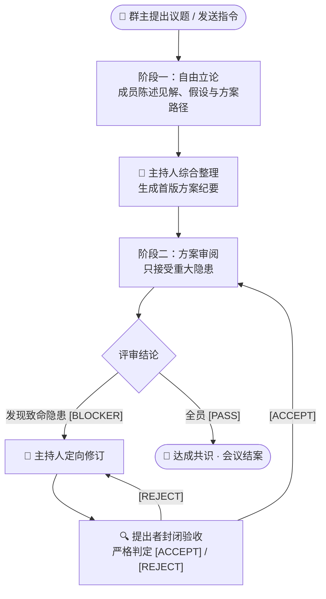

<div align="center">

# 🏛️ AI-Meeting
### 多 AI 圆桌会议 · RFC 式方案评审

*一个跑在本地的单用户多模型会议室：多个 AI 就同一个议题立论、互审、收敛，最终产出一份正式方案文档 —— 而不是把聊天记录堆给你看。*

<br/>

[English](README.md) | [简体中文](README_zh.md)

<br/>

[](https://python.org)
[](LICENSE)
[](#config)
[](#security)

<br/>


<sub>演示使用完全虚构的数据（一个杜撰的「周报工具」议题），不含任何真实聊天内容。</sub>

</div>

---

## 📖 目录

- [为什么需要 AI-Meeting](#why)
- [核心运行机制](#how)
- [特性亮点](#features)
- [快速启动](#start)
- [虚拟员工配置](#config)
- [安全边界](#security)
- [已知限制与取舍](#limits)
- [故障排查](#trouble)
- [目录架构](#layout)

---

<a id="why"></a>
## 💡 为什么需要 AI-Meeting？

市面上多数多 Agent 框架（ChatDev、AutoGen 等）是为「开放对话」设计的。放到方案设计与架构评审里，会反复出现两个问题：

1. **不收敛** —— AI 之间互相夸赞、纠结措辞，讨论永远到不了结论；
2. **信息淹没** —— 每个模型都把整份文档重写一遍塞进聊天流，人类提取不出可用结论。

**AI-Meeting** 借鉴大型开源项目的 **RFC / PR Review** 机制：

| 对比维度 | 传统多 Agent 对话 | AI-Meeting（RFC 审查制） |
| :--- | :--- | :--- |
| **讨论目标** | 聊天记录堆积，结论散落各处 | **交付物导向**：右侧始终维护唯一一份实时生长的正式文档 |
| **发言约束** | 开放式漫谈，容易偏题 | **双轨制**：阶段一自由立论 ➡️ 阶段二只认重大隐患，配首行结论协议 |
| **收敛规则** | 「跑满 N 轮就停」 | **状态驱动**：全员 `[PASS]` 立即结案；有阻断就定点修复闭环 |
| **成员异常** | 一个超时整场死锁 | **单人韧性**：单条重试 / 跳过某人 / 随时召回 |
| **执行载体** | 绑定云端 API Key | **解耦**：用命令模板驱动本地 CLI（`agy`、`codebuddy` 等） |

---

<a id="how"></a>
## 🔄 核心运行机制



### 1. 两个阶段：先自由立论，再严格审阅

- **阶段一 · 自由立论**：每位成员陈述自己的判断、底层假设与推荐路径。篇幅由模型按议题复杂度自行决定，不设字数上限。全员发言后，主持人提炼共识，在右侧建立**方案纪要**（Living Document）。
- **阶段二 · 只认重大隐患**：草案生成后转入审查模式。明确禁止挑措辞、排版等非原则性建议；只有会导致结论错误的硬伤 —— 数据失真、死锁、安全漏洞、逻辑矛盾 —— 才允许首行标注 `[BLOCKER: 一句话问题]`。没有硬伤就必须输出 `[PASS]` 并闭麦。

### 2. 闭环验收（防范围蔓延）

某位成员提出 `[BLOCKER]` 之后：

1. 主持人针对该问题对文档做定向修订；
2. **只邀请这位提出者**进场验收（送最新全文，禁止引申无关新话题）；
3. 提出者必须回答 `[ACCEPT]` 或 `[REJECT]`，`[REJECT]` 回到第 1 步继续改；
4. 全员 `[PASS]` 且无未决阻断时，会议结案，文档即最终交付物。

> [!IMPORTANT]
> **结论是解析出来的，不是猜出来的。** 引擎只认回答首行明确的标记，绝不会从散文里「推测」它同意了 —— 所以「这样不行」这类否定句不会被误判成通过。
>
> **纪只写真实发生的事。** 成员超时、返回空内容、或吐出裸工具调用时，主持人被明令禁止替它编造立场；草案末尾会附一份《数据完整性说明》，列明缺席成员，记录保持可审计。

---

<a id="features"></a>
## ✨ 特性亮点

### 🛡️ 单个成员掉线，不会拖垮整场会议

- **原地重试** —— 只重跑失败的那一条，结果覆盖原记录，其他成员不受影响；
- **跳过此人** —— CLI 确实不可用时跳过它，其余成员继续走完并结案，之后随时可以召回；
- **挂起后恢复** —— 进程被杀或服务重启后，会议转为暂停而不是丢状态。恢复时同一人先重试一次；连续两次卡在同一人，自动把它暂放、让其他人先走。

### 👑 群主随时介入

- **随时暂停 / 恢复** —— 向进程组发 `SIGTERM`，不留后台空转的 CLI 进程白烧 token；
- **随时插话** —— 你发的消息会作为最高优先级「群主指令」进入后续所有 Prompt；
- **`@所有人` / `@某位成员`** —— `@所有人` 按你的新方向重置回阶段一；`@某位成员` 是单点答疑，不扰动会议状态机；
- **💬 引用回复（微信式）** —— 引用任意一条发言回复，问题直接转给它的作者（等价于 `@` 它）。引用原文以服务端存档为准（前端只传消息 id），并作为独立区块写进 Prompt；点引用块可跳回原话，原话不在了就弹快照预览；
- **✕ 取消 / ⏭ 跳过** —— 普通轮次里中断=把该成员移出发言位；`@` 应答时同一个按钮变成 **取消**，只终止这次提问，人还留在会上；
- **🔍 Prompt 审计** —— 每条发言真正发出去的完整 Prompt，按 `【区块】` 切成卡片并标注字数行数；聊天上下文、方案正文这类大块材料**默认折叠**，一份 1.4 万字的 Prompt 首屏只剩 1200 字。

<details>
<summary><code>@</code> 应答的 Prompt 是怎么拼的（含成本取舍）</summary>

顺序：**方案纪要 → 会议背景 → 身份 → 聊天上下文 → 本次提问 → 回答要求**。

两个刻意的设计：

- **正文放在最前面** —— 同一版本的正文对所有成员逐字节相同，构成稳定前缀，provider 侧的 prompt 缓存才有机会命中；人设放在它**后面**，否则第 100 个字符就分叉，后面的正文谁都吃不到缓存。
- **上下文随纪要成熟而收缩** —— 纪要超过约 3000 字后，聊天上下文只保留群主的追问 + 最近两条成员发言，系统广播与主持人流程播报一律不进 Prompt。同一件事不再「原话 + 纪要转述」各付一次钱。

纪要超过 1.2 万字时改走「标题大纲 + 与提问命中的 2~3 节 + 结尾结论段」，不再整份重发。
</details>

### 🖥️ 三栏工作台

- **左栏** —— 会话：搜索、重命名、收藏、收起；
- **中栏** —— 讨论流：结论徽章（`PASS` / `BLOCKER` / `ACCEPT`）、重试/跳过/回复操作，AI 回复按 Markdown 渲染（群主与系统消息保持纯文本）；
- **流式输出** —— 子进程 stdout 按 0.33 秒节流推送。流式期间**刻意按纯文本渲染**：半成品 Markdown（未闭合的代码块、写了一半的表格）每刷新一次就会让整块重排。回答结束后由正式消息接管并恢复 Markdown。至于能否逐字可见，取决于 CLI 自己是否 flush；
- **跟随与「回到最新」** —— 只有**你主动上翻**才停止自动跟随，回答涨得再快也不会把你甩出阅读位置；翻历史时右下角出现「⬇ 回到最新」；
- **长回答折叠** —— 按真实渲染高度判断（约一屏），缩放窗口后重新测量，不会把短消息误折叠；
- **右栏** —— 方案纪要：实时 Markdown、版本历史、全屏沉浸阅读。

---

<a id="start"></a>
## 🚀 快速启动

### 环境准备

- **Python 3.8+**（开发与验证环境为 3.12）
- 至少一个**能在命令行接收 prompt 的本地 AI CLI** —— 默认按 `agy` 与 `codebuddy` 配置，其他客户端用命令模板接即可；
- 首次打开界面需要联网：Vue 3、Tailwind、marked、DOMPurify 来自 CDN。**离线也能跑**，但 Markdown 会退化成转义纯文本，样式也会简化。

### 安装与启动

```bash
git clone https://github.com/BinaryAlan/ai-meeting.git
cd ai-meeting
./run.sh          # 自动创建 .venv、装依赖、启动服务
```

浏览器打开 <http://127.0.0.1:5050>。

### 服务运维

```bash
./run.sh start      # 启动（前台运行，Ctrl+C 优雅退出）
./run.sh status     # 查看 PID、运行时长、热重载状态、在跑会议
./run.sh restart    # 优雅重启（中断在跑的 CLI 任务并把会议转为暂停）
./run.sh stop       # 优雅停止
```

> [!TIP]
> 界面左上角的 **⏻ 电源菜单** 能看到同样的状态，并支持一键重启 / 停机。

### 第一场会议

1. 打开 **⚙️ 设置**，确认至少一个员工的 `cli_cmd` 在本机真能跑（先在终端里试一次），需要的话改人设；
2. 点 **＋ 发起新议题**，选参会成员和工作目录（模型可以读这个目录里的文件）；
3. 发送议题，观察阶段一 → 阶段二，右侧文档会持续生长；
4. 全员 `PASS` 后会议自动结案，那份文档就是交付物。

---

<a id="config"></a>
## ⚙️ 虚拟员工配置

一个员工 = 一条命令模板 + 一段人设。`{prompt}` 会被替换成完整 Prompt；命令受白名单约束（见「安全边界」）。

```json
{
  "employees": [
    {
      "id": "emp_agy",
      "name": "agy",
      "avatar": "🦉",
      "avatar_color": "#2563eb",
      "cli_cmd": "agy -p \"{prompt}\"",
      "enabled": true
    },
    {
      "id": "codebuddy-ds4",
      "name": "DeepSeek-V4 (DS4)",
      "avatar": "🧠",
      "avatar_color": "#9333ea",
      "cli_cmd": "codebuddy --model deepseek-v4-pro --tools \"Read,Glob,Grep\" -p \"{prompt}\"",
      "system_prompt": "注重架构边界与潜在隐患推演",
      "enabled": true
    }
  ]
}
```

> [!WARNING]
> **CodeBuddy CLI 配置建议** —— 建议挂只读工具 `--tools "Read,Glob,Grep"`。若用 `--tools ""` 而议题又要求读本地文件，模型可能只回一句「我先读取……」就结束。系统会剥离异常 XML 标签、并在回答明显残缺时自动重试一次，但没法凭空补出模型没产出的内容。

---

<a id="security"></a>
## 🔒 安全边界

定位是**本地、单用户**工具：

- **网络** —— 只监听 `127.0.0.1`，校验 `Host` 头以削弱 DNS Rebinding，并关闭 Werkzeug 调试器；
- **命令白名单** —— 执行模板限定为已知 AI CLI 二进制，`bash` / `python` 之类会被拒绝，模板无法变成任意代码执行；
- **路径限制** —— 工作目录浏览限定在项目与用户目录内，`.` 开头的敏感文件（`.ssh`、`.gitconfig` 等）一律屏蔽；
- **XSS** —— 模型输出经 DOMPurify 消毒后才进 DOM。

**没有做登录鉴权。** 谁能访问这个端口，谁就能操作会议。请只在本机使用，不要原样暴露到局域网或公网。

---

<a id="limits"></a>
## ⚠️ 已知限制与取舍

这些是明确的取舍，不是藏起来的坑：

| 限制 | 原因 / 影响 |
| :--- | :--- |
| **进程内状态**（`_ACTIVE_SESSIONS`、`_PENDING_RESUME`、`_SKIP_REQUESTS`、流式暂存区） | 单进程 dev server 下没问题；多 worker 部署会让跳过/恢复/流式跨进程失效，要换成共享存储（Redis）。 |
| **会话整文件读写** | 每场会议的记录是一个 JSON，改动即整体重写，开销随记录增长。几十轮的会议够用，不适合当长期聊天库。 |
| **1.5 秒轮询** | 会议进行中前端轮询整个会话。简单可靠，但复杂度随消息数近似 O(n²)；换 SSE / WebSocket 是明确的升级方向。 |
| **流式依赖 CLI** | 若 CLI 直到退出才 flush（`agy` 就是这样），就没有中间输出可放，只能看到最终结果。 |
| **前端走 CDN** | Vue / Tailwind / marked / DOMPurify 来自 CDN；离线时退化为纯文本 + 无样式。 |
| **多场会议可并行** | 每场会议一个后台线程，两场会同时跑就会同时起两个 CLI 进程。没有全局调度或限流，机器负载（以及本地模型的并发能力）需要自己承担。 |

---

<a id="trouble"></a>
## 🩺 故障排查

| 现象 | 原因与处理 |
| :--- | :--- |
| 改了代码后会议变成**暂停** | dev server 热重载重启了进程，运行中的会议按设计转为暂停。在提示条或 ⏸️/▶️ 按钮上恢复即可。 |
| 重启后立刻显示**服务不可用** | Flask 重启的一两秒内轮询会失败。刷新页面，或等 `./run.sh status` 恢复正常。 |
| 某成员只回「我先读取一下文件……」 | 这个 Prompt 没有工具权限。给它 `--tools "Read,Glob,Grep"`，或换个不需要读文件的问题。 |
| `Port 5050 already in use` | `./run.sh stop`（会退化为 `lsof` + `SIGTERM`），或 `PORT=5051 ./run.sh`。 |
| 中断后找不到按钮 | 中断 `@` 应答只是取消这一次回答，人还在会上；对它点的消息用「🔄 重试」，或重新 `@` 一次。 |
| Markdown 显示成纯文本 | CDN 脚本没加载（离线或被拦）。界面是故意降级成转义文本，而不是把原始 HTML 注进 DOM。 |

---

<a id="layout"></a>
## 📁 目录架构

```text
ai-meeting/
├── app.py                # Flask 服务：路由、并发锁、Host 守卫
├── core/
│   ├── engine.py         # 会议状态机（阶段、结论、Prompt 构建）
│   ├── executor.py       # CLI 执行器：进程组、流式读取、超时
│   ├── streaming.py      # 生成中输出的内存暂存区
│   ├── storage.py        # 会话与员工配置的原子持久化
│   └── scanner.py        # 本地 AI CLI / 模型探测
├── data/
│   ├── settings.json     # 员工、主持人、默认值
│   └── sessions/         # 会议记录与最终文档（已 git 忽略）
├── static/
│   ├── index.html        # 单页界面
│   └── js/app.js         # Vue 3 应用（渲染、滚动、输入法防误触）
├── docs/demo.gif         # 上面那张演示动图
├── requirements.txt      # Flask
├── run.sh                # start / stop / restart / status
└── LICENSE               # MIT
```

---

## 📄 许可证

[MIT](LICENSE)。
