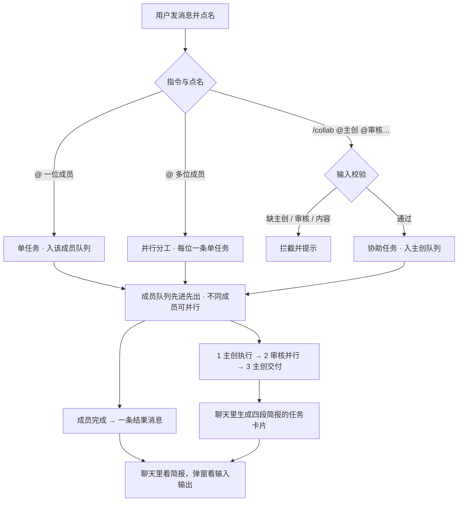

<div align="center">

# AI Atelier

### 多 AI 协同任务工作台

*把任务交给本机的一组 AI 成员：有人干活、有人只读审核、有人按意见改完再交付。聊天里看简报，右侧工作目录里拿到文件。*

<br/>

[English](README.md) | [简体中文](README_zh.md)

<br/>


<br/>


<sub>演示动图按实际使用顺序走：**一条消息并发分工给三位成员**（最后一位还在写），再到 **/collab 协助任务**的三段式卡片；每个场景停留约 3 秒、滚动用约 4 秒走完、场景之间用约 0.8 秒白场过渡（全片 64 秒），不会一闪而过。画面中的会话、成员、任务与文件均为虚构示例。</sub>

</div>

---

## 📖 目录

- [这是什么](#about)
- [快速启动](#start)
- [任务类型与分发](#tasks)
- [聊天里的任务卡片](#card)
- [消息、上下文与删除](#message)
- [工作目录与文件预览](#workspace)
- [队列、取消与重试](#queue)
- [设置与运行规程](#settings)
- [安全边界](#security)
- [测试与文档](#test)
- [目录结构](#layout)

---

<a id="about"></a>

## 💡 这是什么

AI Atelier 是一个**跑在本机的单用户多 AI 工作台**。你在一个会话里把任务交给 AI 团队成员，成员按角色分工完成工作、互相审核、交付终版。软件的目的不是生成一份「会议纪要」，而是让几个 AI 真正把活干完：结果既包括聊天里的说明，也包括它们写进工作目录的文件。

界面只有三栏，没有全局控制条：

| 区域 | 内容 |
| :--- | :--- |
| **左栏** | 会话列表：新建、改名、收藏、收起、搜索 |
| **中栏** | 聊天流：用户消息、单任务结果消息、协助任务卡片；Markdown 渲染、逐段折叠、弹窗看完整输入与原始输出 |
| **右栏** | 工作目录文件树；点文件在弹窗里预览 |

成员目前以**本机 CLI 子进程**执行（默认按 `agy` / `codebuddy` 配置，也可换成任意受支持的命令行工具）。界面与任务流程不依赖具体执行后端。完整设计见 [软件设计说明](docs/task-review-protocol.md)。

---

<a id="start"></a>

## 🚀 快速启动

### 准备

- **Python 3.8+**（开发与验证环境为 3.12）
- 至少一个能接收 prompt 的**本地 AI CLI**；「设置 → 成员管理 → 添加成员」会扫描本机已安装的 CLI 与可用模型，命令模板自动生成，也可手工改

> [!NOTE]
> 目前唯一执行后端是本地 CLI 子进程，远程模型 API 尚未接入。

### 安装与运行

```bash
git clone https://github.com/BinaryAlan/ai-atelier.git
cd ai-atelier
./run.sh          # 自动创建 .venv、安装依赖、启动服务
```

浏览器打开 <http://127.0.0.1:5050>。`run.sh` 首次运行会建虚拟环境并安装 `requirements.txt`（只依赖 Flask）。

```bash
./run.sh start      # 前台启动（Ctrl+C 优雅退出）
./run.sh status     # PID、运行时长、进行中任务、热重载状态
./run.sh restart    # 重启（进行中的任务标记已取消，可从卡片重试）
./run.sh stop       # 优雅停止
./run.sh dev        # 开发模式：开启热重载
./run.sh logs       # 跟踪服务日志（restart 拉起的实例输出写 .run/service.log）
```

### 第一个任务

1. **⚙️ 设置 → 成员管理**：确认至少两位可用成员；
2. **＋ 新建会话**：选择成员和工作目录（成员可读取该目录里的资料）；
3. 发一条 `@gemini-3.8 帮我整理这份资料的大纲`（单任务），或 `/collab @gemini-3.8 @ds-4.1 @hy4-free 把这份资料整理成可执行方案`（协助任务）；
4. 单任务看结果消息，协助任务直接在聊天里看卡片；产出的文件在右栏。

---

<a id="tasks"></a>

## 🔄 任务类型与分发

任务类型由指令与点名方式决定。

**单任务** —— `@` 一位成员，请它做一件事。任务进入该成员的队列独立完成，输出一条结果消息（Markdown 正文 + 产物信息），消息上直接挂「取消 / 重试 / 重新生成」。

不写 `@` 也可以：默认发给本场会话里最近一位回过话、且仍然可用的成员，连着追问不用反复点名。会话里还没有 AI 说过话时，消息只作为上下文保留。

**并行分工** —— 一条普通消息 `@` 了两位及以上成员时，每位各建一条单任务，各写各的、各出一条结果消息。它们天然并行（不同成员互不阻塞）、互不牵连（一位失败不影响其他人，重试各点各的），彼此的答案也互不可见，避免趋同。产物同在一个工作目录，所以每份都要求文件名带自己的前缀（如 `DS4-北京攻略.md`）。发送前输入框会提示「将分别发给 A、B、C：各自独立作答，互不参考」；被点名的成员若已停用或缺 CLI 配置，整条消息会被拦下。

**协助任务** —— 用 `/collab` 发起，固定**一轮**三个环节：主创执行 → 多位审核并行 → 主创交付。输入严格校验：必须显式指定一位主创、其后至少一位审核成员、并写上任务内容，缺任一项都会拦下并提示。提及可以散落在句子里，也兼容 `@DS4`、`@//agy/`、`@DeepSeek-V4 (DS4)` 等写法。



| 环节 | 做什么 | 卡片上的入口 |
| :--- | :--- | :--- |
| **1 主创执行** | 主创在工作目录完成工作，给出简短结果与产物清单 | 取消 / 重试执行 / 重新执行 |
| **2 成员审核** | 每位审核成员只读地阅读真实产物，独立并行给出意见 | 每人各自：取消 / 重试审核 / 重新审核 |
| **3 主创交付** | 主创拿到全部意见，按自己的判断改一遍，交付终版 | 取消交付 / 重试交付 / 重新生成交付 |

用户原话（去掉指令前缀与提及）原样作为任务上下文；软件不解析任务目标、不设置验收标准。审核成员一律**只读**，不改主创产物。个别审核失败、超时、被取消或无意见时，卡片记录状态，主创仍然交付。

**审核标准**（`prompts/roles/reviewer.md`）：① **审视隐患与漏洞** —— 查逻辑自洽性、边界条件、实操可用性上的硬伤，边界条件不限于程序，方案看约束变化 / 落地断点，产品设计看用户分层 / 边缘流程；② **鼓励新意与巧思** —— 主创解法中规中矩时直接提出更巧妙、体验或效率更优的替代思路，可以是尚未落盘的设想，标明可选与代价；③ **精简实用，言之有物** —— 篇幅不设上限，但杜绝套话空泛理论，每条必须能定位、可实操；④ **达标即过** —— 产物已足够优秀就写 `[通过]` 并简述亮点，严禁硬挤琐碎细节。判定基准按「用户原话 > 产物自述 > 通用底线」排序，软件不替用户设置任务级验收标准。`[通过]` 会一路传到卡片（绿色「通过」标签）、流水与主创输入（标注「无需改动」），避免主创为达标意见硬找改动。规程文件在每次执行时现场读取，点「重新审核」会按当前规程重新拼一份完整输入，**不复用上一次的输入快照**；历史快照只作留档，不会发给模型，界面也不对规程版本做额外标注。

---

<a id="card"></a>

## 🗂️ 聊天里的任务卡片

协助任务一创建，卡片就出现在聊天流里，**不用点开弹窗就能看完一轮**：

- **头部**：任务目标、整体状态、创建时间、总耗时、参与人数、产物个数、三步进度与「n/m 已完成」。点头部横栏收起 / 展开整张卡片，收起时头部与底部流水仍可见，排版与展开时一致（约 8 行）。
- **一段一个角色**：🎯 主创执行、🤝 每位审核各一段、📦 主创交付。每段给出状态、开始时刻与用时、Markdown 简报（超长时按原排版裁到约 8 行，保留标题与列表）、以及这一段的三个按钮：`展开全文 / 收起`、`输入输出 ›`、`重新执行 / 重新审核 / 重新生成交付`（运行中是「取消」）。审核成员判定「达标即过」时，该段另挂一个绿色「通过」标签。点正文只折叠，只有「输入输出」会弹窗。
- **底部**：最新一条流水 + 「完整任务详情」。

**审核补全后自动补一次交付**：重跑任意一位审核后，只要所有审核都出了结论（已完成 / 无意见），系统自动按最新意见重出一次终稿，并在交付段挂上「↻ 审核补全后重新生成」标签（悬停可看重出时刻）；流水里也写明这一步是系统补的。多位审核并发重跑只补一次。只要还有审核失败 / 超时 / 被取消，就不自动补，只标「意见已更新 · 终稿待重新生成」，由用户点「重新生成交付」决定。用户自己点重出后，标签回到手动来源。

**两个弹窗分工**：

- 每段的「输入输出 ›」——本轮实际发给模型的完整 Prompt 与原始输出，顶部显示**开始 / 返回时刻与用时**；末尾的产物登记 JSON 会收进可折叠的「产物登记数据」，不混在正文里。历次执行记录也走同一个弹窗，方便复盘。
- 「完整任务详情」——三步进度、产物清单、终版摘要、主创对审核意见的处理说明、实时流水、历次执行记录与每一段的取消 / 重试入口。

任务状态：排队中 / 执行中 / 已交付 / 已取消 / 失败 / 超时；成员位置另有 等待 / 进行中 / 已完成 / 失败 / 已取消 / 超时 / 无意见。

---

<a id="message"></a>

## ✉️ 消息、上下文与删除

- AI 输出按 **Markdown** 渲染（标题、列表、引用、表格），模型输出经 DOMPurify 消毒后才进 DOM；Mermaid 代码块渲染成流程图，组件按需从本地 `static/vendor/` 加载。
- 引用回复把被引用的原话一起交给成员，引用块可跳回原消息；原消息不在时显示保存的快照。
- 长内容按渲染后高度默认折叠，给「展开全文 / 收起」。
- 每条消息有删除入口：**用户自己的消息在左上角，其余消息与任务卡片在右上角**，默认不显示，只有鼠标移到那一小块角落热区才浮出 ✕，点击需确认。
- **删除的边界**：删除是物理移除，之后发起的新任务（以及点了重试后重新拼的 Prompt）不会再带上这条内容；但**已经跑完的任务**里保存的 `sent_prompt` 是发送当时的快照，点开「输入输出」仍能看到它——那是执行记录，不该被事后改写。
- 输出协议要求模型**先写正常正文**，需要登记产物时再在末尾附一个 JSON 代码块；服务端会把登记块从正文里摘掉，聊天里看到的永远是给人读的文字，不是 JSON。

---

<a id="workspace"></a>

## 📁 工作目录与文件预览

每个会话绑定一个工作目录，AI 在其中读写文件；主创输出产物清单，软件据此列出本次产物。右侧面板点文件即在弹窗里预览：

- Markdown：表格、代码块、标题按正常排版渲染，`mermaid` 围栏代码块直接出图；
- 图片走本地 `raw` 接口显示；其他文本按等宽文本展示；
- 超过 500KB 的文件给出提示，不硬塞进弹窗；可一键复制完整路径。

成员能否写文件由「设置 → 成员管理」里的**读写权限**决定，审核环节一律只读。开启后服务端按 CLI 类型自动补参数（`agy` 加 `--dangerously-skip-permissions`，`codebuddy` 补 `-y` 与 `Write/Edit/Bash` 工具），不需要手改命令模板。**写权限默认关闭**。

CLI 子进程使用**环境变量白名单**启动：宿主机注入的 `SERVER__PORT`、代理、沙箱变量等不会传进去，避免 CLI 抢宿主端口报 `EADDRINUSE`。

---

<a id="queue"></a>

## ⏳ 队列、取消与重试

- 每位成员一个先进先出队列：同一成员串行，不同成员并行；审核由任务直接发起，不同审核成员可同时跑，某位忙时等它当前任务结束。界面显示排队位置。
- **取消**只出现在正在输出的消息或正在进行的环节上，立即向进程发终止信号；已写入的文件保留、不回滚、无确认弹窗，输入框即刻可用。
- **重试**只重跑被点击的那一次执行，沿用原输入与同一工作目录，不新增任务、不增加流程轮次。重跑主创执行会让审核与交付按流程重新推进；重跑审核只更新该位成员的意见（结论齐全时自动补一次交付）。
- 任务与队列随会话持久化。刷新页面不改变运行中的任务；服务重启后，进行中的任务标记已取消并可从被中断的环节重试，排队任务重新拉起。

---

<a id="settings"></a>

## ⚙️ 设置与运行规程

设置只有三部分：**成员管理**、**界面语言**（简体中文 / English，切换即生效）、**服务**（PID、运行时长、进行中任务、热重载，一键重启 / 停止）。

**成员管理**负责「这个成员用哪个模型、怎么执行」：

| 项 | 说明 |
| :--- | :--- |
| 名字 / 头像 / 人设 | 名字可以是 `gemini-3.8` 这种带空格的写法，`@` 点名同样能匹配 |
| 模型 | 添加成员时扫描本机已装 CLI 与模型；下拉框可搜索，也可勾选「只看免费」过滤 |
| 推理程度 | 同一模型的高 / 中 / 低不拆成三个模型，选中后在下方单选；各 CLI 分别落到自己的参数上（`agy` 变体、`--effort`、`-c model_reasoning_effort=`、`opencode --model id#level`） |
| CLI 模板 | 由上面两项自动生成，保留 `{prompt}` 占位；也可手工改，但二进制必须在白名单里 |
| 读写权限 / 超时 | 写权限默认关闭，单成员可设单次超时，也可批量开关写权限 |

会话里还能临时改：点聊天右上角的「会话成员」，选某位成员即可调整它在这个会话的推理程度——**只对当前会话生效**，不影响成员本身的配置。

随软件提供的一组规程文本，服务端拼输入时加入，告诉成员当前处于哪个环节、该输出什么：

| 文件 | 用途 |
| :--- | :--- |
| `prompts/protocol/task-flow.md` | 协作流程与环节顺序 |
| `prompts/roles/single.md` | 单任务成员：完成这一件事，输出正文与产物登记 |
| `prompts/roles/owner.md` | 主创：完成工作、登记产物、按审核意见修订并交付 |
| `prompts/roles/reviewer.md` | 审核成员：只读、四条审核标准、`[通过]` 判定与登记块 |

---

<a id="security"></a>

## 🔒 安全边界

定位是**本地、单用户**工具：

- **网络**：只监听 `127.0.0.1`，校验 `Host` 头削弱 DNS Rebinding，关闭 Werkzeug 调试器；
- **命令白名单**：CLI 执行模板限定为已知 AI CLI 二进制，`bash` / `python` 之类会被拒绝，模板无法变成任意命令执行；子进程环境走白名单；
- **路径限制**：工作目录浏览限定在项目与用户目录内，`.ssh`、`.gitconfig` 等点开头的敏感路径被屏蔽；
- **写权限默认关闭**：开启后成员可改动工作目录、执行命令，请只在可信目录启用；
- **XSS**：模型输出经 DOMPurify 消毒，原始 HTML 不会直接注入页面。

> [!WARNING]
> **没有登录鉴权。** 能访问这个端口的人就能操作会话，包括打开写权限。请只在本机使用，不要原样暴露到局域网或公网。

---

<a id="test"></a>

## 🧪 测试与文档

```bash
.venv/bin/python -m unittest discover -s tests -v
```

当前 **189 项测试全部通过**，覆盖指令解析（含带空格成员名）、队列与并行、三环节流程、取消 / 重试、审核补全自动交付、审核规程四条标准、`[通过]` 判定链路与「重审按当前规程重拼输入」、服务重启恢复与结果消息状态同步、只读审核、CLI 注册表与命令模板、环境变量白名单、消息删除与上下文（超长内容保留头尾与最近一条）、文件预览接口与 HTTP 端点。逐条核对见 [验收记录](docs/acceptance.md)（A1–A83），设计细节见 [软件设计说明](docs/task-review-protocol.md)。

---

<a id="layout"></a>

## 📁 目录结构

```text
ai-atelier/
├── app.py                       # Flask 服务：接口、Host 守卫、静态资源与缓存策略
├── core/
│   ├── tasks.py                 # 任务状态机、成员 FIFO 队列、上下文拼装、卡片构建
│   ├── executor.py              # CLI 子进程、命令/环境白名单、超时与取消
│   ├── storage.py               # 会话与设置的原子持久化
│   ├── cli_registry.py          # CLI 注册表：扫描方式、命令模板、写权限参数、环境变量
│   └── scanner.py               # 本机已装 CLI 与模型探测（带缓存）
├── prompts/
│   ├── protocol/task-flow.md    # 协作流程规程
│   └── roles/                   # 单任务 / 主创 / 审核成员规程
├── data/
│   ├── settings.json            # 界面语言与成员列表
│   ├── scanned_models.json      # 扫描到的 CLI / 模型缓存（git 忽略）
│   └── sessions/                # 会话、消息、任务与队列（git 忽略）
├── static/
│   ├── index.html               # 单页界面
│   ├── js/app.js                # Vue 3 应用
│   ├── js/i18n.js               # 英文界面词典
│   └── vendor/                  # Vue / Tailwind / marked / DOMPurify / Mermaid（本地离线）
├── docs/
│   ├── demo.gif                 # 演示动图（中文界面）
│   ├── demo-en.gif              # 演示动图（英文界面）
│   ├── task-review-protocol.md  # 软件设计说明
│   └── acceptance.md            # 验收标准与逐条核对
├── tests/                       # 任务系统、执行器、消息删除、文件预览测试
├── requirements.txt             # Flask
├── run.sh                       # start / dev / stop / restart / status / logs
└── LICENSE                      # PolyForm Noncommercial 1.0.0
```

---

## 📄 许可证

[PolyForm Noncommercial License 1.0.0](LICENSE) —— 仅允许个人、研究、教学及其他非商业用途；**未经版权方另行授权，不得用于商业用途**。
