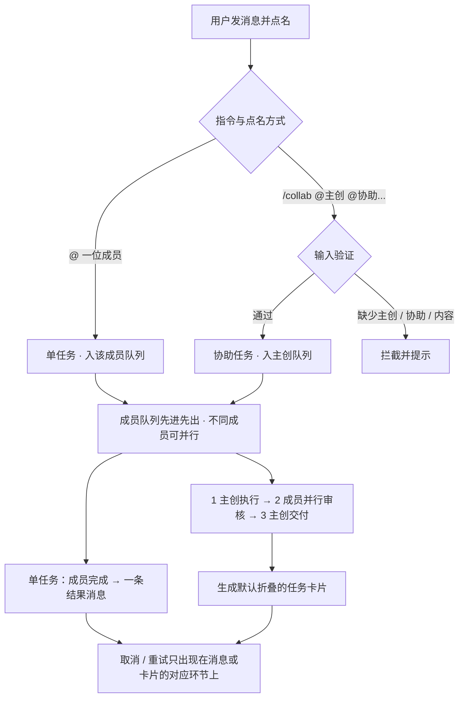

<div align="center">

# AI-Meeting

### 多 AI 协同任务工作台

*一个在本机运行的多 AI 协同工作台：把任务交给 AI 团队成员，成员各司其职地执行、互相审核、交付结果。*

<br/>

[English](README.md) | [简体中文](README_zh.md)

<br/>


-blueviolet?style=flat-square)


</div>

---

## 📖 目录

- [软件是什么](#about)
- [两类任务](#tasks)
- [任务卡片](#card)
- [队列、取消与重试](#queue)
- [工作目录与权限](#workspace)
- [设置](#settings)
- [运行规程](#protocol)
- [快速启动](#start)
- [安全边界](#security)
- [目录架构](#layout)

---

<a id="about"></a>

## 💡 软件是什么

AI-Meeting 是一个在本机运行的多 AI 协同工作台。用户在一个聊天会话里把任务交给 AI 团队成员，成员按各自的角色干活、互相审核、交付结果。

软件的目的不是生成一份方案文档，而是让多个 AI 各司其职地协同完成工作。聊天窗口是协作现场，右侧面板只保留工作目录，作为协作过程中文件产出与浏览的共享载体；一次协作的结果既包括聊天里的说明，也包括 AI 在工作目录里产出的文件。

界面由三部分组成：

- **左栏** —— 会话列表：新建、重命名、收藏、收起，可搜索；
- **中栏** —— 消息与任务卡片：结果消息、默认折叠的协助任务卡片、引用回复、Markdown 渲染、长内容折叠、完整输入与原始输出查看；
- **右栏** —— 工作目录文件树与浏览，不设全局控制条。

AI 成员当前以本机命令行工具执行，后续也会支持指向远程模型服务。界面与任务流程不依赖具体的执行方式。完整设计见 [软件设计初稿](docs/task-review-protocol.md)。

---

<a id="tasks"></a>

## 🔄 两类任务

任务类型由用户的指令与点名方式决定。

**单任务**：`@` 一位成员，请它做一件事。任务进入该成员的队列，由它独立完成，输出一条结果消息（简短说明 + 产物清单）。

**协助任务**：用 `/collab` 发起，格式为 `/collab @主创 @协助成员1 [@协助成员2...] 任务内容`。输入时严格校验：必须显式指定一位主创，其后至少一位协助成员，并写上任务内容；缺任一项都会拦截提示。协助任务固定一轮：



| 环节 | 内容 | 卡片上的操作 |
| :--- | :--- | :--- |
| **1 主创执行** | 主创在工作目录完成工作，给出简短结果与产物清单 | 取消；失败、超时或已取消后重试 |
| **2 成员审核** | 指定协助成员各自阅读真实产物，独立并行给出意见或建议 | 每位成员位置各自取消 / 重试 |
| **3 主创交付** | 主创拿到全部意见，按自己的判断做一次修改，交付终版 | 重试并重新生成交付内容 |

用户消息原文（去除指令前缀后）作为任务上下文原样提供给参与成员，成员自行理解要做什么。主创向审核成员转交任务时，软件只转交原话与产物信息，不解析任务目标、不设置验收标准。参与审核的成员一律以只读方式执行，不改主创的产物。个别成员失败、超时、被取消或没有给出意见时，卡片标记状态，主创仍然交付。

---

<a id="card"></a>

## 🗂️ 任务卡片

协助任务创建时卡片即出现在聊天窗口，默认折叠；外壳实时显示任务摘要、整体状态、当前环节进度、耗时流水与参与成员状态点。点击弹出窗口，分两部分：

- **第一部分 · 主创做了什么** —— 执行简报、产物清单、终版改动说明，以及主创对审核意见的处理说明；
- **第二部分 · 协助审核** —— 每位成员各占一个位置，显示审核状态与意见，点开可看完整内容与原始输出。

各环节历次执行记录都保留，弹窗内可按记录查看当时的完整输入与原始输出。状态包括：排队中 / 执行中 / 已交付 / 已取消 / 失败，卡片里的成员还有 等待 / 进行中 / 已完成 / 失败 / 已取消 / 超时 / 无意见。

其他消息能力：引用回复把被引用的原话一起交给成员，引用块可跳回原话（原话不在时显示快照）；长内容按真实渲染高度默认折叠；每条 AI 输出都能查看发给它的完整输入和它的原始输出；AI 输出经 Markdown 渲染。

---

<a id="queue"></a>

## ⏳ 队列、取消与重试

- 每位成员一个先进先出队列，同一成员的任务串行执行，不同成员之间互不阻塞、可并行；审核环节由任务直接发起，不同审核成员可同时并行，若某成员正忙则等它当前任务结束再串行执行。界面显示成员的排队位置。
- **取消** 只出现在正在输出的消息或正在进行的环节上。点击立即向执行进程发送终止信号，已写入的文件自然保留、不强制回滚，无弹窗打扰，输入框即刻恢复就绪。
- **重试** 出现在「失败」「已取消」「超时」的消息或环节上，按原输入重跑被点击的那一次执行，不新增任务、不增加流程轮次。重跑主创执行后，审核与交付按流程重新推进；重试审核只更新该成员的意见，需要更新终版时点主创交付的重试。
- 任务与队列随会话保存。刷新页面不改变正在执行的任务；服务重启后，进行中的任务标记为已取消，可在卡片里从被中断的环节重试，排队任务会重新拉起。

---

<a id="workspace"></a>

## 📁 工作目录与权限

每个会话对应一个工作目录，AI 在其中读写文件。主创输出产物清单，软件据此列出本次产生的文件；右栏文件树可直接浏览与查看内容。

成员能否写文件由设置里的读写权限决定，协助任务的审核环节一律只读。开启写权限后，服务端按 CLI 类型自动补参数（`agy` 加 `--dangerously-skip-permissions`，`codebuddy` 加 `-y` 并把 `Write/Edit/Bash` 补进 `--tools`），不需要手改命令模板。**写权限默认关闭**，请只在本机、目录可信时开启。

---

<a id="settings"></a>

## ⚙️ 设置

设置只有三部分：

- **成员管理** —— 添加与编辑成员，配置名字、头像、人设、命令行模板、读写权限、单次超时；可直接批量开启 / 关闭写权限；
- **界面语言** —— 简体中文 / English，切换后立即生效；
- **服务** —— 查看运行状态（PID、运行时长、进行中任务、热重载），一键重启 / 停止。


---

<a id="protocol"></a>

## 📜 运行规程

随软件提供的一组文本，服务端在拼装输入时加入，告诉成员当前处于哪个环节、应该输出什么：

| 文件 | 用于 |
| :--- | :--- |
| `prompts/protocol/task-flow.md` | 描述协作流程与环节顺序 |
| `prompts/roles/single.md` | 单任务成员：完成这一件事，输出简短结果与产物清单 |
| `prompts/roles/owner.md` | 主创：完成工作、输出产物清单、根据审核意见做一次修改并交付 |
| `prompts/roles/reviewer.md` | 审核成员：只读、阅读真实产物、给出意见或结果 |

规程里约定的结构化输出由服务端解析；解析不到时按纯文本展示，不影响交付。

---

<a id="start"></a>

## 🚀 快速启动

### 环境准备

- **Python 3.8+**（开发与验证环境为 3.12）
- 至少一个**能在命令行接收 prompt 的本地 AI CLI** —— 默认按 `agy` 与 `codebuddy` 配置，其他客户端用命令模板接即可

> [!NOTE]
> **关于执行后端**：目前只实现了「本地 CLI 子进程」这一种执行方式，后续会加入 API 远程调用。

### 安装与启动

```bash
git clone https://github.com/BinaryAlan/ai-meeting.git
cd ai-meeting
./run.sh          # 自动创建 .venv、装依赖、启动服务
```

浏览器打开 <http://127.0.0.1:5050>。

### 服务运维

```bash
./run.sh start      # 启动（前台运行，Ctrl+C 优雅退出）
./run.sh status     # 查看 PID、运行时长、进行中任务
./run.sh restart    # 重启（进行中的任务标记为已取消，可在卡片里重试）
./run.sh stop       # 优雅停止
./run.sh dev        # 仅开发时用：开启热重载
```

**设置 → 服务进程** 能看到同样的状态，并支持在网页里一键重启 / 停机。

### 第一个任务

1. 打开 **⚙️ 设置 → 成员管理**，确认至少有两位可用成员；
2. 点 **＋ 新建会话**，选成员和工作目录（成员可以读这个目录里的文件）；
3. 发一条 `@agy 帮我整理这份资料的大纲`，或者发 `/collab @agy @DS4 @HY4 把这份资料整理成可执行方案`；
4. 单任务看结果消息，协助任务点开卡片看主创做了什么与各位成员的审核意见；右栏可查看产出的文件。

### 测试与验收

```bash
.venv/bin/python -m unittest discover -s tests -v
```

测试覆盖任务解析、队列、三环节流程、取消与重试、服务重启恢复、只读审核与 HTTP 接口。逐条核对结果见 [验收记录](docs/acceptance.md)。

---

<a id="security"></a>

## 🔒 安全边界

定位是**本地、单用户**工具：

- **网络** —— 只监听 `127.0.0.1`，校验 `Host` 头以削弱 DNS Rebinding，并关闭 Werkzeug 调试器；
- **命令白名单** —— 在当前 CLI 后端下，执行模板限定为已知 AI CLI 二进制，`bash` / `python` 之类会被拒绝，模板无法变成任意代码执行；
- **路径限制** —— 工作目录浏览限定在项目与用户目录内，`.` 开头的敏感文件（`.ssh`、`.gitconfig` 等）一律屏蔽；
- **写权限默认关闭** —— 成员默认只读，开启后可改动工作目录里的文件、执行命令，请只在可信目录上启用；
- **XSS** —— 模型输出经 DOMPurify 消毒后才进 DOM，原始 HTML 不会直接注入页面。

**没有做登录鉴权。** 谁能访问这个端口，谁就能操作会话（包括打开写权限）。请只在本机使用，不要原样暴露到局域网或公网。

---

<a id="layout"></a>

## 📁 目录架构

```text
ai-meeting/
├── app.py                     # Flask 服务：接口、Host 守卫、缓存策略
├── core/
│   ├── tasks.py               # 任务状态机、成员 FIFO 队列、输入拼装、卡片构建
│   ├── executor.py            # CLI 子进程执行、超时、取消、写权限
│   ├── storage.py             # 会话与设置的原子持久化
│   └── scanner.py             # 本地 AI CLI / 模型探测
├── prompts/
│   ├── protocol/task-flow.md  # 协作流程规程
│   └── roles/                 # 单任务 / 主创 / 审核成员规程
├── data/
│   ├── settings.json          # 界面语言与成员列表
│   └── sessions/              # 会话、消息、任务与队列（已 git 忽略）
├── static/
│   ├── index.html             # 单页界面
│   ├── js/app.js              # Vue 3 应用
│   ├── js/i18n.js             # 英文界面词典
│   └── vendor/                # Vue / Tailwind / marked / DOMPurify（本地提供）
├── docs/
│   ├── task-review-protocol.md# 软件设计初稿
│   └── acceptance.md          # 验收标准与逐条核对
├── tests/test_tasks.py        # 任务系统自动化测试
├── requirements.txt           # Flask
├── run.sh                     # start / dev / stop / restart / status
└── LICENSE                    # PolyForm Noncommercial 1.0.0
```

---

## 📄 许可证

[PolyForm Noncommercial License 1.0.0](LICENSE) —— 仅允许个人、研究、教学及其他非商业用途；**未经版权方另行授权，不得用于商业用途**。
