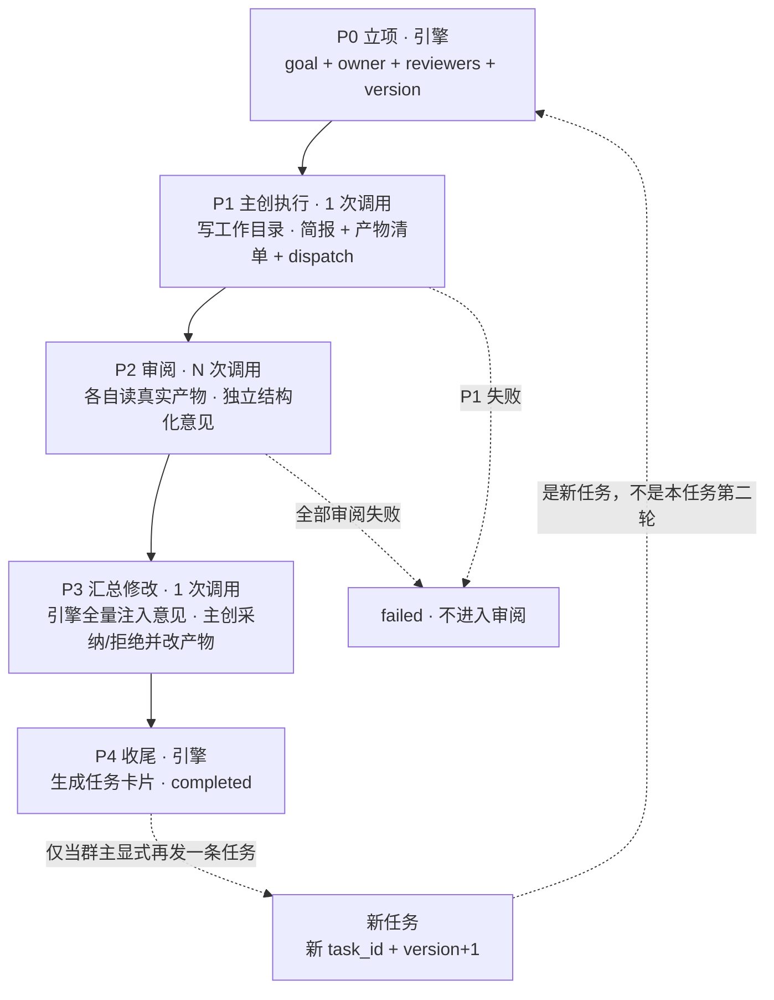
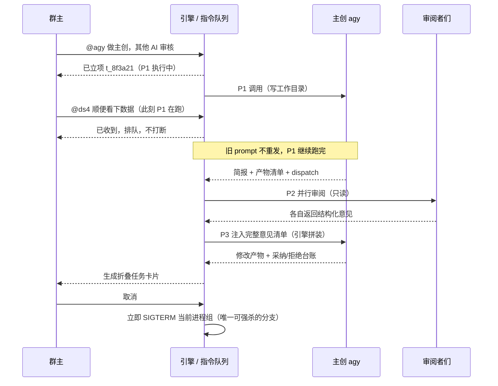
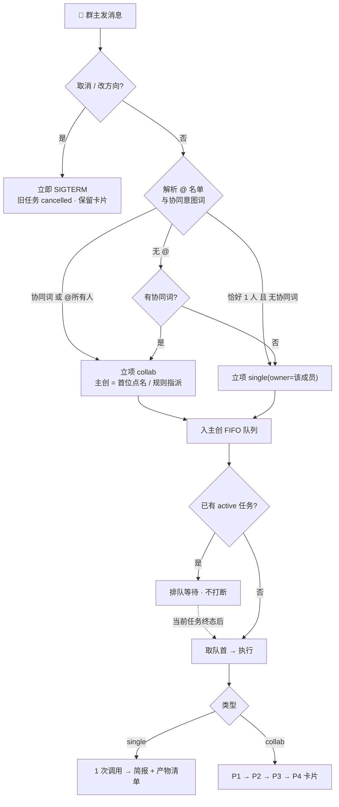

# AI 团队任务协议 v2.0：单任务 / 协助任务（详细设计）

> 状态：**详细设计，待确认 2 项（§15）**。本文定义流程、数据契约与落地拆分，**未改动任何运行时代码**。
> 本文**推翻 v0.1**（「主持人调度 + 多轮审阅直到一致」）。推翻记录见 §0。
> 一句话定位：**聊天会话是容器，任务是调度单位**。群主把任务交给 AI，AI 干活、互相审阅、交付结果；方案文档不是目的，多 AI 协同工作才是。

> 说明：原文里的 `@//agy/` 写作形式按「点名 agy 这位成员」理解，本文统一记作 `@agy`。

---

## 0. v1 → v2 变更摘要

| 维度 | v0.1（推翻） | v2.0（本文） |
| :--- | :--- | :--- |
| 主持人 | 有：识别意图、指派主创、排审阅顺序、把麦交回、判定收敛 | **无**。流程骨架归引擎，阶段内调度归主创 |
| 责任链 | 群主 → 主持人 → 主创 / 审阅者 | 群主 → 主创（执行 + 调度 + 负全责）→ 审阅者 |
| 流程形状 | 多轮循环，直到「达成一致」 | **固定 4 阶段流水线，修改一次即收工，无下一轮** |
| 收敛判定 | DRI 否决制 + BLOCKER 台账 + 用户确认 | **不需要**。P3（汇总修改）完成即终态 |
| 任务单位 | 会话级单一任务 + 轮次 | 任务表 + **每成员 FIFO 队列** |
| 任务分类 | 无（只有「明确 / 不明确指示」两种立项入口） | **单任务 / 协助任务** |
| 输出形态 | 聊天流里逐条消息 | **结构化任务卡片**：默认折叠，点击 pop 弹窗 |
| 模型调用数 | 不定：每轮 `N+2`，轮数由收敛决定 | **固定 `N+2`**（N = 审阅人数），可预算 |
| 指导层（skill） | 建议三层拆分，含主持人规程 | 按定义明确为**注入 prompt 的运行规程**：系统 / 主创 / 审阅者 |

**为什么推翻**：v0.1 有一个无法同时满足的矛盾 —— 主创有「不认同可以不做」的否决权，却又要求「直到大家达成一致」。它逼出了收敛判定、轮次上限、分歧升级、意见台账这一整套复杂度。v2 用「只做一次、不追求一致」直接把矛盾消掉，顺带把主持人这个不产出、只传话的中间层去掉，责任链从三跳缩到一跳。这是更简洁、也更可实现的模型。

---

## 1. 结论：设计成立，但必须补 4 条约束

**认同**。相对 v0.1，这一版在四个地方明显更优：

1. **责任链最短**：立项人 = 执行人 = 调度人 = 最终负责人，不存在「调度的人不干活、干活的人不负责」。
2. **流程有界**：固定阶段数让调用数、耗时、token 都能预先算出来，不会出现无限循环或「假收敛」。
3. **队列语义明确**：「用户随意 @」和「任务不丢」可以同时成立，比 v0.1 依赖「消息恰好在轮次边界被消费」的巧合更可靠。
4. **输出结构化 + 默认折叠**：正面解决聊天区被长输出淹没的问题，且项目已有长消息折叠、prompt 查看器弹窗、引用跳转等组件可以直接复用。

但如果不加以下 4 条约束，流程会退化，写在这里作为 v2 的**硬约束**：

| 约束 | 不补会怎样 | 落点 |
| :--- | :--- | :--- |
| **A. 流程骨架归引擎，调度微调归主创** | 「agy 根据提前定义的流程调度」被实现成「让模型自己决定下一步」，又变回不可预测的多轮 | §5、§6 |
| **B. 意见的数据权归引擎，不归主创** | 主创既当运动员又当裁判：它可以只挑自己认同的意见转发，part_b 的审核结果就成了摆设 | §5 P2/P3、§8 |
| **C. 立项指派必须有确定性规则** | 主持人被删掉后，「没点名谁做」和「谁来当主创」没人接，任务卡在立项 | §3.1 |
| **D. 阶段消息落盘，只是默认不渲染** | 折叠卡片若只存一份聚合文本，会丢掉 Prompt 审计、引用回复、失败重试这三项现有能力 | §8、§9 |

---

## 2. 角色与名词

**v2 无主持人**：没有任何角色专职做意图识别、调度、收敛判定或把麦交来交去。立项由规则 + 引擎完成，阶段内分派由主创完成，流程推进由引擎状态机完成。

| 角色 | 职责 | 不做什么 |
| :--- | :--- | :--- |
| **群主（用户）** | 下任务、@ 点名、追加要求、取消、改方向、验收 | 不做流程调度 |
| **主创（Owner / DRI）** | 干活并写工作目录；在协助任务里**额外负责调度**（指定审阅者及侧重）；汇总意见做一次修改并给出采纳/拒绝理由；对产物负全责 | 不增加阶段、不发起第二轮、不删减审阅意见 |
| **审阅者（Reviewer）** | 读**真实产物**，独立给出结构化意见与优化建议 | **只读**，不改文件，不看其他审阅者的意见（防从众） |
| **引擎（服务端）** | 立项与指派、持有队列与状态机、拼装 prompt、收集意见、生成卡片、处理中断/超时/落盘 | 不做语义判断；不把模型散文当结构化数据用 |

**没有主持人之后，原来主持人干的活怎么分**

| 原职责 | v2 归属 |
| :--- | :--- |
| 识别用户意图、改派主创 | 规则短路 + 引擎确定性指派（§3.1、§7），必要时回显让用户一句话改派 |
| 排审阅顺序、把麦交回 | 引擎固定流水线 + 主创在 P1 输出的 `dispatch` 微调（§5、§6） |
| 判定收敛 | **取消**。P3 完成即收工，不需要判定 |
| 梳理纪要 / 定稿 | **降级为引擎产物索引**：右侧文档面板由 `part_a.artifacts` 自动汇总，不再单独调模型写纪要。旧 `document` 字段保留用于旧会话读取 |

配置里的 `moderator` 对象保留为兼容字段（旧会话、Prompt 审计需要），但**新流程不再调用它，也不把它列为可 @ 的调度对象**。

---

## 3. 任务模型

### 3.1 两类任务与判定

**规则优先，不为分类单独调一次模型**（省一次调用、低延迟、可预测）。

| 类型 | 触发 | 参与人 | 结果 |
| :--- | :--- | :--- | :--- |
| **单任务 `single`** | 消息里 `@` 了恰好一位成员，且**不含协同意图词** | 只有该成员 | 1 次调用；简报 + 产物清单；不生成任务卡片 |
| **协助任务 `collab`** | 含协同意图词（`主创 / 审核 / 审阅 / 其他 AI / 大家 / 一起 / 协助 / 其他人提意见 / review / all hands…`）或 `@所有人`，无论有没有点名 | 主创 + N 位审阅者 | `N+2` 次调用；生成结构化任务卡片 |

**判定顺序**（命中即停）：

1. 取消词 / 改方向词 → 立即中断（§7），不立项；
2. `@所有人` 或协同意图词 + 点名 → `collab`，被点名的**第一位**为主创，其余启用成员为默认审阅者；
3. `@` 恰好一位 + 无协同词 → `single`，该成员为执行人；
4. 无 `@` + 有协同词 → `collab`，主创走**确定性指派**；
5. 无 `@` + 无协同词 → 默认 `single`，执行人走**确定性指派**。

**确定性指派规则（约束 C）**，按顺序取第一个可用者：

1. 任务关键词与成员 `system_prompt` / 人设标签匹配度最高者；
2. 会话 `employee_ids` 中第一个 `enabled && write_access` 的成员（主创要能干活）；
3. 第一个 `enabled` 成员；
4. 都没有 → 不立项，回显一条「没有可用成员，请先在设置里启用」。

指派结果**必须在聊天里回显一句**：`已把任务交给 [X]；想换人直接 @ 另一位`。用户 `@` 另一位即改派（在阶段边界生效，不打断）。这是把主持人「自己指定并说明理由」的职责用零成本规则替代。

> 未点名时默认走 `single` 而不是 `collab`，是为了避免一句随口的话就启动全队、烧掉 `N+2` 次调用。该默认值做成设置项 `collab.default_type_when_unassigned`。

### 3.2 任务状态机

`status` × `phase` 双字段，`phase` 只在 `active` 时有意义：

| status | 含义 | 允许的 phase |
| :--- | :--- | :--- |
| `queued` | 在成员 FIFO 里排队 | — |
| `active` | 正在执行 | `1` 主创执行 / `2` 审阅 / `3` 汇总修改 |
| `completed` | P3 完成且卡片已生成 | `4` |
| `cancelled` | 群主取消 / 改方向，旧任务终止 | 保留终止时 phase |
| `failed` | 超时、CLI 错误、结构化输出解析失败且重试耗尽 | 保留终止时 phase |
| `interrupted` | 服务重启时正在跑，需人工重试 | 保留终止时 phase |

**合法迁移**

```
queued ──取队首──> active(1)
active(1) ──P1 成功──> active(2)      │ P1 失败 → failed（不进入审阅，避免审空气）
active(2) ──全部审阅者终态──> active(3) │ 全部失败 → failed 并附诊断（不静默跳过审阅）
active(3) ──P3 成功 + 卡片落盘──> completed(4)
任意 active ──取消/改方向──> cancelled（立即 SIGTERM）
任意 active ──超时/错误──> failed
任意 active ──服务重启──> interrupted
```

**没有从 `active(3)` 指回 `active(2)` 的边** —— 这就是「不要有下一轮」。群主若不满意，显式发新任务（新 `task_id` + 新 `version`），那是**新任务**而不是本任务的第二轮；旧卡片保持完整可查。

### 3.3 每成员 FIFO 队列

- `session.task_queues: { emp_id: [task_id, ...] }`，`session.tasks: { task_id: Task }`，`session.active_task_id`。
- 单任务入执行人队列；协助任务入主创队列。**P2 的审阅子调用不排队**，它们属于同一个 active 任务的内部阶段。
- 首版**会话级单 active 任务**：同一时间只跑一个任务，其余排队。理由：工作目录是共享的，多任务并行写会互相覆盖；也和当前单进程 `step()` 后台循环兼容。
- 不同成员的队列**不并行**（首版串行）；**P2 审阅是唯一可并行的例外**（审阅者只读、互不干扰，且卡片状态位天然适合并行）。若实现成本优先，可退化为逐个串行，卡片结构不变。
- **取消语义**：`queued` 项直接从队列移除；`active` 项走立即中断（§7）。
- **持久化**：队列、任务表、`active_task_id`、`phase` 全部随会话 JSON 原子落盘。当前 `app.py` 里 `_ACTIVE_SESSIONS` / `_PENDING_RESUME` / `ACTIVE_PROCESSES` 是进程内状态，**不能作为任务真相**；重启后从落盘状态恢复，正在跑的 CLI 不复活，标 `interrupted` 并给「重试本阶段」入口。
- **防饥饿**：群主在任务进行中发的「追加要求」不新建任务、不插队，合并进 `task.pending_directives`（最多保留最近 K 条，默认 5），在阶段边界一次性消费。

### 3.4 任务数据结构

```json
{
  "task_id": "t_8f3a21",
  "version": 1,
  "type": "collab",
  "goal": "把这份亲子教育的问题转成可落地的解决方案",
  "source_msg_id": "m_9c21",
  "owner_id": "emp_agy",
  "owner_name": "agy",
  "assigned_by": "explicit_mention | engine_rule",
  "reviewer_ids": ["emp_ds4", "emp_hy4"],
  "status": "active",
  "phase": 2,
  "pending_directives": [],
  "artifacts": [
    { "path": "docs/parenting-plan.md", "summary": "方案正文", "bytes": 8421 }
  ],
  "opinions": [
    { "opinion_id": "cmt_01", "reviewer_id": "emp_ds4", "severity": "major",
      "items": [{ "target": "docs/parenting-plan.md#第2节", "problem": "…", "suggestion": "…" }],
      "summary": "落地路径缺时间线" }
  ],
  "revision": null,
  "card_msg_id": "m_9d44",
  "budget": { "calls": 3, "max_calls": 6, "seconds": 38.4 },
  "created_at": 1762848000,
  "finished_at": null
}
```

`version` 用于区分「原任务」与「改方向后重新立项的新任务」；改方向时旧任务置 `cancelled` 并保留全部产物与卡片，新建 `version+1`。

---

## 4. 单任务流程

```
@B 「把 X 整理成 Y」→ 立项 single(owner=B) → 入 B 的 FIFO → 取队首 active(1)
  → 1 次 CLI 调用（注入 single 规程 + 会议背景 + 纪要索引 + 本条任务）
  → 输出「简短结果 + 产物清单」，作为一条普通成员消息进聊天流
  → completed
```

- **不生成任务卡片**：单任务的产出本来就是一条短消息，再 folded 一层反而多余。
- 群主在单任务执行中再 `@B` 发一句 → 追加要求，在本次调用结束后的边界消费，不新建任务、不打断当前进程。
- 群主 `@C` → 生成 `single(C)` 排进 C 的队列；当前 B 的任务照常跑完。
- 失败/超时：沿用现有 `run_with_retry` 与 `retry` 接口；重试耗尽标 `failed`，产物清单照常列出。

---

## 5. 协助任务：固定 4 阶段流水线

| 阶段 | 谁 | 模型调用 | 输入 | 输出 | 失败策略 |
| :--- | :--- | :--- | :--- | :--- | :--- |
| **P0 立项** | 引擎 | 0 | 群主原话、`@` 名单、会话成员、设置 | `Task`（§3.4）+ 回显指派 | 无可用成员 → 回显，不立项 |
| **P1 主创执行** | 主创 | 1 | 规程 `owner.md` + goal + 背景 + 纪要索引 + 工作目录（可写） | 简报（≤600 字）、产物清单、`dispatch` 字段 | 重试 1 次；仍失败 → `failed`，不进审阅 |
| **P2 审阅** | 每位审阅者 | N | 规程 `reviewer.md` + goal + **产物清单 + 真实文件（只读）**；不看其他人的意见 | 结构化意见（见下） | 单个失败标 `failed` 并继续；全部失败 → `failed` + 诊断 |
| **P3 汇总修改** | 主创 | 1 | 规程 `owner.md` + goal + 产物清单 + **引擎全量注入的意见清单** + 待处理追加指令 | 修改产物 + 采纳/拒绝台账 + 终版简报 | 解析失败重试 1 次；再失败降级为纯文本台账并标 `parse_error` |
| **P4 收尾** | 引擎 | 0 | 上述全部 | `task_card` 消息 + 任务置 `completed` | 卡片生成失败不得丢任务状态 |

**总调用数 `N + 2`**，P0/P4 零调用。`N` 受 `collab.max_reviewers`（默认 = 会话启用成员数 − 1，上限可配）约束。



> 图里唯一指向 A 的虚线来自**群主显式发起的新任务**。流水线内部**没有任何回边**。

### P1 的 `dispatch`（主创唯一的调度权）

```json
{
  "dispatch": {
    "reviewer_ids": ["emp_ds4", "emp_hy4"],
    "focus": { "emp_ds4": "数据准确性", "emp_hy4": "落地可行性" },
    "note": "重点看第 2 节的时间线"
  }
}
```

引擎校验：`reviewer_ids ⊆ 会话 employee_ids`、不含 `owner_id`、去重、数量 ≤ `max_reviewers`。非法则**回退到「全部启用的其他成员」**，在卡片 `part_b` 标 `dispatch_fallback: true`，不让模型决定流程骨架。主创**不能**：增加阶段、跳过 P2、要求再来一轮、把 P3 转交别人。

### P2 的结构化意见

```json
{
  "opinion_id": "cmt_01",
  "reviewer_id": "emp_ds4",
  "severity": "blocker | major | minor",
  "items": [
    { "target": "docs/parenting-plan.md#第2节", "problem": "…", "suggestion": "…" }
  ],
  "summary": "一句话结论（聊天卡片里显示这句）"
}
```

**关键（约束 B）**：引擎收集每位审阅者的**原始输出**并全量写入 `task.opinions`，P3 的 prompt 由引擎拼装，主创拿到的是完整清单，不是它自己转述或挑过的版本。卡片 `part_b` 展示的也是审阅者原始输出。这样「主创调度」不会变成「主创自说自话」。

### P3 的采纳/拒绝台账

```json
{
  "revision": {
    "decisions": [
      { "opinion_id": "cmt_01", "action": "accept", "reason": "" },
      { "opinion_id": "cmt_02", "action": "reject", "reason": "与任务目标冲突：…" }
    ],
    "changed_files": ["docs/parenting-plan.md"],
    "summary": "终版改动说明"
  }
}
```

- 主创可以拒绝，`reason` 必填且进卡片；**不要求所有人同意、不做收敛判定、没有下一轮**。
- 拒绝不是争议起点，而是这次任务的**已记录决策**。群主若不同意，发新任务即可。

---

## 6. 调度权的边界（最关键的一节）

| 决策 | 归属 | 依据 |
| :--- | :--- | :--- |
| 阶段顺序、阶段数、何时收尾 | **引擎（固定）** | `core/flow` 状态机，模型不可改写 |
| 谁参与审阅、每人侧重什么 | **主创（P1 `dispatch`）** | 引擎校验后执行，非法则回退 |
| 意见清单内容、注入 P3 的完整性 | **引擎** | `task.opinions` 原始输出全量注入 |
| 采纳 / 拒绝及理由 | **主创** | 结构化台账，引擎落盘 |
| 卡片内容与状态位 | **引擎** | 不由任何模型生成 |
| 取消、改方向、追加要求的时机 | **引擎 + 群主** | §7 |

**主创「负责调度」的准确含义**：它在**已定义好的流程内**分派审阅对象与侧重，而不是自己编排流程。这句话必须同时写进 `owner.md` 规程和引擎的 parser，否则「提前定义好的多 AI 协助流程」会被模型的自由发挥替换掉，v2 就退回 v1 的不可预测状态。

---

## 7. 用户消息分流与「@ 不马上中断」

用户可随意 `@`，所以**收到消息 ≠ 立刻中断**。所有消息先落盘进 `pending_directives`（带 `created_at`），由引擎在**阶段边界**消费；只有「取消 / 改方向」允许立即终止当前 CLI。

| 意图 | 判定依据 | 处理 | 中断当前流程 |
| :--- | :--- | :--- | :--- |
| **取消** | 显式取消词：`取消 / 停下 / 别做了 / stop / cancel`、或界面「结束任务」按钮 | 立即 `SIGTERM` 当前进程组，任务 `cancelled`，卡片展示已完成部分 | **立即** |
| **改方向** | `换个做法 / 不要这个了 / 重新做…` 或 goal 明显改变 | 立即中断，旧任务 `cancelled` + 保留卡片与产物，新建 `version+1` | **立即** |
| **@ 某位成员** | 点名规则 | 有协同词 → 协助任务；无协同词 → `single` 入该成员队列；运行中 @ 主创 → 追加要求，@ 其他人 → 排队或独立应答 | **否** |
| **@所有人 / 协同词** | 规则 | 立项 `collab`，进主创队列 | **否** |
| **普通回复** | 其余 | 视为对**当前阶段处理者**的追加指令（P1/P3 → 主创，P2 → 主创汇总时用），在阶段边界消费 | **否** |
| **无活跃任务时的新消息** | 无 `active_task_id` | 按 §3.1 立项并立刻取队首 | 不适用 |

**「回复最近那个 AI」的认领链**：显式引用回复（`reply_to`，已有能力） > 文本 `@` > 当前阶段处理者 > 跳过 `sender == "system"` 与流程播报后最近一条**成员实质发言** > 主创兜底。**不能按消息列表最后一条算** —— 最后一条常是系统播报或群主自己上一条。

**失效规则**：追加指令若跨过 ≥2 个阶段仍未消费，或已被同任务的后续指令覆盖，标 `stale` 并回显一条「这条要求已过期，未执行」，**不静默执行过期指令**。



---

## 8. 结构化输出契约：`task_card`

挂在一条消息上：`{ sender: "system", verdict: "TASK_CARD", kind: "task_card", task_id, task_card: {...}, in_chat: true }`。

```json
{
  "kind": "task_card",
  "task_id": "t_8f3a21",
  "task_type": "collab",
  "version": 1,
  "goal": "把这份亲子教育的问题转成可落地的解决方案",
  "status": "running | completed | cancelled | failed | interrupted",
  "phase": "1 | 2 | 3 | 4",
  "owner": { "id": "emp_agy", "name": "agy", "avatar": "🤖" },
  "assigned_by": "explicit_mention",
  "created_at": 1762848000,
  "finished_at": null,
  "part_a": {
    "title": "主创做了什么",
    "brief": "P1 简短结果（≤600 字）",
    "artifacts": [ { "path": "docs/parenting-plan.md", "summary": "方案正文", "bytes": 8421 } ],
    "revision": {
      "summary": "P3 终版改动说明",
      "decisions": [ { "opinion_id": "cmt_01", "action": "accept", "reason": "" } ],
      "changed_files": ["docs/parenting-plan.md"]
    },
    "msg_id": "m_p1",
    "revision_msg_id": "m_p3"
  },
  "part_b": [
    {
      "reviewer_id": "emp_ds4", "name": "DS4", "avatar": "🧠",
      "focus": "数据准确性",
      "status": "pending | running | done | failed | skipped",
      "summary": "一句话结论",
      "opinion": { "opinion_id": "cmt_01", "severity": "major", "items": [] },
      "raw_output": "审阅者原始输出（审计用）",
      "elapsed": 12.3,
      "msg_id": "m_p2_ds4"
    }
  ],
  "budget": { "calls": 5, "max_calls": 6, "seconds": 61.2 },
  "flags": { "dispatch_fallback": false, "parse_error": false }
}
```

**双轨消息（约束 D，必须实现）**

- 每个阶段的原始消息（P1 输出、每位审阅者输出、P3 输出）**照常写入 `session.messages`**，带 `task_id`、`stage`、`in_chat: false`、完整 `sent_prompt` / `raw_response`。
- 前端主聊天流过滤 `in_chat: false`，只渲染一条 `task_card` 消息 → 达成「不堆一大堆东西」。
- 这些隐藏消息仍可被：prompt 查看器（`openInspectModal`）、引用回复（`reply_to`）、失败重试、审计追溯使用；弹窗内每个阶段位提供「查看这条的 Prompt / 原始输出」入口，按 `msg_id` 直达。
- **卡片自包含**：`task_card` 冗余存放展示所需字段，弹窗不需要额外请求；隐藏消息只用于审计与操作。

---

## 9. 前端展示设计

**① 聊天区：一条紧凑任务卡片（默认折叠）**

固定高度约 5–7 行，只显示：

```
┌──────────────────────────────────────────────┐
│ 🧩 协助任务 · 进行中            P2 · 审阅 2/3  │
│ 把这份亲子教育的问题转成可落地的解决方案…     │
│ 主创 agy  │  🤖 agy  🟢  🧠 DS4 🔵  🧩 HY4 ⚪ │
│ ▓▓▓▓▓▓▓▓░░░░  [ 查看详情 ↗ ]               │
└──────────────────────────────────────────────┘
```

- 状态徽章（进行中 / 已完成 / 已取消 / 失败）、阶段进度、参与人头像 + 状态点（`pending ⚪ / running 🔵 / done 🟢 / failed 🔴 / skipped ⚪`）。
- 点击卡片任意位置或「查看详情」→ 打开 pop 弹窗；**卡片本体不参与长消息折叠、不显示引用按钮、不触发消息高亮**，避免和现有消息交互打架。
- 卡片渲染分支放在消息循环最前：`v-if="msg.kind === 'task_card'"` 走独立组件，其余走原气泡模板。

**② pop 弹窗：两部分结构**

复用现有 inspect modal 容器（`fixed inset-0` / `max-w-3xl` / `max-h-[88vh]` / 分段折叠），分两个 Tab：

- **Tab A「主创做了什么」**：P1 简报（Markdown 渲染）→ 产物清单（路径 + 摘要 + 大小，可点击复制）→ P3 终版改动说明 + 采纳/拒绝台账（表格：意见 id、提出人、结论、理由）。
- **Tab B「协助审核」**：**每位审阅者一个卡片位**，网格排列；卡片头是头像 + 名字 + 状态点 + 侧重 + 耗时，正文默认再折叠一句话摘要，点开显示完整意见与原始输出 → 底部「查看这条 Prompt / 原始输出」按 `msg_id` 调 `openInspectModal`。
- 顶部固定：任务标题、goal 全文、主创、版本号、状态、调用数/耗时。
- 弹窗内所有长文本沿用 `.msg-clamped` + `measureMsgOverflow()`，避免弹窗里又堆一大堆。

**③ 实时更新**

轮询（现有 1.5s）时把 `task_card.status / phase / part_b[].status` 加进 `sessionSignature()` 的浅比较键；只在签名变化时局部更新卡片，不重建整页 DOM。P2 并行时状态点逐个从 🔵 变 🟢，用户能直观看到进度。

**④ 双语与复用**

新增词条进 `static/js/i18n.js`（卡片状态、Tab 名、「查看详情」「主创做了什么」「协助审核」「采纳 / 拒绝」等），中英各一份。可复用组件：长消息折叠、inspect modal、Markdown 渲染（`renderMdText`）、引用跳转（`jumpToQuote`）、复制（`copyText`）、状态徽章样式、会话签名浅比较。

---

## 10. 工作目录、产物与权限

- **单写者**：一个任务里只有主创可写；审阅者**强制只读**，由引擎按调用覆盖（见下）。这不影响用户之前要求的「成员都可以开写权限」—— 全局开关仍在，只是协助任务的审阅阶段按角色降权。
- **当前代码缺口**：`Executor.run_employee` 从 `employee["write_access"]` 读权限，没有按调用覆盖。需加 `access_override: Optional[bool] = None`，P2 调用传 `False`（或在调用点传浅拷贝成员对象），P1/P3 传 `None` 沿用配置。
- **审的是产物不是简报**：P2 的 prompt 注入 `part_a.artifacts`（路径 + 摘要）并让审阅者自己读文件；只把聊天简报拿去审等于审描述。产物清单由 P1 结构化输出，引擎校验文件存在、非空，防止「声称做完但什么都没写」。
- **取消不自动回滚**（项目当前没有快照能力）：任务 `cancelled` 时卡片列出**已产生的文件清单**并提示「产物保留，请自行确认是否需要清理」。可选增强：工作目录是 git 仓库时记录任务前 `HEAD`，提供「回到任务前」按钮；非仓库可用目录副本，成本较高，列为二期。
- **执行后端解耦**：队列、状态机、卡片与 CLI / API 无关。当前 `type: "api"` 在 `executor.py` 里是占位（`API 模式正在开发支持中`），后续接入远程 API 时本协议不需要改。

---

## 11. 运行规程（Skill）落地 —— 按「给系统和 AI 做运行指导」定义

按本次明确的定义：**skill 不是给聊天里的 AI 装一个外挂，而是一组无状态、可版本化、由服务端拼进 prompt 的运行规程**，用来指导「系统（引擎）怎么调度、主创怎么干活和调度、审阅者怎么出意见」。原定义里的指导对象包含「主持人」；**v2 取消主持人后，这一份规程改为指导系统与状态机**（`prompts/protocol/task-flow.md`），主创与审阅者各留一份，不再有 `moderator.md`。会议里的 `agy` / `codebuddy` 是 CLI 子进程，只接收 prompt 文本，看不到文件系统里的 `SKILL.md`，所以这些规程必须由 `build_*_prompt()` 注入。

**文件清单**

| 文件 | 指导对象 | 核心内容 |
| :--- | :--- | :--- |
| `prompts/protocol/task-flow.md` | 系统 + 开发者 | 阶段契约、状态枚举、任务分类规则、「@ 不打断」、无下一轮（本文 §3–§7 的机器版） |
| `prompts/roles/single.md` | 单任务执行人 | 只做这一件事；输出「简报 + 产物清单」；不 @ 别人；完成标记格式 |
| `prompts/roles/owner.md` | 主创 | 写工作目录；简报 ≤600 字；**产物清单格式**；`dispatch` 字段格式与允许范围；P3 逐条采纳/拒绝并写理由；**不得要求再来一轮**；`[任务完成]` 标记 |
| `prompts/roles/reviewer.md` | 审阅者 | **只读、不改文件**；必须读真实产物；不看他人意见；意见 JSON schema（`opinion_id / severity / items[target,problem,suggestion] / summary`）；不得从众或只夸赞 |
| `prompts/engine/intent-rules.md` | 引擎实现 | 意图词表、短路优先级、认领链、失效规则（可编译成代码常量表） |

**规程与代码的契约（最值钱的部分）**：规程里规定的每一种结构化输出（产物清单、`dispatch`、意见、台账）都必须在 `core/flow/parser.py` 有对应 parser 与校验，**解析失败重试一次，再失败降级为纯文本并标 `parse_error`，既不卡死流程也不把散文当结构化数据用**。延续项目已有原则：结论是解析出来的，不是猜出来的。

**版本化**：规程文件带 `version` 头，拼 prompt 时写进 `sent_prompt` 的元信息，方便审计「这次任务用的是哪版规程」。

> 与 WorkBuddy Skill 的关系：以上运行期不依赖 WorkBuddy Skill。若将来要给「开发/评审本项目的 agent」装一个 Skill，内容是「按本协议检查实现是否走样」（审阅者有没有被误给写权限、P3 有没有回边、意见是否被主创过滤），那是给工具型 agent 的检查清单，不是运行期依赖。

---

## 12. 与当前代码的差距

| 能力 | 当前实现 | v2 目标 | 主要改动文件 |
| :--- | :--- | :--- | :--- |
| 模式 | `mode: roundtable \| task`；圆桌是双阶段立论/审阅，task 是主创 @ 一人协助 | 会话不再选模式，只有 `single / collab` 两类**任务** | `core/storage.py`、`core/engine.py` |
| 主持人 | `get_moderator()` 做纪要/定稿；`task` 模式完全绕开它 | 新流程不调用；纪要降级为引擎产物索引 | `core/engine.py`、`core/i18n.py` |
| 任务单位 | 无任务表；`collab` 只有 `owner / round / pending_helper` | `tasks` + `task_queues` + `active_task_id` + `phase` | `core/storage.py`、`core/flow.py`（新） |
| 用户意图 | `detect_mention()` 只认 `@成员 / @所有人`；普通消息仅作「群主指令」注入 | 六类意图 + 队列 + 阶段边界 + 取消强杀 | `core/engine.py`、`app.py` |
| 审阅环节 | 无全体审阅；只有一对一 `pending_helper` | P2 并行 N 位只读审阅 + 结构化意见 | `core/flow.py`、`core/engine.py` |
| 调度 | 引擎硬编码 `max_rounds` 循环；AI 可 @ 一人协助 | 固定 4 阶段 + 主创 `dispatch` 微调 + 无回边 | `core/flow.py` |
| 写权限 | `run_employee` 只从成员配置读 `write_access` | 增加按调用覆盖，审阅者强制只读 | `core/executor.py` |
| 输出 | 逐条消息进聊天流 | `task_card` + 阶段消息 `in_chat:false` 双轨 | `core/flow/card.py`（新）、前端 |
| 卡片 UI | 无（已有长消息折叠、inspect modal、引用跳转可复用） | 紧凑卡片 + pop 弹窗 + part_b 状态网格 | `static/index.html`、`app.js`、`i18n.js` |
| 状态真相 | `_ACTIVE_SESSIONS` 等进程内变量，重启即丢 | 全部随会话 JSON 落盘，重启可恢复 | `app.py`、`core/storage.py` |
| 执行后端 | `cli` 可用，`api` 占位 | 协议与后端解耦，后续接 API 不改流程 | — |

**好消息**：`api_send_message` 目前只写消息并拉起后台 runner，CLI 阻塞期间消息本来就只在轮次边界被消费 ——「@ 不立即打断」这一半**已经天然具备**，v2 要做的是把它从「碰巧如此」变成有队列、有失效规则、有取消例外的契约。

---

## 13. 实施拆分（建议顺序，每步可独立验收）

1. **数据契约与状态机**：`core/flow.py`（状态枚举/迁移、FIFO、卡片构建、parser）、`storage.py` 增字段、旧会话读取兼容。验收：构造会话 → 入队 → 迁移 → 落盘 → 重启恢复，全用单测，不调模型。
2. **单任务跑通**：`@B` → 排队 → 1 次调用 → 简报。验收：连发 3 条 @B，严格 FIFO、不并发、不丢任务。
3. **协助任务 4 阶段**：P1/P2/P3 结构化输出 + 引擎全量注入意见 + P4 卡片。验收：无回边；审阅者权限为只读；意见一条不漏进 P3 prompt（用带标记的测试意见验证）。
4. **卡片与弹窗**：紧凑卡片、默认折叠、pop 弹窗两部分、part_b 状态位、双语、实时更新。验收：中英双语截图；阶段消息不出现在主聊天流但可查 Prompt。
5. **中断与恢复**：取消强杀、改方向重建版本、追加指令失效规则、超时、服务重启恢复。验收：取消后无残留进程；卡片列出已产生文件。
6. **旧模式迁移与清理**：`roundtable` / `task` 旧会话保留为只读历史；删除旧 `collab` 状态机与主持人调度分支；README 与设置里的模式文案同步。

---

## 14. 风险清单

### P0 —— 不补会跑不下去或数据不可信

| # | 风险 | 后果 | 修补 |
| :-- | :--- | :--- | :--- |
| 1 | 去掉主持人后没有立项指派 | 未点名主创的任务卡住，或误启动全队 | §3.1 确定性指派 + 回显可改派 + 无可用成员兜底 |
| 2 | 主创过滤审阅意见 | part_b 只是装饰，审核形同虚设 | 引擎收集原始输出并全量注入 P3；卡片展示原文（§6 约束 B） |
| 3 | 「流程由主创调度」被实现成模型自由编排 | 又变回不可预测多轮，成本失控 | 骨架固定在引擎状态机，`dispatch` 只改参与人与侧重（§6 约束 A） |
| 4 | 取消被当成排队指令 | 白烧完整 `N+2` 次调用 | 取消/改方向规则短路 + 立即 SIGTERM，优先级最高（§7） |
| 5 | 卡片只存聚合文本 | 丢 Prompt 审计、引用回复、失败重试 | 阶段消息落盘 + `in_chat:false` 双轨（§8 约束 D） |
| 6 | 审阅者读的是简报不是产物 | 「审描述」，意见不可执行 | 注入产物清单 + 只读访问工作目录 + 产物存在性校验（§10） |

### P1 —— 影响体验与成本

| # | 风险 | 修补 |
| :-- | :--- | :--- |
| 7 | 队列/状态在内存，重启丢失 | 全量落盘，重启标 `interrupted` 并给「重试本阶段」 |
| 8 | 主创被追加指令淹没，任务迟迟不收尾 | 追加指令合并且不插队，上限 K 条，跨 2 阶段标 stale |
| 9 | 结构化输出解析失败 | parser 重试 1 次 → 降级纯文本 + `parse_error` 标记，不卡死 |
| 10 | P2 部分/全部审阅失败 | 单个失败继续，卡片标红；全部失败任务 `failed` 并给诊断，不静默跳过 |
| 11 | `N+2` 次调用成本与延迟 | `max_reviewers`、单调用 `timeout`、任务总时长三重上限；P2 可并行 |
| 12 | 卡片轮询造成整页重渲染 | 把卡片签名并入 `sessionSignature()` 浅比较，局部更新 |
| 13 | 审阅者误获写权限 | `access_override=False` 按调用降权，不改全局配置 |

### P2 —— 兼容与收尾

| # | 风险 | 修补 |
| :-- | :--- | :--- |
| 14 | 卡片与现有消息交互冲突 | 独立 `v-if` 分支，禁用折叠/引用/高亮，点击事件 `stop` |
| 15 | 旧会话打不开 | 旧 `mode` / `document` / `collab` 字段保留只读兼容 |
| 16 | 取消后残留半成品文件 | 卡片列出文件清单 + 清理提示；git 快照列为二期 |
| 17 | 中英词条漏翻 | 新增词条全量进 `i18n.js`，用覆盖率脚本校验 |

---

## 15. 待确认（只有 2 项，均已给出默认值）

1. **圆桌模式是否彻底下线？** 默认方案：新建会话不再有模式选择，只有两类任务；旧 `roundtable` / `task` 会话保留为**只读历史**（能打开、能看、不能继续跑）。若你希望圆桌作为第三种任务类型保留，需要在 §3.1 增加一条判定分支。
2. **取消时产物是否回滚？** 默认方案：**不自动回滚**，卡片列出已产生文件 + 清理提示。若工作目录是 git 仓库，二期提供「回到任务前 HEAD」按钮。

其余设计决策已在本文定死：审阅者只读、P2 可并行（可退化为串行）、未点名主创按规则指派、P3 完成即收工、任务卡片默认折叠 + 弹窗、规程以 prompt 片段注入。

---

## 附录 A：任务分流图



## 附录 B：示例索引

- 完整 `Task` 结构：§3.4
- P1 `dispatch` / P2 意见 / P3 台账：§5
- 完整 `task_card` 结构：§8
- 卡片折叠态与弹窗布局：§9

---

*本文只定义设计与契约，未改动运行时代码。规程文件（`prompts/`）与状态机（`core/flow.py`）按 §13 分六步落地。*
