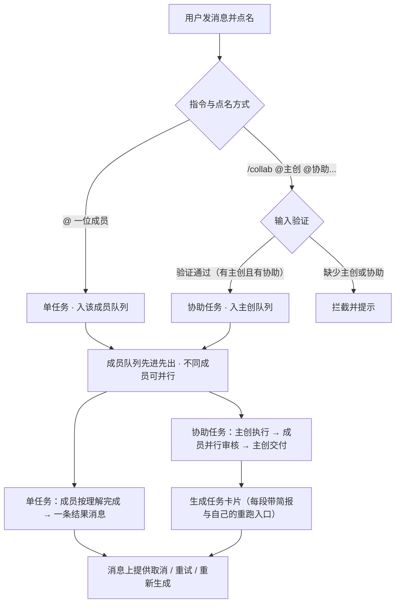
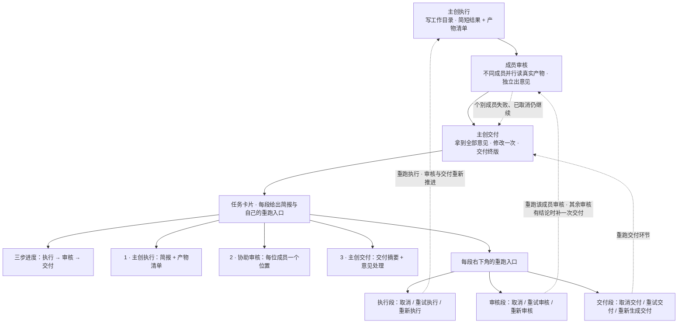

# AI-Meeting 软件设计初稿

> 多 AI 协同任务工作台

---

## 1. 这个软件是什么

AI-Meeting 是一个在本机运行的多 AI 协同工作台。用户在一个聊天会话里把任务交给 AI 团队成员，成员按各自的角色干活、互相审核、交付结果。

软件的目的不是生成一份方案文档，而是让多个 AI 各司其职地协同完成工作。聊天窗口是协作现场，右侧面板只保留工作目录，作为协作过程中文件产出与浏览的共享载体；一次协作的结果既包括聊天里的说明，也包括 AI 在工作目录里产出的文件。

AI 成员当前以本机命令行工具执行，后续也会支持指向远程模型服务。界面与任务流程不依赖具体的执行方式。

---

## 2. 谁在用、怎么用

- 用户打开一个会话，在输入框里写任务，用 `@` 点名一位成员。
- 输入框里打 `/` 会列出当前可用的指令，打 `@` 会列出本会话的成员；上下键选择，Enter 补全，Esc 关闭。选完 `/collab` 会直接接着列出成员，按「先主创、后协助成员」的顺序选即可。
- 被点名的成员按自己对这条消息的理解去做，把结果发回聊天窗口。
- 用户可以点某条消息的「回复」引用它，把追问连同原话一起交给成员。
- 每条 AI 输出都能查看「发送给它的完整输入」和「它的原始输出」。
- 长内容默认折叠，点击可展开。
- 取消和重试由用户在具体消息或任务卡片的对应环节上点击触发。

---

## 3. 核心概念

| 概念 | 说明 |
| :--- | :--- |
| **会话** | 一个聊天窗口，保存消息、任务与产物索引 |
| **成员** | 一位 AI 团队成员，有名字、头像、人设、命令行模板、读写权限、单次超时 |
| **任务** | 用户点名成员后产生的一个工作单元，分单任务与协助任务 |
| **队列** | 每位成员一个先进先出队列，同一成员的任务串行执行，不同成员之间可并行执行 |
| **运行规程** | 随软件提供的文本，拼进成员的输入，说明当前环节与输出格式 |
| **任务卡片** | 协助任务在聊天窗口里的结构化展示，按环节给出简报，细节在「完整任务详情」里 |

---

## 4. 任务

### 4.1 两类任务

任务类型由用户的指令与点名方式决定。

**单任务**：`@` 一位成员，请它做一件事。任务进入该成员的队列，由它独立完成，输出一条结果消息。

**协助任务**：使用 `/collab` 指令发起，格式如 `/collab @主创 @协助成员1 [@协助成员2...] 任务内容`。输入时系统进行严格验证：必须显式指定一位主创成员，其后至少指定一位协助成员；若缺少主创或缺少协助成员，予以拦截提示，确保主创与协助关系清晰。主创按软件预置的协作流程推进一轮，被指定的协助成员参与审核，输出一张任务卡片。

点名按「出现顺序」判定：整条消息里第一个能对上成员的 `@` 是主创，其余都是协助成员，不要求它们挨在一起——`/collab @agy 你来做，@DS4 @HY4 负责审核` 与 `/collab @agy @DS4 @HY4 你来做` 等价，任务内容都是去掉提及后剩下的文字。成员名大小写不敏感，`@//agy/`、`@deepseek-v4/(DS4)` 这类带路径装饰或按目录名写的提及也能认出来；对不上任何成员的 `@`（例如邮箱）按普通文字保留。

用户消息原文（去除指令前缀后）作为任务上下文原样提供给参与的成员，成员自行理解要做什么。主创向参与审核的成员转交任务时，软件只转交原话与产物信息，不解析任务目标、不设置验收标准，也不判断一条消息是不是取消、改方向或追问。

### 4.2 单任务的执行

1. 用户的消息点名了某位成员，产生一个单任务，进入该成员的队列。
2. 轮到它时，软件把这条消息、会话背景、产物索引和运行规程拼成输入，交给这位成员执行。
3. 成员在工作目录里完成工作，把简短结果和产物清单发回聊天窗口。
4. 这次任务结束，下一条排队的任务开始。

### 4.3 协助任务的一轮流程

协助任务只有一轮：

| 环节 | 内容 |
| :--- | :--- |
| **1 主创执行** | 主创在工作目录完成工作，在聊天里给出简短结果与产物清单；卡片里这一段提供「取消」，结束后提供「重新执行」（失败、超时、已取消时是「重试执行」） |
| **2 成员审核** | 除主创外的指定协助成员各自阅读真实产物，按审核规程的四条标准独立并行给出意见；卡片里每位成员这一段各自提供「取消」与「重新审核」（失败、已取消、超时或无意见时是「重试审核」） |
| **3 主创交付** | 主创拿到全部审核意见，按自己的判断做一次修改，交付终版结果与产物清单；卡片里这一段提供「取消交付」与「重新生成交付」 |

- 三个环节重跑互不影响：点哪一段就只重跑那一段，已完成的其他环节不动。
- 主创执行进行中的「取消」终止这次执行；失败、超时、已取消时同一位置给「重试执行」，成功之后给「重新执行」，都按原输入重跑主创执行。重跑成功后流程从审核环节继续，之前的审核意见与交付结果作废，不再作为本次交付依据。
- 审核环节的「取消」终止该成员正在进行的这次审核；「重试审核」按原输入重新执行该成员的审核；这一位已经给出意见后仍可点「重新审核」重出一份意见。
- 主创交付的「重新生成交付」按当前这批审核意见与最新产物重新执行一次交付环节，生成新的终版结果与产物清单；执行没成功之前不提供这个入口，避免出一个没有产物也没有意见的「已交付」。
- 审核环节不自动补跑。个别成员失败、超时、被取消或没有给出意见时，卡片上标记它的状态，主创仍然交付。
- 重跑某一位审核后，终稿就是照旧意见写的了，所以这一位审核结束、且其余审核都已给出结论时，软件自动补一次交付；用户不需要再点交付段。**这一版终稿会在交付段标出「↻ 审核补全后重新生成」**（悬停能看到重新生成时刻），和用户手点的「重新生成交付」区分开。多位审核并发重跑时只补一次，用 `review_generation` / `auto_deliver_generation` 去重。
- 取消与重试不新增任务，也不增加流程轮次；重跑主创执行后，审核与交付按流程重新推进。协助任务始终只有一轮。
- 参与审核的成员以只读方式执行，不改主创在工作目录里的产物。
- 交付后任务即完成，三个环节各自保留自己的重跑入口。还有问题由用户发下一条指令决定。

#### 审核标准（`prompts/roles/reviewer.md`）

审核成员按同一套标准产出意见，避免不同成员各写一套、篇幅与口径随模型心情漂移：

1. **审视隐患与漏洞**：查逻辑自洽性、边界条件、实操可用性上的硬伤。边界条件不限于程序，看的是「在什么前提和范围内成立、出了范围会怎样」——代码看空输入 / 异常路径 / 并发，方案看约束变化 / 落地断点 / 衡量口径，产品设计看用户分层 / 边缘流程 / 认知负荷。
2. **鼓励提出新意与巧思**：主创解法中规中矩时，直接提出更巧妙、更有创意或体验 / 效率更优的替代思路；可以是尚未落盘的设想，须写明为什么更优、前提与代价，并标为可选建议。
3. **精简实用，言之有物**：篇幅不设上限，但杜绝套话、客套、空泛理论；每条都要能定位到文件或位置，说清现状 / 影响 / 怎么改，具备可实操性。
4. **达标即过**：产物已足够优秀且无重大优化空间时，直接写 `[通过]` 并简述亮点，严禁为了提意见硬挤琐碎细节。

判定基准按「用户原话 > 产物自述 > 通用底线」排序，软件仍不替用户设置任务级验收标准；定的是审核方法论。审核对象限于已落盘的真实产物，但巧思作为「提出来的建议」不受此限。

正文首行的 `[通过]` / `[意见]` 是判定标记，末尾 JSON 登记块里的 `review.verdict` 由服务端解析，落到该成员这一段的 `review_verdict`：卡片挂「通过」标签、流水写「审核通过」，主创收到的【审核意见】里也会标注「[通过]，无需改动」。模型漏写登记块时按首行标记兜底判定。`owner.md` 相应要求主创区分「通过 / 隐患 / 巧思」三类意见：通过的无需改动，隐患逐条说明修没修，巧思可采纳可不采纳但要说明取舍依据。

规程文件由 `_read_protocol()` 在**每次执行时现场读盘**，不在内存里缓存：点「重新审核」走 `retry → _run_review_one → _execute → build_prompt`，会按当前 `task-flow.md` 与 `reviewer.md` 重新拼一份完整输入并覆盖该段的 `sent_prompt`，历史输入快照不会被复用或发给模型。审核环节的【输出要求】单独写明「即使没有产出文件也要附 `review` 登记块」，避免沿用执行 / 交付段的「产出了文件才登记」。存量会话里旧规程的输入快照只作留档，不会发给模型；界面不对规程版本加任何标注，重审后输入内容本身即换成当前规程。

### 4.4 队列

- 每位成员一个先进先出队列，同一成员的任务串行执行；不同成员之间的任务互不阻塞，支持并行执行。
- 协助任务的审核环节由任务直接发起，指定的不同审核成员可同时并行审核；若某位成员正在执行自己队列中的其他任务，则审核等它当前任务结束后再串行执行。
- 同一成员若有多个任务排队，界面显示该成员队列的排队状态。
- 任务与队列随会话保存。刷新页面不改变正在执行的任务；服务重启后，进行中的任务标记为已取消，可在卡片里从被中断的环节重试。

---

## 5. 消息与操作

### 5.1 消息

- 用户 `@` 谁，这条消息就交给谁。
- 没有 `@` 任何成员时，默认交给本场会话里**最近一位回过话、且现在仍可用**的成员（聊天窗里接着刚才那位说）；
  该消息会带 `auto_to` 标记，气泡上显示「默认发给 XXX」。会话里还没有任何 AI 回过话时，
  消息只记录在聊天里，作为上下文保留。
- 正在执行的任务继续运行，直到它结束，或用户点「取消」：单任务在它的输出消息上取消，协助任务在卡片里的对应环节上取消。
- 引用回复把被引用的原话一起交给成员。

### 5.2 取消与重试

- 中途取消策略与 Agent 保持一致：点击「取消」立即向当前执行进程发送终止信号（SIGTERM/SIGKILL）；取消前已写入的文件自然保留在工作目录中，不执行强制回滚，无弹窗打扰；任务卡片与状态静默转为「已取消」，输入框即刻恢复就绪。
- 「取消」按钮只出现在正在输出的消息或正在进行的环节上，点击终止这一次执行。
- 状态为「失败」「已取消」或「超时」的消息显示「重试」按钮，按原输入重新执行一次；已经成功的单任务消息显示「重新生成」，按同一份输入重写这条回答。
- 协助任务的重跑入口挂在卡片（6.2）的每一段上，点哪一段就重跑哪一段：主创执行段是「取消 / 重试执行 / 重新执行」，每位审核段是「取消 / 重试审核 / 重新审核」，交付段是「取消交付 / 重试交付 / 重新生成交付」。三段都成功之后依然可以直接点某一段重跑，不需要先展开详情。
- 重试只重跑被点击的那一次执行，沿用原输入与同一工作目录；重跑主创执行后，审核与交付按流程重新推进。协助任务的重试不增加流程轮次，各环节的历史记录保留。
- 重新审核某一位成员后，如果**所有审核都给出了结论**（已完成 / 无意见），系统自动补一次交付，把终稿按最新意见重出一遍；卡片交付段挂「↻ 审核补全后重新生成」标签，流水写「全部审核已出结论，自动补一次交付」+「审核结论已齐，系统自动补一次交付（终稿重新生成）」。只要还有审核失败 / 超时 / 被取消，就不自动补，只标「意见已更新 / 终稿待重新生成」，由用户点交付段的「重新生成交付」决定。用户之后手点重新生成交付，标签换成手动来源，不再挂自动标记。

### 5.3 界面上的控制

聊天界面由会话列表、消息区、输入框和右侧工作目录面板组成。右侧面板只保留工作目录文件树与浏览（点文件在弹窗里预览），控制操作都在消息或任务卡片的对应环节上完成，界面不设全局控制条。

---

## 6. 输出展示

### 6.1 结果消息

结果消息由简短说明和产物清单组成，清单列出文件路径、摘要与大小。长内容默认折叠；每条消息可查看完整输入与原始输出。

展示给用户的始终是模型写的正文，不是 JSON。软件给成员的要求是「正文用正常文字回答，产物清单用末尾一段 JSON 代码块登记」：软件把这段登记摘出来供产物核验与后续环节引用，正文原样进聊天气泡。旧写法（整段只有一个 JSON 对象）也兼容：从中取 `summary` 展示；连 `summary` 都没有时，把字段拼成可读文字，绝不把 `{...}` 原样丢进聊天。原始输出（含 JSON、含报错）只在「查看输入 / 原始输出」里出现。

### 6.2 协助任务卡片

任务创建时卡片即出现在聊天窗口，排队与执行状态都在卡片上更新。卡片分两层：聊天里直接看人，弹窗里看细节。

**聊天里的卡片**回答「这一轮谁做了什么」。头部是任务摘要、整体状态、总耗时、参与人数（`主创 + n 位审核`、产物个数）与**创建时间**（`YYYY-MM-DD HH:MM:SS`，任务创建时落库，老会话退回卡片消息的落库时刻），下面一排三步徽标（执行 → 审核 → 交付）与审核进度「n/m 已完成」，底部一行是最新一条流水与「完整任务详情」入口。「完整任务详情」弹窗头部同样显示创建时间。中间按环节给出简报，一段一个角色：

- 主创执行：主创名字、状态、执行耗时、执行简报。
- 协助审核：每位成员各一段，各自的审核状态、审核耗时与该成员的意见。
- 主创交付：交付状态、交付耗时、终版摘要；系统自动补的那一次额外挂「↻ 审核补全后重新生成」标签，详情弹窗的交付块还有一行说明。

每段简报默认限高约 8 行（`max-height` + 底部渐隐），**保留 markdown 原有的块级排版**——早期用 `-webkit-line-clamp` 需要把 `<p>/<ul>/<li>` 压成 inline，收起时文字会堆成一坨；现在收起看到的就是展开排版的前几行。超出时点正文或「展开全文」就地展开、再点「收起」；这段展开状态只存在浏览器里，刷新回到摘要视图。整张卡片可以点头部横栏收起 / 展开（右侧 ▸/▾ 指示），收起时头部与底部流水仍可见。**点正文、头部都只是折叠，不会弹窗**；只有每段右下角的「输入输出 ›」才打开该环节本轮实际发给模型的 Prompt 与原始输出，弹窗顶部还给出这次执行的开始 / 返回时刻与用时。段标题上显示该环节的开始时刻与耗时（悬停看返回时刻）。没出结果时不留白：进行中显示「正在执行，简报生成后会显示在这里…」，等待中显示「排队等待中…」，失败与超时分别提示去详情里看报错或已产出的内容，没有意见的成员正文写「未提出意见」而状态徽标仍是「无意见」。

**每一段的右下角各有自己的重跑按钮**，就在「输入输出」同一行的右侧，不必先进弹窗：

| 段 | 运行中 | 有结果 | 失败 / 超时 / 已取消 |
| :--- | :--- | :--- | :--- |
| 主创执行 | ✕ 取消 | 🔄 重新执行 | 🔄 重试执行 |
| 协助审核（每位成员各一个） | ✕ 取消 | 🔄 重新审核 | 🔄 重试审核 |
| 主创交付 | ✕ 取消 | 🔄 重新生成交付 | 🔄 重试交付 |

主创执行没成功之前，交付段不给按钮——那会产出一个没有产物也没有审核意见的「已交付」。点哪一段就只重跑哪一段，同一件事不会在别处再出现一个按钮，卡片底部只留流水与「完整任务详情」。

耗时按环节各自统计（`part_a.elapsed`、`part_b[].elapsed`、`part_a.final_elapsed`），不是把整轮任务时间摊到三段上——审核是并行的，三段耗时相加会大于总耗时，这是正常的。

**点「完整任务详情」**弹出窗口看全部内容，顶部一条同样的三步进度（已完成打勾、失败标感叹号、进行中高亮），下面按三个环节分块：

**1 · 主创执行**
执行简报与产物清单。主创执行中显示「取消」，失败、超时或已取消显示「重试执行」，已成功显示「重新执行」。这一块展示的是本轮执行真正产出的东西，产出清单一处看全。

**2 · 协助审核**
每位参与成员各占一个位置，显示审核状态与它给出的意见或结果，标题旁给出「已完成 n/m」。审核进行中的位置显示「取消」，失败、已取消、超时或没有给出意见的位置显示「重试」，已给出意见的位置显示「重新审核」，重跑后该位置更新为新的审核结果。

**3 · 主创交付**
交付摘要（终版做了什么）与对审核意见的处理说明，这一块独立成段，不再和执行的产出混在一起。交付进行中显示「取消交付」，结束后显示「重新生成交付内容」。三个环节各有自己的「查看输入 / 原始输出」，打开的是该环节本轮实际发给模型的内容。

卡片在审核过程中实时更新状态。各环节的原始记录都保存下来，弹窗内可按记录查看完整输入与原始输出，以及实时流水。

### 6.3 状态

- 任务：排队中 / 执行中 / 已交付 / 已取消 / 失败 / 超时。
- 卡片里的成员：等待 / 进行中 / 已完成 / 失败 / 已取消 / 超时 / 无意见。

---

## 7. 数据结构

**任务**

```json
{
  "task_id": "t_8f3a21",
  "type": "collab",
  "source_msg_id": "m_9c21",
  "goal": "用户消息原文",
  "owner_id": "emp_agy",
  "reviewer_ids": ["emp_ds4", "emp_hy4"],
  "status": "running",
  "step": 2,
  "artifacts": [
    { "path": "docs/parenting-plan.md", "summary": "方案正文", "bytes": 8421 }
  ],
  "card_msg_id": "m_9d44",
  "created_at": 1762848000
}
```

**任务卡片**

```json
{
  "kind": "task_card",
  "task_id": "t_8f3a21",
  "goal": "把这份亲子教育的问题转成可落地的解决方案",
  "status": "delivered",
  "owner": { "id": "emp_agy", "name": "agy" },
  "part_a": {
    "brief": "主创执行后的简短结果",
    "artifacts": [
      { "path": "docs/parenting-plan.md", "summary": "方案正文", "bytes": 8421 }
    ],
    "final": {
      "summary": "终版改动说明",
      "opinion_handling": "主创对审核意见的处理说明"
    },
    "msg_id": "m_p1"
  },
  "part_b": [
    {
      "member_id": "emp_ds4",
      "name": "DS4",
      "status": "done",
      "summary": "一句话审核结论",
      "raw_output": "审核成员原始输出",
      "msg_id": "m_p2_ds4"
    }
  ]
}
```

会话里保存 `tasks`、`task_queues` 和 `active_task_id`。消息带 `kind`、`task_id`、`in_chat`、`sent_prompt`、`raw_response` 字段；协助任务各环节的记录以 `in_chat: false` 保存，不在聊天流里逐条铺开，但完整输入与原始输出都可查。取消与重试产生新的执行记录，卡片里的 `msg_id` 指向最新一次，历次记录按环节保留可查。

Prompt 在**环节发起时**就写入（`part_a.sent_prompt` / `part_b[].sent_prompt` / `part_a.final_sent_prompt`），不等执行结束：这样环节进行中点开「查看输入 / 原始输出」能看到本轮真正发出去的内容，执行失败时也留得下证据。原始输出仍只在拿到回复后写入。三者都为空时才提示「未留存」，并按环节状态区分说法——未开始说「还没开始」，进行中说「稍后刷新」，已结束且为空才是老记录没有留存。

---

## 8. 工作目录与权限

- 每个会话对应一个工作目录，AI 在其中读写文件。
- 成员能否写文件由设置里的读写权限决定；协助任务的审核环节一律只读。
- 主创输出产物清单，软件据此列出本次产生的文件。
- 右侧面板列出工作目录里的文件，点文件在弹窗里预览：Markdown 按文档渲染（标题、列表、表格、代码块），图片直接显示，其余文本按等宽字体原样展示，压缩包与 Office 这类二进制只给一句说明并允许复制路径。文本超过 500KB、图片超过 20MB 时提示不支持在线预览，不把提示语当正文。
- 预览弹窗里点外部链接在新标签打开，不替换当前工作台页面；相对链接提示在本机打开。
- 中途取消策略与 Agent 保持一致：取消后已写入的文件自然保留在工作目录，不强制回滚，无弹窗打扰；任务卡片如实记录当前产出，用户可直接发新消息继续或按需重试。

---

## 9. 运行规程

随软件提供的一组文本，服务端在拼装输入时加入，告诉成员当前处于哪个环节、应该输出什么。

| 文件 | 用于 |
| :--- | :--- |
| `prompts/protocol/task-flow.md` | 描述软件的协作流程与环节顺序 |
| `prompts/roles/single.md` | 单任务成员：完成这一件事，输出简短结果与产物清单 |
| `prompts/roles/owner.md` | 主创：完成工作、输出产物清单、根据审核意见做一次修改并交付 |
| `prompts/roles/reviewer.md` | 审核成员：只读、四条审核标准（隐患与漏洞 / 新意与巧思 / 精简实用 / 达标即过）、`[通过]` 判定与登记块 |

规程里约定的结构化输出由服务端解析；解析不到时按纯文本展示，不影响交付。审核登记块的 `review` 字段（`verdict` / `issues` / `ideas`）会被摘掉不展示，只用来给卡片和主创标注判定结果。

---

## 10. 设置

设置由三部分组成：

- **成员管理**：添加与编辑成员，配置人设、命令行模板、读写权限、单次超时。
- **界面语言**：简体中文 / English。
- **服务**：查看运行状态、重启、停止。

---

## 11. 技术组成

- 后端 Flask，前端 Vue3；页面资源随软件提供。
- AI 成员以命令行子进程执行，输入由服务端拼装、输出由服务端解析。执行方式可替换，当前为本机命令行，后续支持远程 API。
- 会话以 JSON 文件保存，包含消息、任务、队列与任务卡片。
- 主要模块：任务状态机与队列、输入拼装、结构化输出解析、卡片构建、界面。

---

## 附录：流程图





---

*本初稿描述软件的目标形态与关键结构。*
