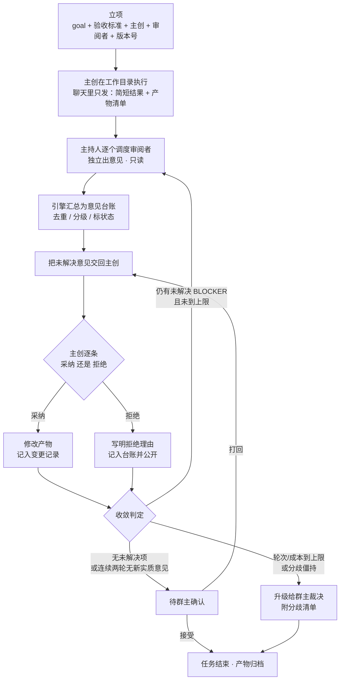
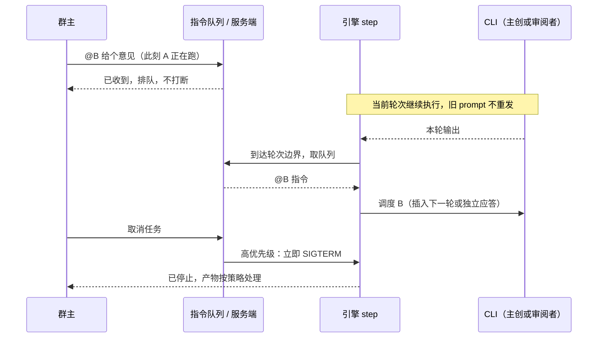

# 单一任务 + 审阅模式：AI 团队协作协议（设计草案 v0.1）

> 状态：**设计草案，待拍板**。本文只定义流程与契约，不改代码、不预设实现排期。
> 适用范围：一个会话里同时只有**一个进行中的任务**（单一任务约束），由主持人调度、一位主创执行、其余成员审阅。

---

## 1. 定位

这个项目要做的不是「多 AI 开会审阅一份方案」，而是 **一个 AI 团队**：成员各司其职，有人主创、有人审核、有人提优化建议，主持人负责调度和推进，群主（用户）随时介入。

- **方案纪要不是最终目的**，它是这个团队的共享事实源：让所有成员基于同一份目标、同一版产物、同一份意见台账工作。
- 本文描述的模式叫 **单一任务 + 审阅模式**：一次只做一件事，做完由团队轮番审阅与优化，直到达成可交付的结论。
- 与现有「圆桌讨论」的关系：圆桌是**观点对齐**（各自立论、互审、收敛成纪要）；本模式是**任务执行**（有人真正产出文件或代码，其他人对产物负责）。两者可以共存为不同会议模式，不要互相替代。

---

## 2. 角色与责任边界

| 角色 | 职责 | 不做什么 |
| :--- | :--- | :--- |
| **群主（用户）** | 下任务、改方向、取消、点名提问、最终验收 | 不负责流程调度 |
| **主持人** | 识别用户意图、确定/改派主创、排审阅顺序、把麦交回主创、判定收敛、必要时升级给用户 | **不直接产出方案内容**；不自己改工作目录 |
| **主创（DRI）** | 对任务结果与工作目录里的产物负全责；逐条处理审阅意见，采纳或明确拒绝 | 不把决定权甩给审阅者 |
| **审阅者** | 基于**真实产物**独立给出意见与优化建议，标注严重级别 | 默认**只读**，不直接改主创的产物 |
| **引擎（服务端）** | 持有状态机、按结构化动作调度、调用 CLI、落盘、处理中断与超时 | 不做语义判断（语义交给主持人，但动作必须可解析） |

> **最关键的一条**：主持人只做判断，引擎做执行。主持人输出必须是机器可解析的结构化动作，绝不能是「我觉得接下来让 A 看一下」这种散文——本项目已有的好原则是「结论是解析出来的，不是猜出来的」，这条原则必须延续到调度上。

---

## 3. 主流程

### 3.1 任务发起（两种入口）

- **明确指示**：群主点名主创，例如「把这份亲子教育问题转成可落地方案，@agy 你做主创，其他人审核提意见」。主持人解析出 `goal`（任务目标）、`owner`（主创）、`reviewers`（审阅者集合）后立项。
- **不明确指示**：群主只说任务，没指定谁做。主持人根据成员人设、能力与当前负载**自己指派一位主创**，并在聊天里用一句话说明为什么选它。其余流程完全相同。

立项时引擎固定四件事，之后每一轮都带着它们：`goal`（群主原话 + 主持人整理后的验收标准）、`owner`、`reviewers`、**任务版本号**。任务版本号用于区分「原任务」和「改方向后的新任务」。

### 3.2 主循环

1. **主创执行**：在工作目录里把事做完，聊天界面只发**简短结果 + 产物清单**（改了哪些文件、核心结论是什么）。完整内容留在工作目录，不要把全文刷进聊天流。
2. **逐个审阅**：主持人按排好的顺序，一个一个调度审阅者。每位审阅者看到的是「任务目标 + 产物清单 + 工作目录（只读）+ 未解决分歧清单」，**看不到其他审阅者的意见和主创的拒绝理由**（防止从众、防止第二轮就没新信息）。
3. **汇总成意见台账**：引擎把本轮意见结构化登记，去重、分级、标状态；主持人把**未解决项**交回主创。
4. **主创处理**：逐条选择「采纳」或「拒绝」。拒绝必须写理由，理由进台账、后续轮次对所有人可见。主创是 DRI，有权不做自己不认同的意见——这是设计，不是缺陷。
5. **收敛判定**：见 §5。未收敛则回到第 2 步进入下一轮；收敛则进入 **待群主确认**。
6. **交付**：群主接受 → 任务结束、产物归档；群主打回 → 带着具体意见回到第 4 步。

### 3.3 流程图



---

## 4. 用户消息怎么分流

用户发消息时**不一定是马上中断**，这是本模式最容易做错的地方。所有消息先进**指令队列**，由引擎在**轮次边界（中断点）**统一消费；只有「取消 / 改方向」是例外，允许立即终止当前进程。

| 意图 | 判定依据 | 处理 | 是否中断当前流程 |
| :--- | :--- | :--- | :--- |
| **取消** | 显式取消词、结构化指令 | 立即 `SIGTERM` 当前 CLI，任务终止，产物按策略回滚或保留 | **立即中断** |
| **改变方向** | `goal` 发生变化 | 立即中断，中止旧任务、保留历史与产物快照，建立新任务版本号重新立项 | **立即中断** |
| **@ 主持人** | 点名主持人 | 调整调度：改派主创、换审阅顺序、增删审阅者、改轮次上限 | 否，边界生效 |
| **@ 某位成员** | 点名成员 | 由该成员回答这条问题；**默认不影响主任务的推进**，回答作为一条独立消息进入上下文 | 否，边界生效 |
| **新任务** | 无活动任务时的任务描述 | 立项（明确主创 / 主持人指派） | 不适用 |
| **普通回复** | 其余情况 | 视为**对当前/最近发言者的回复**，由该 AI 处理并继续它的工作 | 否，边界生效 |

```mermaid
flowchart TD
    U["👤 群主发消息"] --> Q["写入指令队列<br/>不打断正在执行的 CLI"]
    Q --> C{"规则 + 主持人<br/>结构化意图判定"}
    C -->|取消| X["立即 SIGTERM<br/>终止任务"]
    C -->|改变方向| Y["立即中断<br/>新版本号重新立项"]
    C -->|@ 主持人| M["生成调度动作<br/>改派 / 改顺序 / 改配置"]
    C -->|@ 某成员| A["该成员应答<br/>主任务不暂停"]
    C -->|普通回复| R["由引用对象 / 当前发言者认领"]
    M --> B["轮次边界消费"]
    A --> B
    R --> B
    B --> LOOP["回到主循环"]
    X --> END["任务结束"]
    Y --> LOOP
```

**「普通回复 = 回复最近这个 AI 所说的话」的落地细则**

- 优先级：**显式引用回复（前端传 `reply_to`）> 文本 @ > 当前发言者 > 主创**。
- 「最近」不能按「消息列表最后一条」算：最后一条可能是系统播报、主持人流程提示、或者群主自己上一条消息。要跳过 `sender == "system"` 与主持人流程播报，取最近一条**成员/主持人的实质发言**。
- 当前没有任何 AI 在发言时（例如任务刚结束），普通回复交给主持人判断是新任务还是闲聊。
- 低置信度时（分不清「追加要求」和「回复」），主持人复述一句让群主确认，不要擅自猜。

### 指令消费时序



---

## 5. 收敛判定（必须先定死，否则流程跑不完）

「直到最后大家达成一致」这句话不能直接实现，需要换成一个可判定的条件。

- **区分「共识」与「裁定」**：主创是 DRI，对产物负责；审阅者是建议方。所谓「达成一致」应该是 **没有未解决的 BLOCKER**，而不是「所有人都喜欢这版」。主创拒绝并给出理由的意见，记为 `resolved(rejected)`，不算未解决。
- **收敛条件**（满足任一）：
  1. 台账里没有 `open` 的 BLOCKER，且本轮无新增实质意见；
  2. 连续两轮没有新增实质意见（防止礼节性「看起来不错」无限续轮）；
  3. 群主显式说「可以了」。
- **硬上限**：最大轮次、最大模型调用数、最大耗时、最大 token 预算，任一到顶即停止并**升级给群主**，附上分歧清单（谁提的、主创为什么拒绝、还剩什么没解决），由人来拍板。
- **防重复**：被拒意见默认不再重提；除非提出者给出新证据，且必须引用该意见 id。台账里每条意见带 `id / 提出人 / 内容 / 级别 / 状态 / 拒绝理由 / 轮次`，每轮只向模型传**增量 + 未解决项**，不重发全部历史。

---

## 6. 工作目录、产物与权限

- **审的是产物，不是摘要**：主创必须输出「产物清单 + 变更摘要」作为审阅输入；审阅者凭清单去读工作目录里的真实文件。只把聊天里的简报拿去审，等于审描述而不是审成果。
- **单写者原则**：建议 **主创写、审阅者默认只读**。用户提到「他们都可以开启写权限，不然没法干活」——能力上可以全开，但**同一任务里应约定只有一个写者**，否则多人同时改同一份文件会互相覆盖，且出问题时无法追责。若确需多人写，按角色分目录 + 记录每次变更（谁、哪个文件、哪一轮）。
- **任务前快照 / 可回滚**：任务开始前对工作目录做快照（git 提交或目录副本）。取消、改方向、主创跑偏时才能回到干净状态。当前系统开了写权限后**没有回滚能力**，中断只会留下半成品文件，这是需要先补的。
- **产物校验**：收敛前检查文件确实存在、非空、基本格式正确；防止「声称做完但什么都没写」。

---

## 7. 主持人调度协议（建议的动作契约）

主持人每轮输出一个结构化动作，引擎校验合法后才改状态。示意（不是最终 schema）：

```json
{
  "intent": "assign_owner | set_review_order | hand_back | close | escalate | ask_owner",
  "confidence": 0.86,
  "task_version": 3,
  "owner_id": "emp_agy",
  "reviewer_ids": ["emp_ds4", "emp_hy4"],
  "unresolved": ["cmt_007", "cmt_011"],
  "reason": "任命 agy 为主创，其余两位按数据 / 表达顺序审阅"
}
```

规则：

- 引擎只认结构化字段，**不从自然语言里猜意图**；解析失败则本轮不动状态并让主持人重出一次。
- `confidence` 低于阈值、或动作属于「取消 / 改方向 / 改派主创」时，先把动作复述给群主确认。
- 能用规则短路的先走规则：`@` 语法、显式取消词、引用回复，不必每次都调用一次主持人模型（省一次调用与延迟）。

---

## 8. 状态持久化契约

以下字段必须随会话原子落盘，刷新页面或服务重启后可原样恢复：

```
task_state = {
  version, goal, acceptance, owner_id, reviewers[],
  round, max_rounds, budget{ calls, tokens, seconds },
  comments[] { id, author, text, severity, status, reject_reason, round },
  unresolved[], pending_directives[], artifact_snapshot_id,
  phase, last_speaker_id, awaiting_owner_confirmation
}
```

现状提醒：`core/engine.py` 的 `collab` 已落盘主创 / 轮次 / 最近一份协助输出，但**意见台账、拒绝理由、待处理用户指令、产物快照都没有**；`app.py` 里部分调度状态仍是进程内变量，服务重启即丢。调度状态必须全部进会话文件，不能只放内存。

---

## 9. 漏洞清单（按严重程度）

### P0 —— 不解决流程跑不下去或会损坏数据

| # | 漏洞 | 后果 | 修补 |
| :-- | :--- | :--- | :--- |
| 1 | 「达成一致」没有判定者、标记和上限 | 主创有拒绝权时，审阅者反复提同一条 → 无限循环；或某轮没人反对就假收敛 | §5 的收敛条件 + 硬上限 + 升级给用户裁决 |
| 2 | 意见与拒绝理由不沉淀 | 重复提意见、重复拒绝；每轮整包转发意见导致 prompt 随轮次膨胀 | 结构化意见台账，只传增量与未解决项，被拒意见不再重提 |
| 3 | 多人写同一工作目录且无快照 | 文件互相覆盖、责任不清；取消后残留半成品且无法回滚 | 单写者原则 + 任务前快照 + 变更记录 |
| 4 | 用户意图分类是单点，误判代价不对称 | 把「取消」当回复＝白跑几轮烧 token；把「新任务」当回复＝任务直接丢失 | 结构化 intent + 置信度 + 低置信度回显确认；关键动作可撤销；规则先短路 |
| 5 | 主持人调度若输出散文，引擎无法可靠执行 | 调度动作被误读，麦交错了人 | §7 的结构化动作契约 + 引擎校验 |

### P1 —— 影响体验与成本

| # | 漏洞 | 后果 | 修补 |
| :-- | :--- | :--- | :--- |
| 6 | 「@ 不马上中断」缺少指令消费模型 | 用户 @ 了却没人理；或排队太久的消息已过时才被执行 | 指令队列 + 只在轮次边界消费 + 消息带时间戳与失效规则；取消/改方向是唯一可强杀的例外 |
| 7 | 「回复最近那个 AI」锚点不明确 | 最近一条可能是系统播报或自己的消息，回复落到错误的人身上 | 引用回复优先；跳过 system 与流程播报；无发言者时交主持人 |
| 8 | 「改变方向」与「追加要求」边界模糊 | 「顺便把 Y 也做了」被当成本轮回复，任务悄悄丢失 | 定义任务边界（goal + 验收标准 + 版本号）；goal 变＝重建任务，goal 不变＝进下一轮 |
| 9 | 同一会话可能连发两个任务 | 两个 active task 抢同一个工作目录 | 单任务约束：新任务需显式结束当前任务，或进待办队列；界面常驻当前任务卡 |
| 10 | 审阅者互相看得见意见 | 从众，第二轮起没有新信息 | 独立审阅：只给产物 + 未解决分歧清单，汇总后再公开 |
| 11 | 成本与延迟 | 每轮 = 主持人 + N 个审阅者 + 主创 ≈ N+2 次调用；每次用户消息再调一次主持人分类 | 规则短路分类、审阅者可按批次、设调用数/时间/token 三重预算 |

### P2 —— 收尾与责任

| # | 漏洞 | 后果 | 修补 |
| :-- | :--- | :--- | :--- |
| 12 | AI 自己宣布「一致了」就收工 | 用户没机会验收 | 收敛后进入「待群主确认」，接受 / 打回两条路径 |
| 13 | 没有产物校验 | 「声称做完但文件没写」也会走完流程 | 收敛前校验文件存在、非空、格式可用 |
| 14 | 状态部分在内存 | 重启后主创/轮次/分歧丢失 | §8 的落盘契约 |

---

## 10. 与当前实现的差距

| 能力 | 当前代码 | 本模式目标 |
| :--- | :--- | :--- |
| 主持人 | `get_moderator()` 的人设只做「梳理记录、整理纪要、定稿」；task 模式完全绕开主持人 | 意图识别、指派主创、排审阅顺序、交接、判定收敛 |
| 审阅环节 | 无。自主协作里只有「主创 @ 一位同事协助」，一对一、无台账 | 全体审阅者逐轮独立出意见 |
| 意见/拒绝 | 只把最近一份协助输出塞进 `build_task_continue_prompt` | 结构化台账、拒绝理由、去重、增量传递 |
| 收敛 | `[任务完成]` 标记 / `max_rounds` | 无未解决 BLOCKER + 用户确认 + 分歧升级 |
| 用户意图 | `detect_mention()` 只有 `@成员` / `@所有人`；普通消息仅作为「群主指令」注入后续 prompt | 六类意图 + 优先级 + 结构化判定 |
| 引用/最近发言者 | 已有 `reply_to` 引用回复机制（正确方向），但没有「普通回复自动认领最近发言者」 | 引用优先 + 明确的 fallback 链 |
| 指令时序 | `api_send_message` 只写消息并 `start_background_runner`；CLI 阻塞期间消息只能等轮次结束 | 显式队列 + 中断点 + 取消可强杀 |
| 写权限 | `write_access` 逐人开关，服务端按 CLI 注入参数 | 单写者约定 + 快照/回滚 + 产物校验 |

> 好消息：现有实现已经天然具备「@ 不立即打断正在跑的 CLI」这一半（消息只在轮次边界被消费），缺的是**显式的队列语义、失效规则和取消例外**，把「碰巧如此」变成「契约保证」。

---

## 11. 这个能当成一个 Skill 给 AI 用吗？

**结论：不能只靠一个 Skill 驱动这套流程；但值得拆成三层，其中「角色作业规程」那一层确实应该做成 skill 形态给 AI 用。**

### 为什么一个 Skill 不够

WorkBuddy 的 Skill（或任何 `SKILL.md` 形态的能力包）本质是**无状态的知识/规程文档**：告诉一个能调工具的 agent「遇到某类任务该怎么做」。而这套流程的核心是**有状态的长事务调度**：

- 谁是当前主创、第几轮、审阅顺序排到谁、哪条意见被拒、拒绝理由是什么、用户消息在排队、哪个 CLI 进程正在跑、产物快照在哪、写权限给了谁——这些必须由**服务端引擎持有并原子落盘**，prompt 文档承载不了；
- 中断、超时、重试、进程组 `SIGTERM`、并发与回滚都是代码行为，不是文档约定；
- 本项目里的 AI 是本地 CLI 子进程（`agy` / `codebuddy`），它们**不加载 WorkBuddy Skill**，能看到的只有服务端拼进 prompt 的文本。

### 建议的三层拆分

| 层 | 形态 | 给谁看 | 内容 |
| :--- | :--- | :--- | :--- |
| **① 协议规范** | `docs/task-review-protocol.md`（本文） | 人（开发者 / 维护者） | 角色、状态机、意图语义、收敛规则、风险清单、待决问题 |
| **② 角色作业规程** | 项目内 `prompts/roles/{moderator,owner,reviewer}.md`，服务端拼 prompt 时注入 | 会议里的 AI | 无状态、可版本化：主持人如何输出结构化动作；主创如何写产物清单、`[任务完成]` 标记、拒绝理由格式；审阅者如何写带级别的可执行意见。**这一层就是「给 AI 用的 skill」** |
| **③ 引擎状态机** | `core/engine.py` 的 `task_state` + 意见台账 + 指令队列 | 机器 | 真正执行调度、校验动作、落盘、中断、超时、权限与预算 |

三层里最值钱的是 **②与③之间的契约**：结构化动作 schema、意见 id、状态枚举、`[任务完成]` 标记。这部分必须是代码里的 parser 与校验，不能只是文档里的一句约定——否则又回到「从模型散文里猜结论」。

### 什么时候真的用 WorkBuddy Skill

- 适合：给**开发/评审这个项目的 agent** 一个 Skill，让它按本协议检查实现是否走样（例如「审阅者是否被误给写权限」「主持人动作是否可解析」）。这是给工具型 agent 的，不是给会议里的 AI。
- 不适合：让会议里的主持人「加载一个 Skill 就自动调度」。调度权必须在引擎。

---

## 12. 待拍板的问题

1. **收敛权**：主创否决制（DRI 说了算）／全员一致／僵持时用户裁决，最终选哪套？
2. **审阅者写权限**：默认只读（推荐）还是允许直接改产物？
3. **任务中到达的消息**：一律排队到轮次边界，还是「@ 主持人 / 改方向」允许插队？
4. **多任务**：严格单任务，还是允许排队第二个任务？
5. **收工**：是否必须群主点「接受」？自动收工要不要保留？
6. **预算默认值**：最大轮次、单任务最大调用数 / 时长 / token 上限各设多少？
7. **产物回滚**：取消时默认回滚到快照，还是保留半成品并标记为废弃？

---

*本文记录的是流程设计与风险，未改动任何运行时代码。定稿后再按 §11 的三层拆分落地。*
