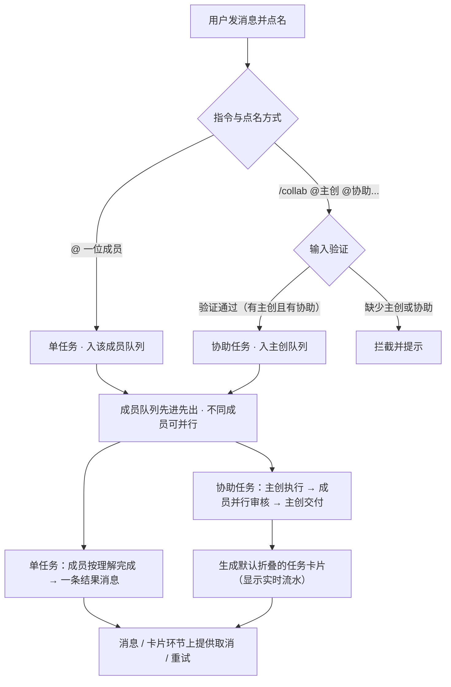
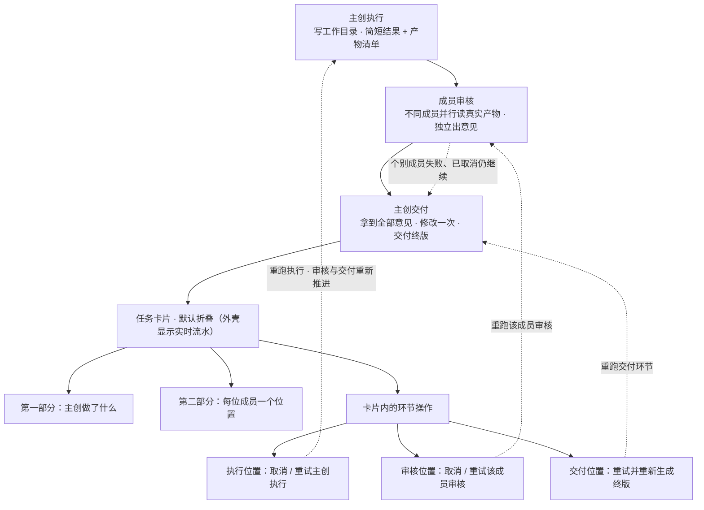

# AI-Meeting 软件设计初稿

> 多 AI 协同任务工作台

---

## 1. 这个软件是什么

AI-Meeting 是一个在本机运行的多 AI 协同工作台。用户在一个聊天会话里把任务交给 AI 团队成员，成员按各自的角色干活、互相审核、交付结果。

软件的目的不是生成一份方案文档，而是让多个 AI 各司其职地协同完成工作。聊天窗口是协作现场，右侧面板只保留工作目录，作为协作过程中文件产出与浏览的共享载体；一次协作的结果既包括聊天里的说明，也包括 AI 在工作目录里产出的文件。

AI 成员当前以本机命令行工具执行，后续也会支持指向远程模型服务。界面与任务流程不依赖具体的执行方式。

---

## 2. 谁在用、怎么用

- 用户打开一个会话，在输入框里写任务，用 `@` 点名一位成员。
- 被点名的成员按自己对这条消息的理解去做，把结果发回聊天窗口。
- 用户可以点某条消息的「回复」引用它，把追问连同原话一起交给成员。
- 每条 AI 输出都能查看「发送给它的完整输入」和「它的原始输出」。
- 长内容默认折叠，点击可展开。
- 取消和重试由用户在具体消息或任务卡片的对应环节上点击触发。

---

## 3. 核心概念

| 概念 | 说明 |
| :--- | :--- |
| **会话** | 一个聊天窗口，保存消息、任务与产物索引 |
| **成员** | 一位 AI 团队成员，有名字、头像、人设、命令行模板、读写权限、单次超时 |
| **任务** | 用户点名成员后产生的一个工作单元，分单任务与协助任务 |
| **队列** | 每位成员一个先进先出队列，同一成员的任务串行执行，不同成员之间可并行执行 |
| **运行规程** | 随软件提供的文本，拼进成员的输入，说明当前环节与输出格式 |
| **任务卡片** | 协助任务在聊天窗口里的结构化展示，默认折叠 |

---

## 4. 任务

### 4.1 两类任务

任务类型由用户的指令与点名方式决定。

**单任务**：`@` 一位成员，请它做一件事。任务进入该成员的队列，由它独立完成，输出一条结果消息。

**协助任务**：使用 `/collab` 指令发起，格式如 `/collab @主创 @协助成员1 [@协助成员2...] 任务内容`。输入时系统进行严格验证：必须显式指定一位主创成员，其后至少指定一位协助成员；若缺少主创或缺少协助成员，予以拦截提示，确保主创与协助关系清晰。主创按软件预置的协作流程推进一轮，被指定的协助成员参与审核，输出一张任务卡片。

用户消息原文（去除指令前缀后）作为任务上下文原样提供给参与的成员，成员自行理解要做什么。主创向参与审核的成员转交任务时，软件只转交原话与产物信息，不解析任务目标、不设置验收标准，也不判断一条消息是不是取消、改方向或追问。

### 4.2 单任务的执行

1. 用户的消息点名了某位成员，产生一个单任务，进入该成员的队列。
2. 轮到它时，软件把这条消息、会话背景、产物索引和运行规程拼成输入，交给这位成员执行。
3. 成员在工作目录里完成工作，把简短结果和产物清单发回聊天窗口。
4. 这次任务结束，下一条排队的任务开始。

### 4.3 协助任务的一轮流程

协助任务只有一轮：

| 环节 | 内容 |
| :--- | :--- |
| **1 主创执行** | 主创在工作目录完成工作，在聊天里给出简短结果与产物清单；卡片里提供「取消」，失败、超时或已取消后可「重试」 |
| **2 成员审核** | 除主创外的指定协助成员各自阅读真实产物，独立并行给出审核意见或优化建议；卡片里每位成员的位置提供「取消」和「重试」 |
| **3 主创交付** | 主创拿到全部审核意见，按自己的判断做一次修改，交付终版结果与产物清单；卡片里提供「重试」重新生成交付内容 |

- 主创执行进行中的「取消」终止这次执行；失败、超时或已取消后可在同一位置「重试」，按原输入重跑主创执行环节。重跑成功后流程从审核环节继续，之前的审核意见与交付结果作废，不再作为本次交付依据。
- 审核环节的「取消」终止该成员正在进行的这次审核；「重试」按原输入重新执行一次该成员的审核，用于失败、已取消、超时或没有给出意见的情况。
- 主创交付的「重试」按同一批审核意见和当前产物重新执行一次交付环节，生成新的终版结果与产物清单。
- 审核环节不自动补跑。个别成员失败、超时、被取消或没有给出意见时，卡片上标记它的状态，主创仍然交付。
- 重试审核只更新该成员在卡片里的意见，不自动重做交付；需要按新意见更新时，由用户点击主创交付的「重试」。
- 取消与重试不新增任务，也不增加流程轮次；重跑主创执行后，审核与交付按流程重新推进。协助任务始终只有一轮。
- 参与审核的成员以只读方式执行，不改主创在工作目录里的产物。
- 交付后任务即完成，卡片保留交付环节的重试入口。还有问题由用户发下一条指令决定。

### 4.4 队列

- 每位成员一个先进先出队列，同一成员的任务串行执行；不同成员之间的任务互不阻塞，支持并行执行。
- 协助任务的审核环节由任务直接发起，指定的不同审核成员可同时并行审核；若某位成员正在执行自己队列中的其他任务，则审核等它当前任务结束后再串行执行。
- 同一成员若有多个任务排队，界面显示该成员队列的排队状态。
- 任务与队列随会话保存。刷新页面不改变正在执行的任务；服务重启后，进行中的任务标记为已取消，可在卡片里从被中断的环节重试。

---

## 5. 消息与操作

### 5.1 消息

- 用户 `@` 谁，这条消息就交给谁；没有点名成员的消息记录在聊天里，作为上下文保留。
- 正在执行的任务继续运行，直到它结束，或用户点「取消」：单任务在它的输出消息上取消，协助任务在卡片里的对应环节上取消。
- 引用回复把被引用的原话一起交给成员。

### 5.2 取消与重试

- 中途取消策略与 Agent 保持一致：点击「取消」立即向当前执行进程发送终止信号（SIGTERM/SIGKILL）；取消前已写入的文件自然保留在工作目录中，不执行强制回滚，无弹窗打扰；任务卡片与状态静默转为「已取消」，输入框即刻恢复就绪。
- 「取消」按钮只出现在正在输出的消息或正在进行的环节上，点击终止这一次执行。
- 状态为「失败」「已取消」或「超时」的消息显示「重试」按钮，按原输入重新执行一次。
- 协助任务的操作在任务卡片（6.2）的对应环节上：主创执行与每位成员的审核位置提供「取消」和「重试」，主创交付的位置提供「重试」。
- 重试只重跑被点击的那一次执行，沿用原输入与同一工作目录；重跑主创执行后，审核与交付按流程重新推进。协助任务的重试不增加流程轮次，各环节的历史记录保留。

### 5.3 界面上的控制

聊天界面由会话列表、消息区、输入框和右侧工作目录面板组成。右侧面板只保留工作目录文件树与浏览，控制操作都在消息或任务卡片的对应环节上完成，界面不设全局控制条。

---

## 6. 输出展示

### 6.1 结果消息

结果消息由简短说明和产物清单组成，清单列出文件路径、摘要与大小。长内容默认折叠；每条消息可查看完整输入与原始输出。

### 6.2 协助任务卡片

任务创建时卡片即出现在聊天窗口，排队与执行状态都在卡片上更新。聊天窗口里显示一张默认折叠的卡片，外壳实时显示流水状态：任务摘要、整体状态、当前所处环节进度（如主创执行中、各成员并行审核进度等）、实时耗时流水与参与成员状态点。点击卡片弹出窗口查看全部内容，分两部分：

**第一部分 · 主创做了什么**
执行简报、产物清单、终版改动说明，以及主创对审核意见的处理说明。主创执行进行中显示「取消」，失败、超时或已取消显示「重试」；交付完成后显示「重试」，点击重新生成交付内容。卡片展示最新一次执行与交付，历次记录保留。

**第二部分 · 协助审核**
每位参与成员各占一个位置，显示审核状态与它给出的意见或结果；点开可看完整内容与原始输出。审核进行中的位置显示「取消」，失败、已取消、超时或没有给出意见的位置显示「重试」，重试后该位置更新为新的审核结果。

卡片在审核过程中实时更新状态。各环节的原始记录都保存下来，弹窗内可按记录查看完整输入与原始输出。

### 6.3 状态

- 任务：排队中 / 执行中 / 已交付 / 已取消 / 失败。
- 卡片里的成员：等待 / 进行中 / 已完成 / 失败 / 已取消 / 超时 / 无意见。

---

## 7. 数据结构

**任务**

```json
{
  "task_id": "t_8f3a21",
  "type": "collab",
  "source_msg_id": "m_9c21",
  "goal": "用户消息原文",
  "owner_id": "emp_agy",
  "reviewer_ids": ["emp_ds4", "emp_hy4"],
  "status": "running",
  "step": 2,
  "artifacts": [
    { "path": "docs/parenting-plan.md", "summary": "方案正文", "bytes": 8421 }
  ],
  "card_msg_id": "m_9d44",
  "created_at": 1762848000
}
```

**任务卡片**

```json
{
  "kind": "task_card",
  "task_id": "t_8f3a21",
  "goal": "把这份亲子教育的问题转成可落地的解决方案",
  "status": "delivered",
  "owner": { "id": "emp_agy", "name": "agy" },
  "part_a": {
    "brief": "主创执行后的简短结果",
    "artifacts": [
      { "path": "docs/parenting-plan.md", "summary": "方案正文", "bytes": 8421 }
    ],
    "final": {
      "summary": "终版改动说明",
      "opinion_handling": "主创对审核意见的处理说明",
      "changed_files": ["docs/parenting-plan.md"]
    },
    "msg_id": "m_p1"
  },
  "part_b": [
    {
      "member_id": "emp_ds4",
      "name": "DS4",
      "status": "done",
      "summary": "一句话审核结论",
      "raw_output": "审核成员原始输出",
      "msg_id": "m_p2_ds4"
    }
  ]
}
```

会话里保存 `tasks`、`task_queues` 和 `active_task_id`。消息带 `kind`、`task_id`、`in_chat`、`sent_prompt`、`raw_response` 字段；协助任务各环节的记录以 `in_chat: false` 保存，不在聊天流里逐条铺开，但完整输入与原始输出都可查。取消与重试产生新的执行记录，卡片里的 `msg_id` 指向最新一次，历次记录按环节保留可查。

---

## 8. 工作目录与权限

- 每个会话对应一个工作目录，AI 在其中读写文件。
- 成员能否写文件由设置里的读写权限决定；协助任务的审核环节一律只读。
- 主创输出产物清单，软件据此列出本次产生的文件。
- 中途取消策略与 Agent 保持一致：取消后已写入的文件自然保留在工作目录，不强制回滚，无弹窗打扰；任务卡片如实记录当前产出，用户可直接发新消息继续或按需重试。

---

## 9. 运行规程

随软件提供的一组文本，服务端在拼装输入时加入，告诉成员当前处于哪个环节、应该输出什么。

| 文件 | 用于 |
| :--- | :--- |
| `prompts/protocol/task-flow.md` | 描述软件的协作流程与环节顺序 |
| `prompts/roles/single.md` | 单任务成员：完成这一件事，输出简短结果与产物清单 |
| `prompts/roles/owner.md` | 主创：完成工作、输出产物清单、根据审核意见做一次修改并交付 |
| `prompts/roles/reviewer.md` | 审核成员：只读、阅读真实产物、给出意见或结果 |

规程里约定的结构化输出由服务端解析；解析不到时按纯文本展示，不影响交付。

---

## 10. 设置

设置由三部分组成：

- **成员管理**：添加与编辑成员，配置人设、命令行模板、读写权限、单次超时。
- **界面语言**：简体中文 / English。
- **服务**：查看运行状态、重启、停止。

---

## 11. 技术组成

- 后端 Flask，前端 Vue3；页面资源随软件提供。
- AI 成员以命令行子进程执行，输入由服务端拼装、输出由服务端解析。执行方式可替换，当前为本机命令行，后续支持远程 API。
- 会话以 JSON 文件保存，包含消息、任务、队列与任务卡片。
- 主要模块：任务状态机与队列、输入拼装、结构化输出解析、卡片构建、界面。

---

## 附录：流程图





---

*本初稿描述软件的目标形态与关键结构。*
